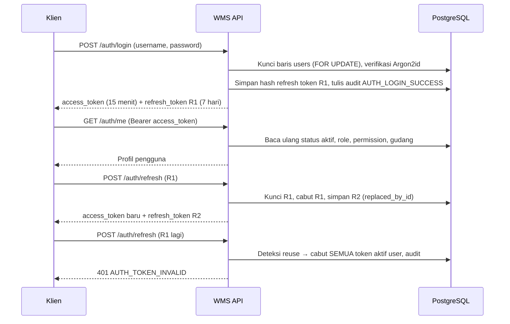

# Autentikasi & Otorisasi

## 1. Informasi Umum

| Atribut | Keterangan |
| --- | --- |
| **Modul** | Autentikasi (Login, Refresh Token, Logout, Profil, Ganti Kata Sandi) |
| **Base path** | `/api/v1/auth` |
| **Rujukan PRD** | FR-01, FR-09, 7.2, Bagian 3 & 3.2, AC-05, AC-11, AC-12 |
| **Status implementasi** | ✅ Sudah diimplementasikan dan diuji (`tests/test_auth.py`, `tests/test_rbac_scoping.py`) |
| **Kode sumber** | [routes/auth.py](../../app/api/routes/auth.py), [auth_service.py](../../app/services/auth_service.py), [deps.py](../../app/api/deps.py), [security.py](../../app/core/security.py), [permissions.py](../../app/core/permissions.py), [access_service.py](../../app/services/access_service.py) |
| **Tabel terkait** | `users`, `refresh_tokens`, `roles`, `permissions`, `role_permissions`, `user_warehouses`, `audit_logs` |
| **Modul terkait** | [Pengguna & RBAC](users.md), [Audit Log](audit-logs.md) |

Modul ini menerbitkan dan mengelola sesi pengguna berbasis JWT, sekaligus menyediakan mekanisme otorisasi (RBAC dan *Warehouse Scoping*) yang dipakai oleh seluruh modul lain.

---

## 2. Penjelasan Fitur

### 2.1 Tujuan

* Memastikan hanya pengguna aktif yang terdaftar yang dapat mengakses API.
* Menjaga sesi tetap aman dengan *Access Token* berumur pendek dan *Refresh Token* yang dirotasi.
* Mendeteksi pencurian token melalui penggunaan ulang *Refresh Token* yang sudah dicabut.
* Melindungi akun dari tebakan kata sandi berulang (*brute force*) dengan penguncian sementara.
* Mencatat seluruh aktivitas autentikasi penting ke *Audit Log*.

### 2.2 Alur Sesi



### 2.3 Peran Pengguna

Seluruh endpoint di modul ini dapat dipakai oleh **semua peran**. Tidak ada *permission* khusus yang dibutuhkan (sesuai PRD 3.1: "Setiap pengguna terautentikasi dapat melihat profil sendiri dan mengganti kata sandinya sendiri tanpa permission khusus").

---

## 3. Autentikasi dan Otorisasi

### 3.1 Mekanisme Token

| Token | Format | Umur | Penyimpanan di server | Cara pakai |
| --- | --- | --- | --- | --- |
| **Access Token** | JWT HS256, klaim `sub` (id pengguna, string), `jti`, `iat`, `exp` | `ACCESS_TOKEN_MINUTES` (bawaan **15 menit**) | Tidak disimpan (*stateless*) | Header `Authorization: Bearer <access_token>` |
| **Refresh Token** | String acak opak (`secrets.token_urlsafe(48)`) | `REFRESH_TOKEN_DAYS` (bawaan **7 hari**) | Hanya **hash SHA-256** di `refresh_tokens.token_hash` | Dikirim di *body* JSON ke `/auth/refresh` dan `/auth/logout` |

Kata sandi di-*hash* dengan **Argon2id** (`argon2-cffi`).

### 3.2 Verifikasi pada Setiap Request

Dependency [`get_current_user`](../../app/api/deps.py) dijalankan pada setiap endpoint terproteksi:

1. Membaca header `Authorization: Bearer <token>`. Bila tidak ada → `401 AUTH_TOKEN_INVALID`.
2. Memvalidasi tanda tangan dan `exp` JWT. Bila gagal → `401 AUTH_TOKEN_INVALID`.
3. **Membaca ulang dari database**: status aktif, `role_name`, daftar `permissions`, dan `warehouse_ids`.
4. Bila pengguna tidak ada atau `is_active = FALSE` → `401 AUTH_TOKEN_INVALID`.

Karena peran dan status dibaca dari DB, **penonaktifan atau perubahan peran langsung berlaku** tanpa menunggu token kedaluwarsa (PRD FR-01, AGENTS.MD Invarian 14). Perilaku ini diuji di `test_ac05_rbac_enforcement_and_audit_log_recording`.

### 3.3 Model Otorisasi (RBAC)

Pemeriksaan *permission* dilakukan di lapisan route melalui `Depends(require_permission("<kode>"))` ([permissions.py](../../app/core/permissions.py)). Bila kode tidak dimiliki peran pengguna → `403 PERMISSION_DENIED`.

* Terdapat **5 peran** dan **24 kode permission** yang di-*seed* oleh migrasi `008_seed_roles_permissions.sql` sesuai Matriks 3.1 PRD.
* Daftar peran beserta permission-nya dapat dibaca melalui [`GET /api/v1/users/roles`](users.md#get-apiv1usersroles--daftar-peran).
* Matriks lengkap per peran tercantum di [users.md — Matriks Peran & Permission](users.md#6-matriks-peran--permission-hasil-seed).

### 3.4 Warehouse Scoping

Pemeriksaan penugasan gudang dilakukan di lapisan **service** oleh [`access_service`](../../app/services/access_service.py):

| Fungsi | Perilaku |
| --- | --- |
| `ensure_warehouse_access(conn, actor, warehouse_id)` | *Super Admin* selalu lolos. Peran lain wajib memiliki baris di `user_warehouses` untuk gudang tersebut; bila tidak → `403 WAREHOUSE_NOT_ASSIGNED` dengan `details.warehouse_id` dan `details.assigned_warehouse_ids`. |
| `get_scoped_warehouse_ids_for_read(conn, actor)` | Mengembalikan daftar gudang yang ditugaskan bila peran = *Warehouse Staff*; `None` (tidak dibatasi) untuk peran lain (PRD 3.2 poin 5–6). |

> [!NOTE]
> Pemeriksaan `ensure_warehouse_access` digunakan oleh endpoint operasional yang membatasi akses gudang, termasuk GR, Transfer, Stock Opname, dan pengelolaan lokasi. Scoping assignment diuji di `test_ac12_warehouse_scoping_assignment_and_access_enforcement`. Penugasan gudang dikelola lewat [`PUT /api/v1/users/{user_id}/warehouses`](users.md#put-apiv1usersuser_idwarehouses--atur-penugasan-gudang).

---

## 4. Ringkasan Endpoint

| Method | Endpoint | Fungsi | Auth | Permission |
| --- | --- | --- | --- | --- |
| POST | `/api/v1/auth/login` | Login dan menerbitkan pasangan token | Tidak | – |
| POST | `/api/v1/auth/refresh` | Merotasi *Refresh Token* dan menerbitkan *Access Token* baru | Tidak (memakai *Refresh Token* di body) | – |
| POST | `/api/v1/auth/logout` | Mencabut *Refresh Token* yang dipakai | Bearer | – (cukup terautentikasi) |
| GET | `/api/v1/auth/me` | Profil pengguna aktif beserta permission & gudang | Bearer | – (cukup terautentikasi) |
| POST | `/api/v1/auth/change-password` | Mengganti kata sandi sendiri | Bearer | – (cukup terautentikasi) |

---

## 5. Detail Endpoint

### POST `/api/v1/auth/login` — Login

Memverifikasi kredensial dan menerbitkan *Access Token* serta *Refresh Token*.

**Autentikasi:** tidak diperlukan.

**Request body** (`LoginRequest`)

| Field | Tipe | Wajib | Validasi |
| --- | --- | --- | --- |
| `username` | string | Ya | Panjang 1–64 karakter; spasi di awal/akhir otomatis di-*trim* (`username.strip()`), dicocokkan *case-sensitive*. |
| `password` | string | Ya | Panjang 1–255 karakter. |

**Contoh request**

```json
{
  "username": "staff.jkt",
  "password": "<PASSWORD>"
}
```

**Response 200** (`TokenOut`)

```json
{
  "access_token": "eyJhbGciOiJIUzI1NiIsInR5cCI6IkpXVCJ9.eyJzdWIiOiIxIiwianRpIjoi...",
  "refresh_token": "vPNPkAVta_wUOHY3XQ84nc3UB33Bw-2o_xO8ZamuJovx...",
  "token_type": "bearer",
  "expires_in": 900,
  "access_expires_at": "2026-10-21T07:28:08.410204Z"
}
```

| Field | Keterangan |
| --- | --- |
| `expires_in` | Umur *Access Token* dalam detik (`ACCESS_TOKEN_MINUTES × 60`). |
| `access_expires_at` | Waktu kedaluwarsa *Access Token* dalam UTC. |

**Kemungkinan error**

| Status | Kode | Penyebab |
| --- | --- | --- |
| 401 | `AUTH_INVALID_CREDENTIALS` | Username tidak dikenal, kata sandi salah, atau akun nonaktif. Pesan sengaja seragam: `"Username atau kata sandi salah."` |
| 429 | `AUTH_TOO_MANY_ATTEMPTS` | Akun sedang terkunci, **atau** percobaan ini adalah kegagalan ke-5 berturut-turut. `details.locked_until` berisi waktu buka kunci (ISO 8601). |
| 422 | `VALIDATION_ERROR` | Field kosong/hilang atau melebihi panjang maksimum. |

Contoh 429:

```json
{
  "error": {
    "code": "AUTH_TOO_MANY_ATTEMPTS",
    "message": "Akun dikunci selama 15 menit karena 5 kali gagal login berturut-turut.",
    "details": { "locked_until": "2026-10-21T07:43:08.410204+00:00" }
  }
}
```

**Aturan bisnis**

| Kondisi | Urutan pemeriksaan | Efek ke `users` | Audit (`action`) |
| --- | --- | --- | --- |
| Username tidak dikenal | 1 | – | `AUTH_LOGIN_FAILED` dengan `user_id = NULL`, `reason = UNKNOWN_USERNAME` |
| Akun masih terkunci (`locked_until > now`) | 2 | Tidak berubah (penguncian **tidak** diperpanjang) | `AUTH_LOGIN_FAILED`, `reason = ACCOUNT_LOCKED` |
| Akun nonaktif | 3 | Tidak berubah (kata sandi tidak diperiksa) | `AUTH_LOGIN_FAILED`, `reason = USER_INACTIVE` |
| Kata sandi salah | 4 | `failed_login_count + 1`; bila mencapai `LOGIN_MAX_ATTEMPTS` (5) → `locked_until = now + LOGIN_LOCK_MINUTES` (15 menit) | `AUTH_LOGIN_FAILED` atau `AUTH_LOGIN_LOCKED` (saat terkunci), `reason = INVALID_CREDENTIALS` |
| Berhasil | – | `failed_login_count = 0`, `locked_until = NULL`, `last_login_at = now` | `AUTH_LOGIN_SUCCESS` (`new_values.refresh_token_id`) |

* Bila masa kunci sudah lewat lalu kata sandi salah lagi, hitungan dimulai ulang dari 1.
* Seluruh langkah dijalankan dalam satu transaksi dengan baris `users` dikunci `FOR UPDATE`. Catatan audit kegagalan **tetap tersimpan** karena error baru dilempar setelah transaksi di-*commit*.
* Kata sandi tidak pernah dicatat ke audit log (disaring oleh `audit_service`).

---

### POST `/api/v1/auth/refresh` — Rotasi Refresh Token

Menukar *Refresh Token* yang valid dengan pasangan token baru. Token lama otomatis dicabut.

**Autentikasi:** tidak memakai header Bearer; *Refresh Token* dikirim di body.

**Request body** (`RefreshTokenRequest`)

| Field | Tipe | Wajib | Validasi |
| --- | --- | --- | --- |
| `refresh_token` | string | Ya | Minimal 1 karakter. |

**Contoh request**

```json
{ "refresh_token": "vPNPkAVta_wUOHY3XQ84nc3UB33Bw-2o_xO8ZamuJovx..." }
```

**Response 200** — format sama dengan [`/auth/login`](#post-apiv1authlogin--login) (`TokenOut`), berisi `refresh_token` **baru**.

**Kemungkinan error**

| Status | Kode | Pesan | Penyebab & efek |
| --- | --- | --- | --- |
| 401 | `AUTH_TOKEN_INVALID` | `Refresh token tidak valid.` | Hash token tidak ditemukan. |
| 401 | `AUTH_TOKEN_INVALID` | `Refresh token sudah dicabut; seluruh sesi aktif telah dihentikan demi keamanan.` | **Deteksi penggunaan ulang**: token sudah dicabut sebelumnya. **Seluruh** *Refresh Token* aktif milik pengguna dicabut dan dicatat `AUTH_REFRESH_TOKEN_REUSE_DETECTED`. |
| 401 | `AUTH_TOKEN_INVALID` | `Refresh token sudah kedaluwarsa.` | `expires_at` sudah lewat; token ditandai dicabut dan dicatat `AUTH_TOKEN_REFRESH_FAILED` (`reason = TOKEN_EXPIRED`). |
| 401 | `AUTH_TOKEN_INVALID` | `Akun pengguna sudah tidak aktif.` | Pemilik token nonaktif; seluruh token aktif pengguna dicabut dan dicatat `AUTH_TOKEN_REFRESH_FAILED` (`reason = USER_INACTIVE`). |
| 422 | `VALIDATION_ERROR` | – | `refresh_token` kosong/hilang. |

**Aturan bisnis**

* Baris token dikunci `FOR UPDATE`, sehingga dua permintaan *refresh* bersamaan dengan token yang sama tidak bisa sama-sama berhasil.
* Saat rotasi: token baru disimpan, token lama diisi `revoked_at = now` dan `replaced_by_id = <id token baru>`.
* Audit: `AUTH_TOKEN_REFRESHED` dengan `old_values.previous_token_id` dan `new_values.new_token_id`.
* Diuji di `test_ac11_refresh_token_rotation_reuse_detection_and_logout` (**AC-11**).

---

### POST `/api/v1/auth/logout` — Logout

Mencabut *Refresh Token* yang dipakai pada sesi ini.

**Autentikasi:** Bearer *Access Token* wajib. Tidak memerlukan *permission* khusus.

**Request body** (`LogoutRequest`)

| Field | Tipe | Wajib | Validasi |
| --- | --- | --- | --- |
| `refresh_token` | string | Ya | Minimal 1 karakter; harus milik pengguna pada *Access Token*. |

**Response 200** (`MessageOut`)

```json
{ "message": "Logout berhasil; refresh token telah dicabut." }
```

**Kemungkinan error**

| Status | Kode | Penyebab |
| --- | --- | --- |
| 401 | `AUTH_TOKEN_INVALID` | Header Bearer tidak ada/tidak valid, **atau** `refresh_token` tidak ditemukan / milik pengguna lain (`"Refresh token tidak valid untuk pengguna ini."`). |
| 422 | `VALIDATION_ERROR` | `refresh_token` kosong/hilang. |

**Aturan bisnis**

* Bersifat **idempoten**: logout dengan token yang sudah dicabut tetap mengembalikan `200` dan **tidak** memicu deteksi penggunaan ulang.
* Setiap pemanggilan sukses mencatat audit `AUTH_LOGOUT` (termasuk pemanggilan ulang).
* *Access Token* yang sedang dipakai **tidak** dicabut (lihat [Catatan](#8-catatan-dan-status-verifikasi)).

---

### GET `/api/v1/auth/me` — Profil Pengguna Aktif

Mengembalikan profil pengguna pemilik *Access Token*, termasuk daftar permission dan gudang yang ditugaskan. Berguna bagi klien untuk menampilkan/menyembunyikan aksi sesuai hak akses.

**Autentikasi:** Bearer. Tanpa *permission* khusus.

**Parameter:** tidak ada.

**Response 200** (`MeOut`)

```json
{
  "id": 2,
  "username": "staff.jkt",
  "email": "staff.jkt@wms.local",
  "full_name": "Budi Operator",
  "role_id": 4,
  "role_name": "Warehouse Staff",
  "is_active": true,
  "permissions": [
    "gr:manage", "gr:read", "ledger:read", "master:read", "opname:count", "opname:read",
    "po:read", "stock:read", "transfer:create", "transfer:read", "transfer:receive", "transfer:ship"
  ],
  "warehouse_ids": [1],
  "last_login_at": "2026-10-21T14:13:09.068883+07:00",
  "created_at": "2026-10-21T14:13:08.757507+07:00",
  "updated_at": "2026-10-21T14:13:08.757507+07:00"
}
```

| Field | Keterangan |
| --- | --- |
| `permissions` | Kode permission milik peran pengguna, diurutkan alfabetis. |
| `warehouse_ids` | ID gudang di `user_warehouses`. Untuk *Super Admin* biasanya kosong karena tidak dibatasi penugasan. |

**Kemungkinan error**

| Status | Kode | Pesan |
| --- | --- | --- |
| 401 | `AUTH_TOKEN_INVALID` | `Header Authorization Bearer token wajib disertakan.` |
| 401 | `AUTH_TOKEN_INVALID` | `Access token tidak valid atau sudah kedaluwarsa.` |
| 401 | `AUTH_TOKEN_INVALID` | `Akun pengguna tidak ditemukan atau sudah dinonaktifkan.` |

---

### POST `/api/v1/auth/change-password` — Ganti Kata Sandi Sendiri

**Autentikasi:** Bearer. Tanpa *permission* khusus.

**Request body** (`ChangePasswordRequest`)

| Field | Tipe | Wajib | Validasi |
| --- | --- | --- | --- |
| `current_password` | string | Ya | Panjang 1–255. Harus cocok dengan kata sandi saat ini. |
| `new_password` | string | Ya | Panjang **8**–255 (PRD 7.2). |

**Contoh request**

```json
{
  "current_password": "<PASSWORD_LAMA>",
  "new_password": "<PASSWORD_BARU_MIN_8>"
}
```

**Response 200**

```json
{ "message": "Kata sandi berhasil diperbarui dan seluruh sesi lama telah dicabut." }
```

**Kemungkinan error**

| Status | Kode | Penyebab |
| --- | --- | --- |
| 401 | `AUTH_INVALID_CREDENTIALS` | `current_password` salah (`"Kata sandi saat ini tidak sesuai."`). |
| 401 | `AUTH_TOKEN_INVALID` | Bearer token tidak valid. |
| 422 | `VALIDATION_ERROR` | `new_password` kurang dari 8 karakter atau field hilang. |

**Aturan bisnis & dampak**

* Hash kata sandi diperbarui; `failed_login_count` direset ke 0 dan `locked_until` dikosongkan.
* **Seluruh** *Refresh Token* aktif pengguna dicabut (FR-01), termasuk milik sesi yang sedang dipakai. Klien harus login ulang setelah *Access Token* saat ini kedaluwarsa.
* Audit: `USER_PASSWORD_CHANGED` dengan `new_values.revoked_refresh_tokens` (jumlah token yang dicabut).

---

## 6. Relasi dan Ketergantungan

| Komponen | Peran |
| --- | --- |
| `users` | Kredensial (`password_hash`), status aktif, `failed_login_count`, `locked_until`, `last_login_at`. |
| `refresh_tokens` | `token_hash` (unik), `expires_at`, `revoked_at`, `replaced_by_id` (FK ke `refresh_tokens.id`, `ON DELETE SET NULL`). FK `user_id` → `users.id` (`ON DELETE CASCADE`). |
| `roles`, `role_permissions`, `permissions` | Sumber daftar permission yang dibaca ulang setiap request. |
| `user_warehouses` | Sumber `warehouse_ids` untuk *Warehouse Scoping*. |
| `audit_logs` | Menerima seluruh catatan aktivitas autentikasi (lihat [audit-logs.md](audit-logs.md#22-daftar-action-yang-dihasilkan-saat-ini)). |
| Konfigurasi (`.env`) | `JWT_SECRET` (wajib, min. 32 karakter), `JWT_ALGORITHM`, `ACCESS_TOKEN_MINUTES`, `REFRESH_TOKEN_DAYS`, `LOGIN_MAX_ATTEMPTS`, `LOGIN_LOCK_MINUTES`, `TRUSTED_PROXY_IPS`. |

Alur lapisan: `routes/auth.py` → `auth_service` → `user_repo`, `token_repo`, `audit_service` → PostgreSQL.

---

## 7. Contoh Penggunaan (cURL)

```bash
BASE=http://localhost:8000/api/v1

# 1. Login
curl -s -X POST "$BASE/auth/login" \
  -H "Content-Type: application/json" \
  -d '{"username":"<USERNAME>","password":"<PASSWORD>"}'

# 2. Profil pengguna aktif
curl -s "$BASE/auth/me" -H "Authorization: Bearer <ACCESS_TOKEN>"

# 3. Rotasi refresh token
curl -s -X POST "$BASE/auth/refresh" \
  -H "Content-Type: application/json" \
  -d '{"refresh_token":"<REFRESH_TOKEN>"}'

# 4. Ganti kata sandi
curl -s -X POST "$BASE/auth/change-password" \
  -H "Authorization: Bearer <ACCESS_TOKEN>" \
  -H "Content-Type: application/json" \
  -d '{"current_password":"<PASSWORD_LAMA>","new_password":"<PASSWORD_BARU>"}'

# 5. Logout
curl -s -X POST "$BASE/auth/logout" \
  -H "Authorization: Bearer <ACCESS_TOKEN>" \
  -H "Content-Type: application/json" \
  -d '{"refresh_token":"<REFRESH_TOKEN>"}'
```

PowerShell (Windows):

```powershell
$base = "http://localhost:8000/api/v1"
$login = Invoke-RestMethod -Method Post -Uri "$base/auth/login" `
  -ContentType "application/json" `
  -Body (@{ username = "<USERNAME>"; password = "<PASSWORD>" } | ConvertTo-Json)
$headers = @{ Authorization = "Bearer $($login.access_token)" }
Invoke-RestMethod -Uri "$base/auth/me" -Headers $headers
```

---

## 8. Catatan dan Status Verifikasi

| # | Status | Catatan |
| --- | --- | --- |
| 1 | ✅ Terverifikasi | Rotasi token, deteksi penggunaan ulang, dan logout sesuai **AC-11** (test lulus). |
| 2 | ✅ Terverifikasi | Penguncian akun setelah 5 kegagalan dan pencatatan audit sesuai FR-01 (test lulus). |
| 3 | ✅ Terverifikasi | Penonaktifan pengguna langsung menolak *Access Token* yang masih berlaku (**AC-05**, Invarian 14). |
| 4 | ℹ️ Batasan desain | *Access Token* bersifat *stateless*: logout dan ganti kata sandi **tidak** mencabut *Access Token* yang sedang berlaku; token tetap valid hingga `exp` (maks. 15 menit) kecuali pengguna dinonaktifkan. PRD FR-01 hanya mensyaratkan pencabutan *Refresh Token*, sehingga perilaku ini sesuai PRD. |
| 5 | ✅ Terverifikasi | Seluruh respons `401` menyertakan header `WWW-Authenticate: Bearer` pada exception handler `DomainError` di `app/main.py`. |
| 6 | ✅ Terverifikasi | `username` saat login otomatis di-*trim* (`username.strip()`) sehingga konsisten dengan normalisasi saat pembuatan pengguna. |
| 7 | ✅ Terverifikasi | Alamat IP dari header `X-Forwarded-For` hanya dipercaya apabila IP koneksi langsung (`request.client.host`) terdaftar pada `settings.trusted_proxy_ips` (`TRUSTED_PROXY_IPS`). |
| 8 | ✅ Terverifikasi | Penolakan rotasi token akibat token kedaluwarsa (`TOKEN_EXPIRED`) maupun akun nonaktif (`USER_INACTIVE`) turut mencatat entri audit `AUTH_TOKEN_REFRESH_FAILED`. |
| 9 | ✅ Terverifikasi | `app/core/config.py` mewajibkan `DATABASE_URL` dan `JWT_SECRET` (minimal 32 karakter) dari variabel lingkungan tanpa nilai *fallback* rahasia di dalam kode sumber (PRD 7.2, AGENTS.MD §6). |

