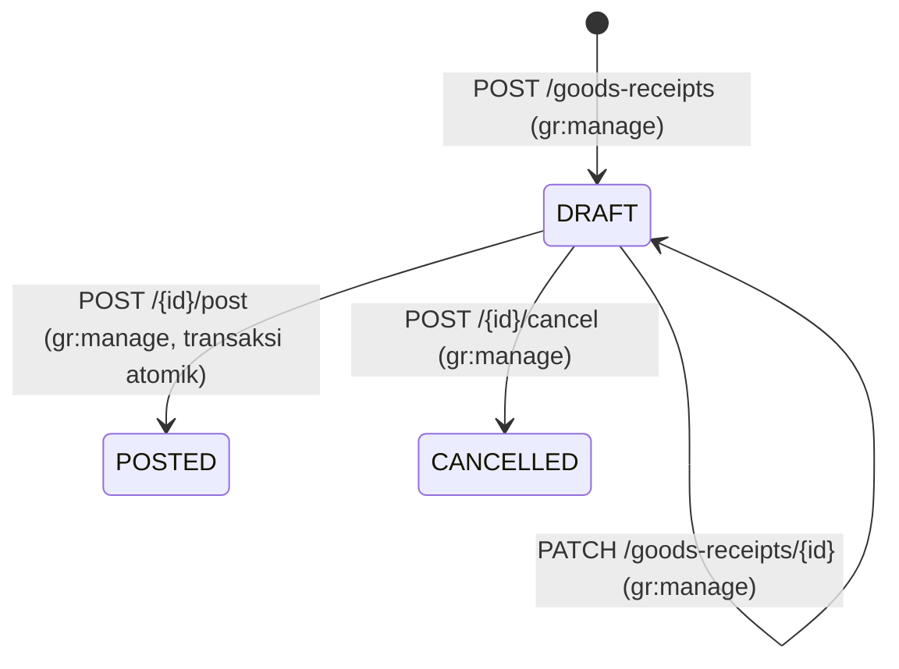

# Goods Receipt (GR)

## 1. Informasi Umum

| Atribut | Keterangan |
| --- | --- |
| **Modul** | Goods Receipt (*Penerimaan Barang dari Purchase Order*) |
| **Base path** | `/api/v1/goods-receipts` |
| **Rujukan PRD** | FR-05, FR-08, FR-09, FR-10, FR-11, Bagian 3.1 (Matriks Permission), 3.2 (*Warehouse Scoping*), 5.1 (*State Machine*), 5.3 (*Movement Types*), 6.2 (*Over-Receipt*), 6.5 (Urutan Penguncian), 6.6 (Pembekuan Lokasi), 6.9 (Presisi Kuantitas), AC-01, AC-07, AC-10, AC-12, AC-13, Lampiran A & B |
| **Status implementasi** | ✅ Sudah diimplementasikan dan diuji (`tests/test_goods_receipt.py`, `tests/test_stock_opname.py`, `tests/test_rbac_scoping.py`) |
| **Kode sumber** | [routes/goods_receipts.py](../../app/api/routes/goods_receipts.py), [gr_service.py](../../app/services/gr_service.py), [inventory_service.py](../../app/services/inventory_service.py), [access_service.py](../../app/services/access_service.py), [numbering_service.py](../../app/services/numbering_service.py), [gr_repo.py](../../app/repositories/gr_repo.py), [po_repo.py](../../app/repositories/po_repo.py), [schemas/goods_receipt.py](../../app/schemas/goods_receipt.py) |
| **Tabel terkait** | `goods_receipts`, `gr_lines`, `purchase_orders`, `po_lines`, `warehouses`, `storage_locations`, `items`, `uoms`, `inventory_balances`, `stock_movements`, `document_sequences`, `audit_logs` |
| **Modul terkait** | [Purchase Order](purchase-orders.md), [Stok & Buku Besar](stock-ledger.md), [Gudang & Lokasi](warehouses.md), [Stock Opname](stock-opnames.md), [Audit Log](audit-logs.md) |

---

## 2. Penjelasan Fitur

### 2.1 Tujuan

Modul Goods Receipt (GR) mencatat penerimaan fisik barang di gudang berdasarkan referensi [Purchase Order (PO)](purchase-orders.md) yang berstatus `ISSUED` atau `PARTIALLY_RECEIVED`. Satu PO dapat dipenuhi melalui satu atau beberapa dokumen GR (penerimaan parsial maupun penuh), di mana lokasi penyimpanan (*bin/rack*) ditentukan pada setiap baris GR.

### 2.2 Alur Bisnis & Siklus Status (*State Machine* — PRD 5.1)



| Status Saat Ini | Pemicu | Status Berikutnya | Syarat & Efek |
| --- | --- | --- | --- |
| *(Baru)* | `POST /api/v1/goods-receipts` | `DRAFT` | PO berstatus `ISSUED` atau `PARTIALLY_RECEIVED`; pengguna ditugaskan ke gudang tujuan PO; validasi awal *over-receipt*; belum mengubah saldo stok. |
| `DRAFT` | `PATCH /api/v1/goods-receipts/{id}` | `DRAFT` | Revisi tanggal terima, catatan, atau penggantian baris GR. |
| `DRAFT` | `POST /api/v1/goods-receipts/{id}/post` | `POSTED` | Minimal 1 baris; di bawah penguncian baris: validasi ulang status PO, batas *over-receipt*, lokasi aktif & tidak dibekukan Opname → tambah `inventory_balances`, tulis ledger `IN_PURCHASE`, tambah `po_lines.qty_received`, evaluasi ulang status PO (`PARTIALLY_RECEIVED`/`RECEIVED`), dan tulis `audit_logs`. Status final. |
| `DRAFT` | `POST /api/v1/goods-receipts/{id}/cancel` | `CANCELLED` | Dokumen dibatalkan tanpa mutasi stok. Status final. |

### 2.3 Urutan Penguncian & Invarian Posting (`gr_service.post_goods_receipt` — PRD 6.2, 6.5, 6.6)

Saat `POST /api/v1/goods-receipts/{gr_id}/post` dipanggil, seluruh langkah dijalankan di dalam satu blok transaksi `with conn.transaction():` dengan urutan penguncian seragam:

1. **Kunci Header GR (`FOR UPDATE`):** Pastikan status masih `DRAFT`; jika sudah `POSTED`/`CANCELLED`, tolak dengan `409 INVALID_STATE_TRANSITION` (mencegah posting ganda pada akses bersamaan — **AC-13**).
2. **Periksa Warehouse Scoping:** `access_service.ensure_warehouse_access(conn, actor, gr["warehouse_id"])` (`403 WAREHOUSE_NOT_ASSIGNED` bila tidak ditugaskan — **AC-12**).
3. **Kunci Header PO & Baris PO (`FOR UPDATE`):** Pastikan PO berstatus `ISSUED` atau `PARTIALLY_RECEIVED`, lalu hitung ulang akumulasi penerimaan untuk setiap `po_line_id`. Jika `po_line.qty_received + total_gr_line_qty > po_line.qty_ordered`, batalkan transaksi dengan `409 OVER_RECEIPT` (**AC-01**).
4. **Mutasi Stok Terurut (`inventory_service.apply_movement`):** Baris GR diurutkan berdasarkan `(location_id, item_id, id)`. Untuk setiap baris, `apply_movement()` mengunci lokasi (`FOR SHARE`), memeriksa pembekuan Stock Opname (`409 LOCATION_FROZEN` bila lokasi sedang dibekukan — **AC-10**), memastikan baris `inventory_balances` ada, mengunci saldo (`FOR UPDATE`), menambah `qty_on_hand`, dan menulis baris `stock_movements` bertipe `IN_PURCHASE` (`reference_type = "GOODS_RECEIPT"`).
5. **Perbarui Baris & Status PO:** Menambah `qty_received` pada `po_lines` dan mengubah status PO menjadi `RECEIVED` (bila seluruh baris penuh) atau `PARTIALLY_RECEIVED`.
6. **Tandai GR `POSTED` & Catat Audit Log:** Menyimpan `posted_at`, `posted_by`, serta mencatat `GR_POSTED` (dan perubahan status PO) ke `audit_logs`. Jika langkah mana pun gagal, seluruh transaksi di-*rollback* (**AC-07**).

> [!IMPORTANT]
> Sesuai PRD 2.2 dan 5.1, tidak ada fitur pembalikan (*reversal*) untuk GR yang sudah `POSTED`. Koreksi atas kesalahan fisik pasca-posting dilakukan melalui mekanisme [Stock Opname](stock-opnames.md).

---

## 3. Autentikasi dan Otorisasi

* **Autentikasi:** Wajib menyertakan header `Authorization: Bearer <access_token>`.
* **Permission & Warehouse Scoping (Matriks 3.1 & PRD 3.2):**

| Permission | Aksi | Peran Bawaan (Matriks 3.1) | Warehouse Scoping `(g)` |
| --- | --- | --- | --- |
| `gr:read` | Daftar & detail GR | *Super Admin*, *Warehouse Manager*, *Purchasing Staff*, *Warehouse Staff*, *Auditor* | **Ya untuk Warehouse Staff** (hanya melihat GR pada gudang yang ditugaskan). Peran lain tidak dibatasi. |
| `gr:manage` | Buat, revisi `DRAFT`, posting, dan batalkan GR | *Super Admin*, *Warehouse Staff* | **Ya** (`ensure_warehouse_access` terhadap gudang tujuan PO). |

---

## 4. Ringkasan Endpoint

| # | Method | Endpoint | Fungsi | Auth | Permission |
| :-: | --- | --- | --- | --- | --- |
| 1 | GET | `/api/v1/goods-receipts` | Daftar GR (paginasi, filter gudang/PO/status/tanggal, pencarian, urut) | Bearer | `gr:read` `(g)` |
| 2 | POST | `/api/v1/goods-receipts` | Buat GR baru berstatus `DRAFT` | Bearer | `gr:manage` `(g)` |
| 3 | GET | `/api/v1/goods-receipts/{gr_id}` | Detail GR beserta daftar baris penerimaan (`lines`) | Bearer | `gr:read` `(g)` |
| 4 | PATCH | `/api/v1/goods-receipts/{gr_id}` | Revisi GR berstatus `DRAFT` | Bearer | `gr:manage` `(g)` |
| 5 | POST | `/api/v1/goods-receipts/{gr_id}/post` | Posting GR secara atomik (`DRAFT → POSTED`) | Bearer | `gr:manage` `(g)` |
| 6 | POST | `/api/v1/goods-receipts/{gr_id}/cancel` | Batalkan GR berstatus `DRAFT` (`DRAFT → CANCELLED`) | Bearer | `gr:manage` `(g)` |

---

## 5. Detail Setiap Endpoint

### 5.1 GET `/api/v1/goods-receipts` — Daftar GR

Mengambil daftar ringkasan Goods Receipt dengan dukungan pagination, filter, pencarian, dan pengurutan.

* **HTTP Method & URL:** `GET /api/v1/goods-receipts`
* **Autentikasi & Permission:** Bearer Token, `gr:read`

**Query Parameter**

| Parameter | Tipe | Wajib | Default | Aturan & Keterangan |
| --- | --- | --- | --- | --- |
| `limit` | integer | Tidak | `50` | Rentang `1..200`. |
| `offset` | integer | Tidak | `0` | Minimal `0`. |
| `warehouse_id` | integer | Tidak | `null` | Filter gudang tujuan. Untuk *Warehouse Staff*, wajib termasuk gudang yang ditugaskan (`403 WAREHOUSE_NOT_ASSIGNED` bila di luar cakupan). |
| `po_id` | integer | Tidak | `null` | Filter berdasarkan ID Purchase Order. |
| `status` | string | Tidak | `null` | Salah satu dari: `DRAFT`, `POSTED`, `CANCELLED`. |
| `date_from` | date (`YYYY-MM-DD`) | Tidak | `null` | Batas awal tanggal penerimaan (`received_date >= date_from`). |
| `date_to` | date (`YYYY-MM-DD`) | Tidak | `null` | Batas akhir tanggal penerimaan (`received_date <= date_to`). Tidak boleh `< date_from`. |
| `search` | string | Tidak | `null` | Pencarian `ILIKE` pada `gr_number`, `po_number`, `supplier_name`, atau `notes`. |
| `sort_by` | string | Tidak | `"id"` | Whitelist: `"id"`, `"gr_number"`, `"received_date"`, `"status"`, `"created_at"`. |
| `sort_dir` | string | Tidak | `"desc"` | `"asc"` atau `"desc"`. |

**Contoh Response Berhasil (`200 OK` — `Page[GoodsReceiptSummaryOut]`)**

```json
{
  "items": [
    {
      "id": 5,
      "gr_number": "GR-202610-0005",
      "po_id": 14,
      "po_number": "PO-202610-0014",
      "supplier_id": 3,
      "supplier_code": "SUP-001",
      "supplier_name": "PT Sumber Jaya",
      "warehouse_id": 2,
      "warehouse_code": "WH-JKT",
      "warehouse_name": "Gudang Jakarta",
      "status": "POSTED",
      "received_date": "2026-10-23",
      "notes": "Penerimaan tahap pertama",
      "line_count": 1,
      "posted_at": "2026-10-23T10:05:00+07:00",
      "posted_by": 9,
      "created_by": 9,
      "created_at": "2026-10-23T10:00:00+07:00",
      "updated_at": "2026-10-23T10:05:00+07:00"
    }
  ],
  "total": 1,
  "limit": 50,
  "offset": 0
}
```

* **Kemungkinan Error:** `401 AUTH_TOKEN_INVALID`, `403 PERMISSION_DENIED`, `403 WAREHOUSE_NOT_ASSIGNED`, `422 VALIDATION_ERROR`.

---

### 5.2 POST `/api/v1/goods-receipts` — Buat GR

Membuat dokumen Goods Receipt baru berstatus `DRAFT` untuk suatu PO. Gudang tujuan GR otomatis disamakan dengan `warehouse_id` pada PO yang dirujuk.

* **HTTP Method & URL:** `POST /api/v1/goods-receipts`
* **Autentikasi & Permission:** Bearer Token, `gr:manage` + **Warehouse Scoping `(g)`** pada gudang PO.

**Request Body (`GoodsReceiptCreate`)**

| Field | Tipe | Wajib | Aturan Validasi |
| --- | --- | --- | --- |
| `po_id` | integer (`> 0`) | Ya | PO harus ada (`404 NOT_FOUND`), gudang tujuannya aktif (`422 INACTIVE_REFERENCE`), dan berstatus `ISSUED` atau `PARTIALLY_RECEIVED` (`409 INVALID_STATE_TRANSITION`). |
| `received_date` | date (`YYYY-MM-DD`) | Ya | Tanggal penerimaan; menentukan periode `YYYYMM` pada `gr_number`. |
| `notes` | string \| `null` | Tidak | Catatan header; string kosong dinormalisasi menjadi `null`. |
| `lines` | array of `GRLineCreate` | Tidak | Default `[]`. Setiap elemen memuat `po_line_id` (int `> 0`, harus milik `po_id`), `location_id` (int `> 0`, harus aktif dan milik gudang PO), `qty_received` (string desimal / int `> 0`, maks 4 desimal, bukan float, patuh `allow_decimal` UoM), dan `notes` (string \| `null`). Kombinasi `(po_line_id, location_id)` tidak boleh berulang dalam satu GR. |

**Contoh Request**

```json
{
  "po_id": 14,
  "received_date": "2026-10-23",
  "notes": "Penerimaan tahap pertama",
  "lines": [
    {
      "po_line_id": 31,
      "location_id": 7,
      "qty_received": "10.0000",
      "notes": "Kondisi baik"
    }
  ]
}
```

**Contoh Response Berhasil (`201 Created` — `GoodsReceiptOut`)**

```json
{
  "id": 5,
  "gr_number": "GR-202610-0005",
  "po_id": 14,
  "po_number": "PO-202610-0014",
  "supplier_id": 3,
  "supplier_code": "SUP-001",
  "supplier_name": "PT Sumber Jaya",
  "warehouse_id": 2,
  "warehouse_code": "WH-JKT",
  "warehouse_name": "Gudang Jakarta",
  "status": "DRAFT",
  "received_date": "2026-10-23",
  "notes": "Penerimaan tahap pertama",
  "line_count": 1,
  "posted_at": null,
  "posted_by": null,
  "created_by": 9,
  "created_at": "2026-10-23T10:00:00+07:00",
  "updated_at": "2026-10-23T10:00:00+07:00",
  "lines": [
    {
      "id": 11,
      "gr_id": 5,
      "po_id": 14,
      "warehouse_id": 2,
      "po_line_id": 31,
      "item_id": 17,
      "item_sku": "BRG-017",
      "item_name": "Kabel NYM",
      "uom_id": 1,
      "uom_code": "ROLL",
      "allow_decimal": false,
      "location_id": 7,
      "location_code": "A-01",
      "location_name": "Rak A01",
      "qty_received": "10.0000",
      "notes": "Kondisi baik",
      "created_by": 9,
      "created_at": "2026-10-23T10:00:00+07:00",
      "updated_at": "2026-10-23T10:00:00+07:00"
    }
  ]
}
```

* **Aturan Bisnis & Audit:** Memvalidasi batas awal *over-receipt* (`po_line.qty_received + sum(gr_line.qty_received) <= po_line.qty_ordered` → `409 OVER_RECEIPT` bila melebihi) dan mencatat `GR_CREATED` pada `audit_logs`.
* **Kemungkinan Error:** `401 AUTH_TOKEN_INVALID`, `403 PERMISSION_DENIED`, `403 WAREHOUSE_NOT_ASSIGNED`, `404 NOT_FOUND`, `409 INVALID_STATE_TRANSITION`, `409 OVER_RECEIPT`, `422 INACTIVE_REFERENCE`, `422 INVALID_LOCATION`, `422 VALIDATION_ERROR`.

---

### 5.3 GET `/api/v1/goods-receipts/{gr_id}` — Detail GR

Mengambil detail lengkap satu Goods Receipt beserta daftar baris (`lines`).

* **HTTP Method & URL:** `GET /api/v1/goods-receipts/{gr_id}`
* **Autentikasi & Permission:** Bearer Token, `gr:read`
* **Path Parameter:** `gr_id` (integer, wajib).
* **Response Berhasil:** `200 OK` (`GoodsReceiptOut`).
* **Kemungkinan Error:** `401 AUTH_TOKEN_INVALID`, `403 PERMISSION_DENIED`, `403 WAREHOUSE_NOT_ASSIGNED` (jika *Warehouse Staff* tidak ditugaskan pada gudang GR), `404 NOT_FOUND`.

---

### 5.4 PATCH `/api/v1/goods-receipts/{gr_id}` — Revisi GR

Memperbarui `received_date`, `notes`, dan/atau mengganti daftar `lines` pada GR berstatus `DRAFT`.

* **HTTP Method & URL:** `PATCH /api/v1/goods-receipts/{gr_id}`
* **Autentikasi & Permission:** Bearer Token, `gr:manage` + **Warehouse Scoping `(g)`**
* **Request Body (`GoodsReceiptUpdate`):** Seluruh field opsional (`received_date`, `notes`, `lines`). Jika `lines` dikirim, seluruh baris diganti; jika `notes` dikirim `""`, catatan dikosongkan menjadi `null`.
* **Aturan Bisnis & Audit:**
  * Mengunci header GR (`FOR UPDATE`); wajib berstatus `DRAFT` dan PO induk masih berstatus `ISSUED` atau `PARTIALLY_RECEIVED` (`409 INVALID_STATE_TRANSITION` bila tidak).
  * Memvalidasi ulang lokasi, barang, UoM, dan batas *over-receipt*.
  * Mencatat `GR_UPDATED` pada `audit_logs`.
* **Response Berhasil:** `200 OK` (`GoodsReceiptOut`).
* **Kemungkinan Error:** `401 AUTH_TOKEN_INVALID`, `403 PERMISSION_DENIED`, `403 WAREHOUSE_NOT_ASSIGNED`, `404 NOT_FOUND`, `409 INVALID_STATE_TRANSITION`, `409 OVER_RECEIPT`, `422 INACTIVE_REFERENCE`, `422 INVALID_LOCATION`, `422 VALIDATION_ERROR`.

---

### 5.5 POST `/api/v1/goods-receipts/{gr_id}/post` — Posting GR

Menyelesaikan penerimaan barang (`DRAFT → POSTED`), menambah saldo stok gudang tujuan, menulis buku besar `IN_PURCHASE`, serta memperbarui pemenuhan PO dalam satu transaksi atomik.

* **HTTP Method & URL:** `POST /api/v1/goods-receipts/{gr_id}/post`
* **Autentikasi & Permission:** Bearer Token, `gr:manage` + **Warehouse Scoping `(g)`**
* **Request Body:** Tidak ada.
* **Aturan Bisnis & Audit:** Lihat urutan penguncian dan validasi pada Bagian 2.3. Minimal 1 baris wajib tersedia pada GR (`422 VALIDATION_ERROR` bila kosong).
* **Response Berhasil:** `200 OK` (`GoodsReceiptOut` dengan `status: "POSTED"`, `posted_at`, dan `posted_by`).
* **Kemungkinan Error:**
  * `401 AUTH_TOKEN_INVALID`
  * `403 PERMISSION_DENIED`
  * `403 WAREHOUSE_NOT_ASSIGNED` — Pengguna tidak ditugaskan ke gudang tujuan PO (**AC-12**).
  * `404 NOT_FOUND`
  * `409 INVALID_STATE_TRANSITION` — GR bukan `DRAFT` (termasuk permintaan posting ganda bersamaan — **AC-13**) atau PO bukan `ISSUED`/`PARTIALLY_RECEIVED`.
  * `409 OVER_RECEIPT` — Akumulasi penerimaan melebihi `qty_ordered` pada baris PO (**AC-01**).
  * `409 LOCATION_FROZEN` — Lokasi tujuan sedang dibekukan oleh sesi Stock Opname aktif (**AC-10**).
  * `422 INACTIVE_REFERENCE` / `422 INVALID_LOCATION` / `422 VALIDATION_ERROR`.

---

### 5.6 POST `/api/v1/goods-receipts/{gr_id}/cancel` — Batalkan GR

Membatalkan dokumen GR berstatus `DRAFT` menjadi `CANCELLED`.

* **HTTP Method & URL:** `POST /api/v1/goods-receipts/{gr_id}/cancel`
* **Autentikasi & Permission:** Bearer Token, `gr:manage` + **Warehouse Scoping `(g)`**
* **Request Body:** Tidak ada.
* **Aturan Bisnis & Audit:**
  * Mengunci header GR (`FOR UPDATE`) dan memeriksa penugasan gudang.
  * Hanya GR berstatus `DRAFT` yang dapat dibatalkan (`409 INVALID_STATE_TRANSITION` bila sudah `POSTED` atau `CANCELLED`).
  * Mencatat `GR_CANCELLED` pada `audit_logs`.
* **Response Berhasil:** `200 OK` (`GoodsReceiptOut` dengan `status: "CANCELLED"`).
* **Kemungkinan Error:** `401 AUTH_TOKEN_INVALID`, `403 PERMISSION_DENIED`, `403 WAREHOUSE_NOT_ASSIGNED`, `404 NOT_FOUND`, `409 INVALID_STATE_TRANSITION`.

---

## 6. Relasi dan Ketergantungan

| Objek / Tabel | Kunci & Constraint Utama (`004_create_purchasing_tables.sql`) | Relasi & Dampak |
| --- | --- | --- |
| `goods_receipts` | `pk_goods_receipts (id)`, `uq_goods_receipts_gr_number (gr_number)`, `fk_goods_receipts_po_warehouse (po_id, warehouse_id) -> purchase_orders (id, warehouse_id)`, `uq_goods_receipts_id_po_warehouse (id, po_id, warehouse_id)` | Menjamin di level database bahwa `warehouse_id` GR selalu identik dengan `warehouse_id` tujuan pada PO. |
| `gr_lines` | `pk_gr_lines (id)`, `fk_gr_lines_gr_context (gr_id, po_id, warehouse_id)`, `fk_gr_lines_po_line_po (po_line_id, po_id)`, `fk_gr_lines_location_warehouse (location_id, warehouse_id)`, `uq_gr_lines_gr_po_line_location (gr_id, po_line_id, location_id)` | Tiga *Composite Foreign Key* menjamin baris PO benar-benar milik PO yang dirujuk dan lokasi penyimpanan benar-benar milik gudang tujuan yang sama. |
| `inventory_service.apply_movement` | Dipanggil saat posting GR | Satu-satunya pintu pembaruan `inventory_balances` dan penulisan baris `stock_movements` (`IN_PURCHASE`). |

Alur lapisan: `routes/goods_receipts.py` → `gr_service.py` (`with conn.transaction():` + `access_service` + `po_repo` + `inventory_service.apply_movement` + `audit_service`) → `gr_repo.py` → PostgreSQL.

---

## 7. Contoh Penggunaan (cURL)

```bash
BASE=http://localhost:8000/api/v1

# 1. Buat Goods Receipt baru (DRAFT) untuk PO #14
curl -s -X POST "$BASE/goods-receipts" \
  -H "Authorization: Bearer <STAFF_TOKEN>" \
  -H "Content-Type: application/json" \
  -d '{
    "po_id": 14,
    "received_date": "2026-10-23",
    "notes": "Pengiriman parsial ke-1",
    "lines": [
      {"po_line_id": 31, "location_id": 7, "qty_received": "10.0000"}
    ]
  }'

# 2. Posting Goods Receipt #5 (menambah stok, menulis ledger IN_PURCHASE, & update PO)
curl -s -X POST "$BASE/goods-receipts/5/post" \
  -H "Authorization: Bearer <STAFF_TOKEN>"

# 3. Lihat daftar Goods Receipt pada Gudang 2
curl -s "$BASE/goods-receipts?warehouse_id=2&status=POSTED" \
  -H "Authorization: Bearer <STAFF_TOKEN>"

# 4. Batalkan Goods Receipt berstatus DRAFT
curl -s -X POST "$BASE/goods-receipts/6/cancel" \
  -H "Authorization: Bearer <STAFF_TOKEN>"
```

---

## 8. Catatan dan Status Verifikasi

| # | Status | Catatan |
| --- | --- | --- |
| 1 | ✅ Terverifikasi | Penerimaan parsial, penolakan *over-receipt* (`409 OVER_RECEIPT`), serta perubahan status PO otomatis ke `PARTIALLY_RECEIVED` dan `RECEIVED` telah diuji di `test_ac01_partial_receipt_over_receipt_and_po_fulfillment` (`tests/test_goods_receipt.py` — **AC-01**). |
| 2 | ✅ Terverifikasi | Atomisitas transaksi posting GR (kegagalan di tengah proses membatalkan perubahan status GR, saldo stok, `qty_received` PO, ledger, dan audit log) telah diuji di `test_ac07_gr_post_transaction_atomicity_rollback_on_failure` (**AC-07**). |
| 3 | ✅ Terverifikasi | Penolakan posting GR ke lokasi yang sedang dibekukan Stock Opname (`409 LOCATION_FROZEN`) telah diuji di `test_ac10_location_freeze_during_opname_and_unfreeze_on_complete_or_cancel` (`tests/test_stock_opname.py` — **AC-10**). |
| 4 | ✅ Terverifikasi | Penolakan akses lintas gudang (`403 WAREHOUSE_NOT_ASSIGNED`) bagi *Warehouse Staff* yang tidak ditugaskan ke gudang PO telah diuji di `test_ac12_warehouse_scoping_assignment_and_access_enforcement` (`tests/test_rbac_scoping.py` — **AC-12**). |
| 5 | ✅ Terverifikasi | Pencegahan posting ganda saat dua request `POST /goods-receipts/{id}/post` dikirim bersamaan pada koneksi terpisah (tepat satu `200 OK` dan satu `409 INVALID_STATE_TRANSITION`) telah diuji di `test_ac13_concurrent_gr_post_prevents_double_posting` (**AC-13**). |
