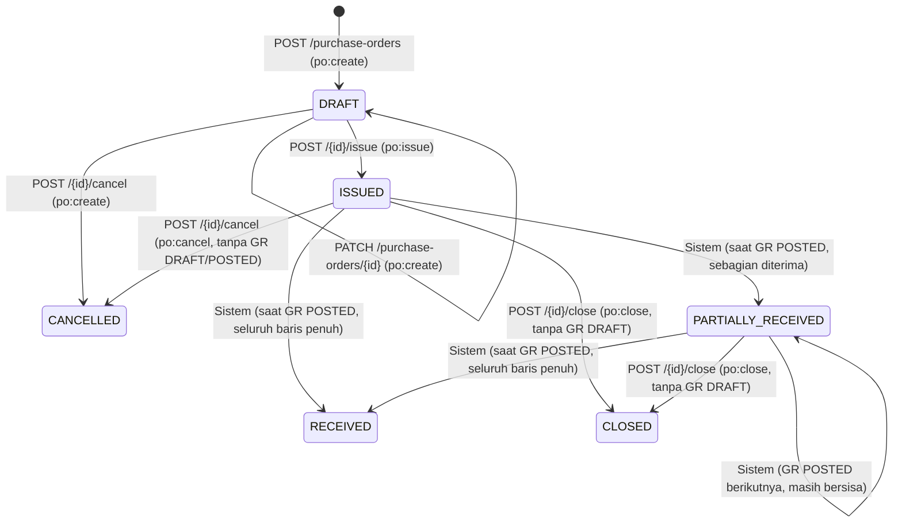

# Purchase Order (PO)

## 1. Informasi Umum

| Atribut | Keterangan |
| --- | --- |
| **Modul** | Purchase Order (*Pesanan Pembelian ke Pemasok*) |
| **Base path** | `/api/v1/purchase-orders` |
| **Rujukan PRD** | FR-04, FR-09, FR-10, FR-11, Bagian 3.1 (Matriks Permission), 3.2 (*Warehouse Scoping*), 5.1 (*State Machine*), 6.2 (*Over-Receipt*), 6.3 (Validasi Gudang/Barang/Pemasok), 6.9 (Presisi Kuantitas), AC-01, AC-05, AC-12, Lampiran A & B |
| **Status implementasi** | ✅ Sudah diimplementasikan dan diuji (`tests/test_goods_receipt.py`, `tests/test_rbac_scoping.py`) |
| **Kode sumber** | [routes/purchase_orders.py](../../app/api/routes/purchase_orders.py), [po_service.py](../../app/services/po_service.py), [numbering_service.py](../../app/services/numbering_service.py), [access_service.py](../../app/services/access_service.py), [po_repo.py](../../app/repositories/po_repo.py), [schemas/purchase_order.py](../../app/schemas/purchase_order.py) |
| **Tabel terkait** | `purchase_orders`, `po_lines`, `suppliers`, `warehouses`, `items`, `uoms`, `goods_receipts`, `document_sequences`, `audit_logs` |
| **Modul terkait** | [Goods Receipt](goods-receipts.md), [Master Data](master-data.md), [Gudang & Lokasi](warehouses.md), [Audit Log](audit-logs.md) |

---

## 2. Penjelasan Fitur

### 2.1 Tujuan

Modul Purchase Order (PO) mengelola siklus pengadaan barang ke pemasok untuk satu gudang tujuan (`warehouse_id`). Setiap dokumen PO menjadi acuan resmi penerimaan barang melalui modul [Goods Receipt (GR)](goods-receipts.md), baik secara bertahap (parsial) maupun sekaligus (penuh).

### 2.2 Alur Bisnis & Siklus Status (*State Machine* — PRD 5.1)



| Status Saat Ini | Pemicu | Status Berikutnya | Syarat & Efek |
| --- | --- | --- | --- |
| *(Baru)* | `POST /api/v1/purchase-orders` | `DRAFT` | Pemasok dan gudang tujuan aktif; nomor `PO-YYYYMM-NNNN` dibuat otomatis. Baris boleh kosong saat penyusunan. |
| `DRAFT` | `PATCH /api/v1/purchase-orders/{id}` | `DRAFT` | Revisi header atau penggantian daftar baris. |
| `DRAFT` | `POST /api/v1/purchase-orders/{id}/issue` | `ISSUED` | Minimal 1 baris; seluruh barang aktif dan `qty_ordered > 0`. Baris PO dikunci dari revisi dan siap menerima GR. |
| `DRAFT` | `POST /api/v1/purchase-orders/{id}/cancel` | `CANCELLED` | Membutuhkan `po:create`. |
| `ISSUED` | `POST /api/v1/purchase-orders/{id}/cancel` | `CANCELLED` | Membutuhkan `po:cancel`; belum ada GR `POSTED` dan tidak ada GR `DRAFT` pada PO tersebut. |
| `ISSUED` | Sistem (saat GR `POSTED`) | `PARTIALLY_RECEIVED` | Total `qty_received > 0` dan masih ada baris dengan `qty_received < qty_ordered`. |
| `ISSUED` / `PARTIALLY_RECEIVED` | Sistem (saat GR `POSTED`) | `RECEIVED` | Seluruh baris PO memiliki `qty_received == qty_ordered`. Status final. |
| `ISSUED` / `PARTIALLY_RECEIVED` | `POST /api/v1/purchase-orders/{id}/close` | `CLOSED` | Membutuhkan `po:close`; tidak ada GR `DRAFT` yang menggantung; `closed_reason` wajib diisi. Status final. |

### 2.3 Aturan Integritas Utama

* **Penomoran Otomatis (FR-10):** Nomor dokumen berformat `PO-YYYYMM-NNNN` (mengikuti bulan dari `order_date`), di-*reset* tiap periode `YYYYMM` secara aman terhadap konkurensi melalui `numbering_service.generate_document_number()`. Nomor dari PO yang dibatalkan tidak digunakan ulang.
* **Keunikan Barang per PO (FR-04 & PRD 6.3):** Satu `item_id` hanya boleh muncul paling banyak satu kali dalam satu PO (`UNIQUE (po_id, item_id)`).
* **Presisi Kuantitas & Satuan Ukur (PRD 6.9 & 7.4):** `qty_ordered` bertipe `NUMERIC(18, 4)` (`> 0`, maks 4 angka desimal, tipe `float` pada JSON ditolak). Jika UoM barang memiliki `allow_decimal = false`, `qty_ordered` wajib bilangan bulat.
* **Perubahan Status Hanya lewat Endpoint Aksi (Invarian 8):** Kolom `status` tidak dapat diubah melalui `PATCH`. Transisi yang tidak sah ditolak dengan `409 INVALID_STATE_TRANSITION`.

---

## 3. Autentikasi dan Otorisasi

* **Autentikasi:** Wajib menyertakan header `Authorization: Bearer <access_token>`.
* **Permission & Warehouse Scoping (Matriks 3.1 & PRD 3.2):**

| Permission | Aksi | Peran Bawaan (Matriks 3.1) | Warehouse Scoping |
| --- | --- | --- | --- |
| `po:read` | Daftar & detail PO | *Super Admin*, *Warehouse Manager*, *Purchasing Staff*, *Warehouse Staff*, *Auditor* | Hanya untuk peran **Warehouse Staff** (hanya melihat PO pada gudang yang ditugaskan; gudang lain → `403 WAREHOUSE_NOT_ASSIGNED`). Peran lain tidak dibatasi. |
| `po:create` | Buat PO `DRAFT`, revisi PO `DRAFT`, batalkan PO `DRAFT` | *Super Admin*, *Purchasing Staff* | Tidak |
| `po:issue` | Terbitkan PO (`DRAFT → ISSUED`) | *Super Admin*, *Purchasing Staff* | Tidak |
| `po:cancel` | Batalkan PO `ISSUED` (`ISSUED → CANCELLED`) | *Super Admin*, *Purchasing Staff* | Tidak |
| `po:close` | Tutup PO (`ISSUED`/`PARTIALLY_RECEIVED → CLOSED`) | *Super Admin*, *Warehouse Manager*, *Purchasing Staff* | Tidak |

> [!NOTE]
> Endpoint `POST /api/v1/purchase-orders/{po_id}/cancel` di lapisan route mengizinkan pemanggil yang memiliki `po:create` **atau** `po:cancel`, lalu di dalam `po_service.cancel_purchase_order()` setelah baris PO dikunci (`FOR UPDATE`), sistem memverifikasi izin spesifik sesuai status aktual dokumen (`po:create` untuk `DRAFT`, `po:cancel` untuk `ISSUED`).

---

## 4. Ringkasan Endpoint

| # | Method | Endpoint | Fungsi | Auth | Permission |
| :-: | --- | --- | --- | --- | --- |
| 1 | GET | `/api/v1/purchase-orders` | Daftar PO (paginasi, filter gudang/pemasok/status/tanggal, pencarian, urut) | Bearer | `po:read` |
| 2 | POST | `/api/v1/purchase-orders` | Buat PO baru berstatus `DRAFT` | Bearer | `po:create` |
| 3 | GET | `/api/v1/purchase-orders/{po_id}` | Detail PO beserta daftar barisnya (`lines`) | Bearer | `po:read` |
| 4 | PATCH | `/api/v1/purchase-orders/{po_id}` | Revisi header dan/atau baris PO berstatus `DRAFT` | Bearer | `po:create` |
| 5 | POST | `/api/v1/purchase-orders/{po_id}/issue` | Terbitkan PO (`DRAFT → ISSUED`) | Bearer | `po:issue` |
| 6 | POST | `/api/v1/purchase-orders/{po_id}/cancel` | Batalkan PO (`DRAFT` atau `ISSUED → CANCELLED`) | Bearer | `po:create` / `po:cancel` |
| 7 | POST | `/api/v1/purchase-orders/{po_id}/close` | Tutup PO dengan alasan wajib (`ISSUED`/`PARTIALLY_RECEIVED → CLOSED`) | Bearer | `po:close` |

---

## 5. Detail Setiap Endpoint

### 5.1 GET `/api/v1/purchase-orders` — Daftar PO

Mengambil daftar ringkasan Purchase Order dengan dukungan pagination, filter, pencarian, dan pengurutan.

* **HTTP Method & URL:** `GET /api/v1/purchase-orders`
* **Autentikasi & Permission:** Bearer Token, `po:read`

**Query Parameter**

| Parameter | Tipe | Wajib | Default | Aturan & Keterangan |
| --- | --- | --- | --- | --- |
| `limit` | integer | Tidak | `50` | Rentang `1..200`. |
| `offset` | integer | Tidak | `0` | Minimal `0`. |
| `warehouse_id` | integer | Tidak | `null` | Filter gudang tujuan. Untuk *Warehouse Staff*, wajib termasuk gudang yang ditugaskan (`403 WAREHOUSE_NOT_ASSIGNED` bila di luar cakupan). |
| `supplier_id` | integer | Tidak | `null` | Filter ID pemasok. |
| `status` | string | Tidak | `null` | Salah satu dari: `DRAFT`, `ISSUED`, `PARTIALLY_RECEIVED`, `RECEIVED`, `CLOSED`, `CANCELLED`. |
| `date_from` | date (`YYYY-MM-DD`) | Tidak | `null` | Batas awal tanggal pesanan (`order_date >= date_from`). |
| `date_to` | date (`YYYY-MM-DD`) | Tidak | `null` | Batas akhir tanggal pesanan (`order_date <= date_to`). Tidak boleh `< date_from`. |
| `search` | string | Tidak | `null` | Pencarian `ILIKE` pada `po_number`, `supplier_code`, `supplier_name`, atau `notes`. |
| `sort_by` | string | Tidak | `"id"` | Whitelist: `"id"`, `"po_number"`, `"order_date"`, `"status"`, `"created_at"`. |
| `sort_dir` | string | Tidak | `"desc"` | `"asc"` atau `"desc"`. |

**Contoh Response Berhasil (`200 OK` — `Page[PurchaseOrderSummaryOut]`)**

```json
{
  "items": [
    {
      "id": 14,
      "po_number": "PO-202610-0014",
      "supplier_id": 3,
      "supplier_code": "SUP-001",
      "supplier_name": "PT Sumber Jaya",
      "warehouse_id": 2,
      "warehouse_code": "WH-JKT",
      "warehouse_name": "Gudang Jakarta",
      "status": "ISSUED",
      "order_date": "2026-10-23",
      "notes": "Pengadaan Oktober",
      "line_count": 2,
      "issued_at": "2026-10-23T09:15:00+07:00",
      "issued_by": 8,
      "closed_reason": null,
      "closed_at": null,
      "closed_by": null,
      "created_by": 8,
      "created_at": "2026-10-23T09:00:00+07:00",
      "updated_at": "2026-10-23T09:15:00+07:00"
    }
  ],
  "total": 1,
  "limit": 50,
  "offset": 0
}
```

* **Kemungkinan Error:** `401 AUTH_TOKEN_INVALID`, `403 PERMISSION_DENIED`, `403 WAREHOUSE_NOT_ASSIGNED`, `422 VALIDATION_ERROR`.

---

### 5.2 POST `/api/v1/purchase-orders` — Buat PO

Membuat dokumen Purchase Order baru dengan status awal `DRAFT`.

* **HTTP Method & URL:** `POST /api/v1/purchase-orders`
* **Autentikasi & Permission:** Bearer Token, `po:create`

**Request Body (`PurchaseOrderCreate`)**

| Field | Tipe | Wajib | Aturan Validasi |
| --- | --- | --- | --- |
| `supplier_id` | integer (`> 0`) | Ya | Pemasok harus ada (`404 NOT_FOUND`) dan berstatus aktif (`422 INACTIVE_REFERENCE`). |
| `warehouse_id` | integer (`> 0`) | Ya | Gudang tujuan harus ada (`404 NOT_FOUND`) dan berstatus aktif (`422 INACTIVE_REFERENCE`). |
| `order_date` | date (`YYYY-MM-DD`) | Ya | Tanggal pemesanan; menentukan periode `YYYYMM` pada `po_number`. |
| `notes` | string \| `null` | Tidak | Catatan header; string kosong dinormalisasi menjadi `null`. |
| `lines` | array of `POLineCreate` | Tidak | Default `[]`. Setiap elemen memuat `item_id` (int `> 0`, unik dalam PO), `qty_ordered` (string desimal / int `> 0`, maks 4 desimal, bukan float, patuh `allow_decimal` UoM), dan `notes` (string \| `null`). |

**Contoh Request**

```json
{
  "supplier_id": 3,
  "warehouse_id": 2,
  "order_date": "2026-10-23",
  "notes": "Pengadaan Oktober",
  "lines": [
    {
      "item_id": 17,
      "qty_ordered": "25.0000",
      "notes": "Kirim utuh bila tersedia"
    },
    {
      "item_id": 21,
      "qty_ordered": "12.5000"
    }
  ]
}
```

**Contoh Response Berhasil (`201 Created` — `PurchaseOrderOut`)**

```json
{
  "id": 14,
  "po_number": "PO-202610-0014",
  "supplier_id": 3,
  "supplier_code": "SUP-001",
  "supplier_name": "PT Sumber Jaya",
  "warehouse_id": 2,
  "warehouse_code": "WH-JKT",
  "warehouse_name": "Gudang Jakarta",
  "status": "DRAFT",
  "order_date": "2026-10-23",
  "notes": "Pengadaan Oktober",
  "line_count": 2,
  "issued_at": null,
  "issued_by": null,
  "closed_reason": null,
  "closed_at": null,
  "closed_by": null,
  "created_by": 8,
  "created_at": "2026-10-23T09:00:00+07:00",
  "updated_at": "2026-10-23T09:00:00+07:00",
  "lines": [
    {
      "id": 31,
      "po_id": 14,
      "item_id": 17,
      "item_sku": "BRG-017",
      "item_name": "Kabel NYM",
      "uom_id": 1,
      "uom_code": "ROLL",
      "allow_decimal": false,
      "qty_ordered": "25.0000",
      "qty_received": "0.0000",
      "notes": "Kirim utuh bila tersedia",
      "created_by": 8,
      "created_at": "2026-10-23T09:00:00+07:00",
      "updated_at": "2026-10-23T09:00:00+07:00"
    },
    {
      "id": 32,
      "po_id": 14,
      "item_id": 21,
      "item_sku": "BRG-021",
      "item_name": "Pipa PVC",
      "uom_id": 2,
      "uom_code": "MTR",
      "allow_decimal": true,
      "qty_ordered": "12.5000",
      "qty_received": "0.0000",
      "notes": null,
      "created_by": 8,
      "created_at": "2026-10-23T09:00:00+07:00",
      "updated_at": "2026-10-23T09:00:00+07:00"
    }
  ]
}
```

* **Aturan Bisnis & Audit:** Mencatat `PO_CREATED` pada `audit_logs` dalam transaksi yang sama.
* **Kemungkinan Error:** `401 AUTH_TOKEN_INVALID`, `403 PERMISSION_DENIED`, `404 NOT_FOUND`, `422 INACTIVE_REFERENCE`, `422 VALIDATION_ERROR`.

---

### 5.3 GET `/api/v1/purchase-orders/{po_id}` — Detail PO

Mengambil detail lengkap satu Purchase Order beserta seluruh baris (`lines`).

* **HTTP Method & URL:** `GET /api/v1/purchase-orders/{po_id}`
* **Autentikasi & Permission:** Bearer Token, `po:read`
* **Path Parameter:** `po_id` (integer, wajib).
* **Response Berhasil:** `200 OK` (`PurchaseOrderOut`).
* **Kemungkinan Error:** `401 AUTH_TOKEN_INVALID`, `403 PERMISSION_DENIED`, `403 WAREHOUSE_NOT_ASSIGNED` (jika pemanggil adalah *Warehouse Staff* yang tidak ditugaskan ke `warehouse_id` PO), `404 NOT_FOUND`.

---

### 5.4 PATCH `/api/v1/purchase-orders/{po_id}` — Revisi PO

Memperbarui informasi header dan/atau mengganti daftar baris PO selama berstatus `DRAFT`.

* **HTTP Method & URL:** `PATCH /api/v1/purchase-orders/{po_id}`
* **Autentikasi & Permission:** Bearer Token, `po:create`
* **Request Body (`PurchaseOrderUpdate`):** Seluruh field opsional (`supplier_id`, `warehouse_id`, `order_date`, `notes`, `lines`).
  * Jika `lines` disertakan, daftar baris lama diganti seluruhnya dengan isi `lines` yang baru (`[]` mengosongkan baris).
  * Jika `notes` dikirim `""` (string kosong), catatan dikosongkan menjadi `null`; jika `notes` tidak dikirim (`null`), catatan lama dipertahankan.
* **Aturan Bisnis & Audit:**
  * Baris PO dikunci dengan `SELECT ... FOR UPDATE`.
  * Jika status PO bukan `DRAFT`, ditolak dengan `409 INVALID_STATE_TRANSITION`.
  * Mencatat `PO_UPDATED` pada `audit_logs`.
* **Response Berhasil:** `200 OK` (`PurchaseOrderOut`).
* **Kemungkinan Error:** `401 AUTH_TOKEN_INVALID`, `403 PERMISSION_DENIED`, `404 NOT_FOUND`, `409 INVALID_STATE_TRANSITION`, `422 INACTIVE_REFERENCE`, `422 VALIDATION_ERROR`.

---

### 5.5 POST `/api/v1/purchase-orders/{po_id}/issue` — Terbitkan PO

Menerbitkan PO dari status `DRAFT` menjadi `ISSUED` sehingga siap digunakan untuk penerimaan barang (GR).

* **HTTP Method & URL:** `POST /api/v1/purchase-orders/{po_id}/issue`
* **Autentikasi & Permission:** Bearer Token, `po:issue`
* **Request Body:** Tidak ada.
* **Aturan Bisnis & Audit:**
  * Mengunci header PO (`FOR UPDATE`), memastikan status saat ini adalah `DRAFT` (`409 INVALID_STATE_TRANSITION` bila bukan).
  * Memvalidasi ulang bahwa pemasok dan gudang tujuan masih aktif (`422 INACTIVE_REFERENCE`), PO memiliki **minimal 1 baris** (`422 VALIDATION_ERROR` bila kosong), serta seluruh barang pada baris masih aktif dan memenuhi aturan kuantitas UoM.
  * Mengisi `issued_at` dan `issued_by`, serta mencatat `PO_ISSUED` pada `audit_logs`.
* **Response Berhasil:** `200 OK` (`PurchaseOrderOut` dengan `status: "ISSUED"`).
* **Kemungkinan Error:** `401 AUTH_TOKEN_INVALID`, `403 PERMISSION_DENIED`, `404 NOT_FOUND`, `409 INVALID_STATE_TRANSITION`, `422 INACTIVE_REFERENCE`, `422 VALIDATION_ERROR`.

---

### 5.6 POST `/api/v1/purchase-orders/{po_id}/cancel` — Batalkan PO

Membatalkan PO berstatus `DRAFT` atau `ISSUED` menjadi `CANCELLED`.

* **HTTP Method & URL:** `POST /api/v1/purchase-orders/{po_id}/cancel`
* **Autentikasi & Permission:** Bearer Token; membutuhkan `po:create` (untuk PO `DRAFT`) atau `po:cancel` (untuk PO `ISSUED`).
* **Request Body:** Tidak ada.
* **Aturan Bisnis & Audit:**
  * Mengunci header PO (`FOR UPDATE`).
  * Bila status `DRAFT`: wajib memiliki izin `po:create` (`403 PERMISSION_DENIED` bila tidak).
  * Bila status `ISSUED`: wajib memiliki izin `po:cancel` dan tidak boleh memiliki dokumen GR berstatus `DRAFT` maupun `POSTED` (`409 INVALID_STATE_TRANSITION` bila sudah ada GR).
  * Bila status selain `DRAFT`/`ISSUED`: ditolak dengan `409 INVALID_STATE_TRANSITION`.
  * Mencatat `PO_CANCELLED` pada `audit_logs`.
* **Response Berhasil:** `200 OK` (`PurchaseOrderOut` dengan `status: "CANCELLED"`).
* **Kemungkinan Error:** `401 AUTH_TOKEN_INVALID`, `403 PERMISSION_DENIED`, `404 NOT_FOUND`, `409 INVALID_STATE_TRANSITION`.

---

### 5.7 POST `/api/v1/purchase-orders/{po_id}/close` — Tutup PO

Menutup PO berstatus `ISSUED` atau `PARTIALLY_RECEIVED` menjadi `CLOSED` apabila sisa pesanan disepakati tidak dilanjutkan.

* **HTTP Method & URL:** `POST /api/v1/purchase-orders/{po_id}/close`
* **Autentikasi & Permission:** Bearer Token, `po:close`
* **Request Body (`PurchaseOrderCloseRequest`):**
  * `closed_reason` (string, wajib, tidak boleh kosong setelah *trim*).

**Contoh Request**

```json
{
  "closed_reason": "Sisa pesanan tidak dilanjutkan sesuai kesepakatan pemasok"
}
```

* **Aturan Bisnis & Audit:**
  * Mengunci header PO (`FOR UPDATE`).
  * Hanya diizinkan dari status `ISSUED` atau `PARTIALLY_RECEIVED` (`409 INVALID_STATE_TRANSITION` untuk status lain).
  * Ditolak dengan `409 INVALID_STATE_TRANSITION` apabila masih ada dokumen GR berstatus `DRAFT` yang merujuk pada PO ini (GR `POSTED` diperbolehkan).
  * Menyimpan `closed_reason`, `closed_at`, `closed_by`, dan mencatat `PO_CLOSED` pada `audit_logs`.
* **Response Berhasil:** `200 OK` (`PurchaseOrderOut` dengan `status: "CLOSED"`).
* **Kemungkinan Error:** `401 AUTH_TOKEN_INVALID`, `403 PERMISSION_DENIED`, `404 NOT_FOUND`, `409 INVALID_STATE_TRANSITION`, `422 VALIDATION_ERROR`.

---

## 6. Relasi dan Ketergantungan

| Objek / Tabel | Kunci & Constraint Utama (`004_create_purchasing_tables.sql`) | Relasi & Dampak |
| --- | --- | --- |
| `purchase_orders` | `pk_purchase_orders (id)`, `uq_purchase_orders_po_number (po_number)`, `uq_purchase_orders_id_warehouse (id, warehouse_id)`, `ck_purchase_orders_status` | Merujuk ke `suppliers (id)` dan `warehouses (id)` (`ON DELETE RESTRICT`). Constraint unik `(id, warehouse_id)` menjadi target *Composite Foreign Key* dari `goods_receipts (po_id, warehouse_id)` agar GR dijamin selalu menuju gudang yang sama dengan PO. |
| `po_lines` | `pk_po_lines (id)`, `uq_po_lines_po_item (po_id, item_id)`, `uq_po_lines_id_po (id, po_id)`, `ck_po_lines_qty_ordered_positive`, `ck_po_lines_qty_received_bounds` | Constraint `CHECK (qty_received >= 0 AND qty_received <= qty_ordered)` menjaga batas penerimaan di level database selain pemeriksaan terkunci di `gr_service.post_goods_receipt()`. |
| `document_sequences` | `pk_document_sequences (doc_type, period)` | Dikunci secara atomik (`INSERT ... ON CONFLICT DO UPDATE`) oleh `numbering_service.generate_document_number()` untuk menghasilkan `PO-YYYYMM-NNNN`. |

Alur lapisan: `routes/purchase_orders.py` → `po_service.py` (`with conn.transaction():` + `numbering_service` + `access_service` + `audit_service`) → `po_repo.py` → PostgreSQL.

---

## 7. Contoh Penggunaan (cURL)

```bash
BASE=http://localhost:8000/api/v1

# 1. Buat Purchase Order baru (DRAFT)
curl -s -X POST "$BASE/purchase-orders" \
  -H "Authorization: Bearer <PURCHASING_TOKEN>" \
  -H "Content-Type: application/json" \
  -d '{
    "supplier_id": 1,
    "warehouse_id": 1,
    "order_date": "2026-10-23",
    "notes": "Pengadaan rutin Oktober",
    "lines": [
      {"item_id": 1, "qty_ordered": "50.0000", "notes": "Kirim bertahap"}
    ]
  }'

# 2. Terbitkan Purchase Order (DRAFT -> ISSUED)
curl -s -X POST "$BASE/purchase-orders/1/issue" \
  -H "Authorization: Bearer <PURCHASING_TOKEN>"

# 3. Ambil daftar Purchase Order dengan filter status ISSUED
curl -s "$BASE/purchase-orders?status=ISSUED&limit=20" \
  -H "Authorization: Bearer <ACCESS_TOKEN>"

# 4. Tutup Purchase Order dengan alasan wajib (ISSUED/PARTIALLY_RECEIVED -> CLOSED)
curl -s -X POST "$BASE/purchase-orders/1/close" \
  -H "Authorization: Bearer <MANAGER_TOKEN>" \
  -H "Content-Type: application/json" \
  -d '{"closed_reason": "Sisa pesanan dibatalkan oleh pemasok"}'
```

---

## 8. Catatan dan Status Verifikasi

| # | Status | Catatan |
| --- | --- | --- |
| 1 | ✅ Terverifikasi | Siklus hidup PO (`DRAFT → ISSUED → CANCELLED / CLOSED`), validasi referensi aktif, duplikasi item, aturan `allow_decimal` UoM, *Warehouse Scoping* pembacaan bagi *Warehouse Staff*, dan pencatatan `audit_logs` telah diuji di `test_purchase_order_lifecycle_validations_rbac_and_audit` (`tests/test_goods_receipt.py`). |
| 2 | ✅ Terverifikasi | Pembaruan otomatis `qty_received` serta transisi status PO menjadi `PARTIALLY_RECEIVED` dan `RECEIVED` saat GR diposting telah diuji di `test_ac01_partial_receipt_over_receipt_and_po_fulfillment` (**AC-01**). |
| 3 | ✅ Terverifikasi | Penolakan penerbitan PO oleh peran yang tidak berwenang (*Warehouse Staff*) dengan `403 PERMISSION_DENIED` telah diuji di `test_ac05_rbac_enforcement_and_audit_log_recording` (**AC-05**). |
