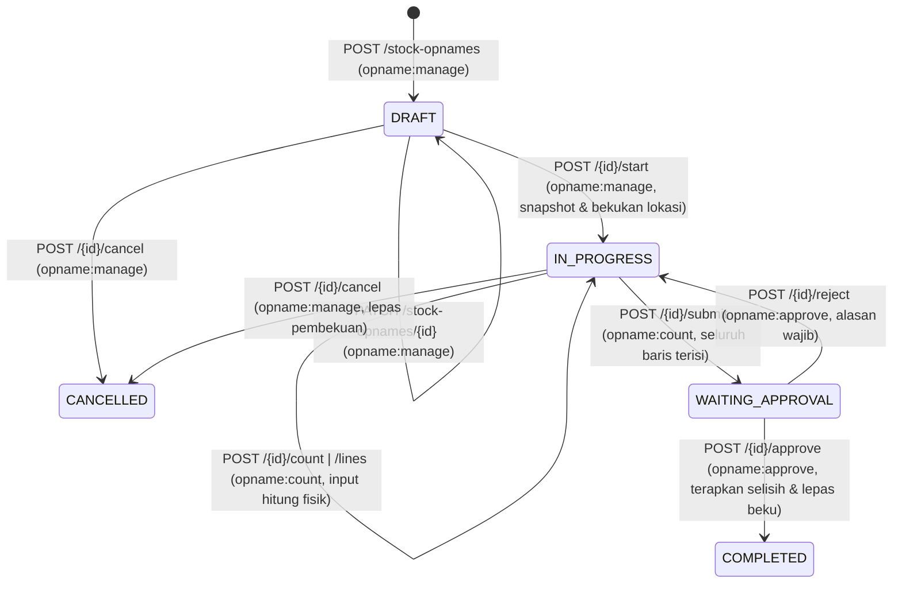

# Stock Opname (Rekonsiliasi Stok Fisik & Saldo Awal)

## 1. Informasi Umum

| Atribut | Keterangan |
| --- | --- |
| **Modul** | Stock Opname (*Penghitungan Fisik, Pembekuan Lokasi, Penyesuaian Stok & Input Saldo Awal*) |
| **Base path** | `/api/v1/stock-opnames` |
| **Rujukan PRD** | FR-03, FR-07, FR-08, FR-09, FR-10, FR-11, Bagian 3.1 (Matriks Permission), 3.2 (*Warehouse Scoping*), 5.1 (*State Machine*), 5.2 (Alur Opname & Saldo Awal), 5.3 (*Movement Types*), 6.5 (Urutan Penguncian), 6.6 (Pembekuan Lokasi), 6.9 (Presisi Kuantitas), AC-04, AC-05, AC-10, AC-12, Lampiran A & B |
| **Status implementasi** | ✅ Sudah diimplementasikan dan diuji (`tests/test_stock_opname.py`, `tests/test_rbac_scoping.py`) |
| **Kode sumber** | [routes/stock_opnames.py](../../app/api/routes/stock_opnames.py), [opname_service.py](../../app/services/opname_service.py), [inventory_service.py](../../app/services/inventory_service.py), [access_service.py](../../app/services/access_service.py), [numbering_service.py](../../app/services/numbering_service.py), [opname_repo.py](../../app/repositories/opname_repo.py), [schemas/stock_opname.py](../../app/schemas/stock_opname.py) |
| **Tabel terkait** | `stock_opnames`, `stock_opname_lines`, `warehouses`, `storage_locations`, `items`, `uoms`, `inventory_balances`, `stock_movements`, `document_sequences`, `audit_logs` |
| **Modul terkait** | [Stok & Buku Besar](stock-ledger.md), [Goods Receipt](goods-receipts.md), [Transfer Stok](stock-transfers.md), [Gudang & Lokasi](warehouses.md), [Audit Log](audit-logs.md) |

---

## 2. Penjelasan Fitur

### 2.1 Tujuan

Modul Stock Opname memfasilitasi penghitungan fisik persediaan pada **satu lokasi spesifik** (`location_id` diisi) atau **seluruh lokasi aktif di dalam satu gudang** (`location_id = null`), membandingkan hasil hitung fisik (`qty_physical`) terhadap potret saldo sistem (`qty_system`), membekukan lokasi selama penghitungan berlangsung, serta menyesuaikan saldo stok secara otomatis setelah disetujui oleh *Warehouse Manager*.

Sesuai FR-03 dan PRD 5.2 poin 4, Stock Opname juga menjadi **mekanisme resmi untuk memasukkan saldo awal stok** pada gudang/lokasi baru (dengan menambahkan baris barang ber-`qty_system = 0` dan mengisi `qty_physical > 0`, yang menghasilkan mutasi `ADJUSTMENT_PLUS`).

### 2.2 Alur Bisnis & Siklus Status (*State Machine* — PRD 5.1)



| Status Saat Ini | Pemicu | Status Berikutnya | Syarat & Efek |
| --- | --- | --- | --- |
| *(Baru)* | `POST /api/v1/stock-opnames` | `DRAFT` | Gudang/lokasi aktif; nomor `OPN-YYYYMM-NNNN` dibuat otomatis. |
| `DRAFT` | `PATCH /api/v1/stock-opnames/{id}` | `DRAFT` | Mengubah cakupan `location_id` atau `notes`. |
| `DRAFT` | `POST /api/v1/stock-opnames/{id}/start` | `IN_PROGRESS` | Mengunci lokasi (`FOR UPDATE`), memastikan tidak ada sesi aktif lain yang tumpang tindih (`409 LOCATION_FROZEN`), mengambil *snapshot* `qty_system` dari `inventory_balances`, dan **membekukan lokasi**. |
| `DRAFT` / `IN_PROGRESS` | `POST /api/v1/stock-opnames/{id}/cancel` | `CANCELLED` | Membatalkan sesi; bila dari `IN_PROGRESS`, pembekuan lokasi dilepas tanpa mengubah saldo. Status final. |
| `IN_PROGRESS` | `POST .../{id}/count` (atau `POST`/`PUT .../{id}/lines`) | `IN_PROGRESS` | Petugas mengisi `qty_physical >= 0` pada baris snapshot atau menambahkan baris barang fisik baru (`qty_system = 0`). |
| `IN_PROGRESS` | `POST /api/v1/stock-opnames/{id}/submit` | `WAITING_APPROVAL` | Seluruh baris wajib sudah memiliki `qty_physical >= 0`. Pembekuan lokasi tetap berlaku. |
| `WAITING_APPROVAL` | `POST /api/v1/stock-opnames/{id}/approve` | `COMPLETED` | Untuk setiap baris dengan `qty_variance != 0`, menyamakan saldo dengan `qty_physical` dan menulis ledger `ADJUSTMENT_PLUS` / `ADJUSTMENT_MINUS`; baris dengan `qty_variance == 0` tidak menulis ledger. Pembekuan dilepas. Status final. |
| `WAITING_APPROVAL` | `POST /api/v1/stock-opnames/{id}/reject` | `IN_PROGRESS` | `rejection_reason` wajib diisi; sesi kembali ke `IN_PROGRESS` untuk dihitung ulang. Pembekuan lokasi tetap berlaku. |

### 2.3 Pembekuan Lokasi (*Location Freeze* — PRD 6.6 & AC-10)

* Selama sesi berstatus `IN_PROGRESS` atau `WAITING_APPROVAL`:
  1. Tidak boleh ada sesi Opname lain yang dimulai pada lokasi yang tumpang tindih (`409 LOCATION_FROZEN`).
  2. Operasi mutasi stok normal — yaitu posting GR ke lokasi tersebut, pengiriman Transfer dari lokasi tersebut, dan penerimaan Transfer ke lokasi tersebut — ditolak oleh `inventory_service.apply_movement()` dengan `409 LOCATION_FROZEN`.
  3. Saat persetujuan Opname (`approve`), `apply_movement()` dipanggil dengan tipe `ADJUSTMENT_PLUS` / `ADJUSTMENT_MINUS` yang secara desain melewati pemeriksaan pembekuan karena penyesuaian justru dieksekusi sebelum sesi ditandai `COMPLETED`.

---

## 3. Autentikasi dan Otorisasi

* **Autentikasi:** Wajib menyertakan header `Authorization: Bearer <access_token>`.
* **Permission & Warehouse Scoping (Matriks 3.1 & PRD 3.2):**

| Permission | Aksi | Peran Bawaan (Matriks 3.1) | Warehouse Scoping `(g)` |
| --- | --- | --- | --- |
| `opname:read` | Daftar & detail sesi Opname | *Super Admin*, *Warehouse Manager*, *Warehouse Staff*, *Auditor* | **Ya untuk Warehouse Staff** (hanya melihat sesi pada gudang yang ditugaskan). Peran lain tidak dibatasi. |
| `opname:manage` | Buat `DRAFT`, revisi `DRAFT`, mulai (`start`), dan batalkan (`cancel`) sesi | *Super Admin*, *Warehouse Manager* | **Ya** (`ensure_warehouse_access` pada `warehouse_id` sesi). |
| `opname:count` | Input hasil hitung fisik (`count`/`lines`) & ajukan persetujuan (`submit`) | *Super Admin*, *Warehouse Staff* | **Ya** (`ensure_warehouse_access` pada `warehouse_id` sesi). |
| `opname:approve` | Setujui (`approve`) atau tolak (`reject`) hasil Opname | *Super Admin*, *Warehouse Manager* | **Ya** (`ensure_warehouse_access` pada `warehouse_id` sesi). |

---

## 4. Ringkasan Endpoint

| # | Method | Endpoint | Fungsi | Auth | Permission |
| :-: | --- | --- | --- | --- | --- |
| 1 | GET | `/api/v1/stock-opnames` | Daftar sesi Stock Opname (paginasi, filter gudang/lokasi/status/tanggal, pencarian, urut) | Bearer | `opname:read` `(g)` |
| 2 | POST | `/api/v1/stock-opnames` | Buat sesi Stock Opname baru berstatus `DRAFT` | Bearer | `opname:manage` `(g)` |
| 3 | GET | `/api/v1/stock-opnames/{opname_id}` | Detail sesi Stock Opname beserta daftar baris hitung (`lines`) | Bearer | `opname:read` `(g)` |
| 4 | PATCH | `/api/v1/stock-opnames/{opname_id}` | Revisi cakupan lokasi atau catatan sesi `DRAFT` | Bearer | `opname:manage` `(g)` |
| 5 | POST | `/api/v1/stock-opnames/{opname_id}/start` | Mulai sesi, ambil *snapshot* `qty_system`, dan bekukan lokasi (`DRAFT → IN_PROGRESS`) | Bearer | `opname:manage` `(g)` |
| 6 | POST | `/api/v1/stock-opnames/{opname_id}/count` | Input/perbarui `qty_physical` atau tambah baris barang baru | Bearer | `opname:count` `(g)` |
| 7 | POST | `/api/v1/stock-opnames/{opname_id}/lines` | Alias untuk `POST /api/v1/stock-opnames/{opname_id}/count` | Bearer | `opname:count` `(g)` |
| 8 | PUT | `/api/v1/stock-opnames/{opname_id}/lines` | Alias untuk `POST /api/v1/stock-opnames/{opname_id}/count` | Bearer | `opname:count` `(g)` |
| 9 | POST | `/api/v1/stock-opnames/{opname_id}/submit` | Ajukan hasil hitung untuk ditinjau (`IN_PROGRESS → WAITING_APPROVAL`) | Bearer | `opname:count` `(g)` |
| 10 | POST | `/api/v1/stock-opnames/{opname_id}/approve` | Setujui hasil Opname & sesuaikan saldo stok (`WAITING_APPROVAL → COMPLETED`) | Bearer | `opname:approve` `(g)` |
| 11 | POST | `/api/v1/stock-opnames/{opname_id}/reject` | Tolak hasil Opname dengan alasan wajib (`WAITING_APPROVAL → IN_PROGRESS`) | Bearer | `opname:approve` `(g)` |
| 12 | POST | `/api/v1/stock-opnames/{opname_id}/cancel` | Batalkan sesi (`DRAFT`/`IN_PROGRESS → CANCELLED`) | Bearer | `opname:manage` `(g)` |

---

## 5. Detail Setiap Endpoint

### 5.1 GET `/api/v1/stock-opnames` — Daftar Sesi

Mengambil daftar ringkasan sesi Stock Opname dengan dukungan pagination, filter, pencarian, dan pengurutan.

* **HTTP Method & URL:** `GET /api/v1/stock-opnames`
* **Autentikasi & Permission:** Bearer Token, `opname:read`

**Query Parameter**

| Parameter | Tipe | Wajib | Default | Aturan & Keterangan |
| --- | --- | --- | --- | --- |
| `limit` | integer | Tidak | `50` | Rentang `1..200`. |
| `offset` | integer | Tidak | `0` | Minimal `0`. |
| `warehouse_id` | integer | Tidak | `null` | Filter gudang. Untuk *Warehouse Staff*, wajib termasuk gudang yang ditugaskan (`403 WAREHOUSE_NOT_ASSIGNED` bila di luar cakupan). |
| `location_id` | integer | Tidak | `null` | Filter cakupan lokasi spesifik. |
| `status` | string | Tidak | `null` | Salah satu dari: `DRAFT`, `IN_PROGRESS`, `WAITING_APPROVAL`, `COMPLETED`, `CANCELLED`. |
| `date_from` | date (`YYYY-MM-DD`) | Tidak | `null` | Batas awal tanggal pembuatan (`created_at::date >= date_from`). |
| `date_to` | date (`YYYY-MM-DD`) | Tidak | `null` | Batas akhir tanggal pembuatan (`created_at::date <= date_to`). Tidak boleh `< date_from`. |
| `search` | string | Tidak | `null` | Pencarian `ILIKE` pada `opname_number` atau `notes`. |
| `sort_by` | string | Tidak | `"id"` | Whitelist: `"id"`, `"opname_number"`, `"status"`, `"created_at"`, `"started_at"`, `"approved_at"`. |
| `sort_dir` | string | Tidak | `"desc"` | `"asc"` atau `"desc"`. |

**Contoh Response Berhasil (`200 OK` — `Page[StockOpnameSummaryOut]`)**

```json
{
  "items": [
    {
      "id": 3,
      "opname_number": "OPN-202610-0003",
      "warehouse_id": 2,
      "warehouse_code": "WH-JKT",
      "warehouse_name": "Gudang Jakarta",
      "location_id": 7,
      "location_code": "A-01",
      "location_name": "Rak A01",
      "status": "IN_PROGRESS",
      "notes": "Opname bulanan lokasi A-01",
      "line_count": 2,
      "started_at": "2026-10-23T13:00:00+07:00",
      "started_by": 3,
      "submitted_at": null,
      "submitted_by": null,
      "approved_at": null,
      "approved_by": null,
      "rejection_reason": null,
      "created_by": 3,
      "created_at": "2026-10-23T12:50:00+07:00",
      "updated_at": "2026-10-23T13:00:00+07:00"
    }
  ],
  "total": 1,
  "limit": 50,
  "offset": 0
}
```

* **Kemungkinan Error:** `401 AUTH_TOKEN_INVALID`, `403 PERMISSION_DENIED`, `403 WAREHOUSE_NOT_ASSIGNED`, `422 VALIDATION_ERROR`.

---

### 5.2 POST `/api/v1/stock-opnames` — Buat Sesi

Membuat jadwal/sesi Stock Opname baru dengan status awal `DRAFT`.

* **HTTP Method & URL:** `POST /api/v1/stock-opnames`
* **Autentikasi & Permission:** Bearer Token, `opname:manage` + **Warehouse Scoping `(g)`** pada `warehouse_id`.

**Request Body (`StockOpnameCreate`)**

| Field | Tipe | Wajib | Aturan Validasi |
| --- | --- | --- | --- |
| `warehouse_id` | integer (`> 0`) | Ya | Gudang harus ada (`404 NOT_FOUND`), aktif (`422 INACTIVE_REFERENCE`), dan pengguna ditugaskan ke gudang ini (`403 WAREHOUSE_NOT_ASSIGNED`). |
| `location_id` | integer (`> 0`) \| `null` | Tidak | Jika diisi, lokasi harus aktif dan milik `warehouse_id` (`422 INVALID_LOCATION`). Jika `null`/tidak diisi, cakupan sesi adalah **seluruh lokasi aktif** di gudang tersebut. |
| `notes` | string \| `null` | Tidak | Catatan sesi; string kosong dinormalisasi menjadi `null`. |

**Contoh Request**

```json
{
  "warehouse_id": 2,
  "location_id": 7,
  "notes": "Opname bulanan lokasi A-01"
}
```

* **Response Berhasil:** `201 Created` (`StockOpnameOut` dengan `status: "DRAFT"`, `lines: []`, dan nomor `OPN-YYYYMM-NNNN`). Mencatat `OPNAME_CREATED` pada `audit_logs`.
* **Kemungkinan Error:** `401 AUTH_TOKEN_INVALID`, `403 PERMISSION_DENIED`, `403 WAREHOUSE_NOT_ASSIGNED`, `404 NOT_FOUND`, `422 INACTIVE_REFERENCE`, `422 INVALID_LOCATION`, `422 VALIDATION_ERROR`.

---

### 5.3 GET `/api/v1/stock-opnames/{opname_id}` — Detail Sesi

Mengambil detail lengkap sesi Stock Opname beserta seluruh baris hitung (`lines`).

* **HTTP Method & URL:** `GET /api/v1/stock-opnames/{opname_id}`
* **Autentikasi & Permission:** Bearer Token, `opname:read`
* **Path Parameter:** `opname_id` (integer, wajib).
* **Response Berhasil:** `200 OK` (`StockOpnameOut`).
* **Kemungkinan Error:** `401 AUTH_TOKEN_INVALID`, `403 PERMISSION_DENIED`, `403 WAREHOUSE_NOT_ASSIGNED` (jika *Warehouse Staff* tidak ditugaskan ke gudang sesi), `404 NOT_FOUND`.

---

### 5.4 PATCH `/api/v1/stock-opnames/{opname_id}` — Revisi Sesi

Memperbarui cakupan `location_id` atau `notes` selama sesi masih berstatus `DRAFT`.

* **HTTP Method & URL:** `PATCH /api/v1/stock-opnames/{opname_id}`
* **Autentikasi & Permission:** Bearer Token, `opname:manage` + **Warehouse Scoping `(g)`**
* **Request Body (`StockOpnameUpdate`):**
  * `location_id` (integer \| `null`, opsional) — Mengubah cakupan ke lokasi tertentu dalam gudang sesi.
  * `clear_location` (boolean, opsional, default `false`) — Kirim `true` untuk menghapus batasan lokasi sehingga cakupan menjadi seluruh gudang (`location_id = null`).
  * `notes` (string \| `null`, opsional) — Kirim `""` untuk mengosongkan catatan.
* **Aturan Bisnis & Audit:** Hanya diizinkan saat `status == "DRAFT"` (`409 INVALID_STATE_TRANSITION` bila bukan). Mencatat `OPNAME_UPDATED` pada `audit_logs`.
* **Response Berhasil:** `200 OK` (`StockOpnameOut`).
* **Kemungkinan Error:** `401 AUTH_TOKEN_INVALID`, `403 PERMISSION_DENIED`, `403 WAREHOUSE_NOT_ASSIGNED`, `404 NOT_FOUND`, `409 INVALID_STATE_TRANSITION`, `422 INVALID_LOCATION`, `422 VALIDATION_ERROR`.

---

### 5.5 POST `/api/v1/stock-opnames/{opname_id}/start` — Mulai Sesi

Memulai sesi Opname (`DRAFT → IN_PROGRESS`), mengambil potret saldo (`qty_system`), dan membekukan seluruh lokasi dalam cakupan.

* **HTTP Method & URL:** `POST /api/v1/stock-opnames/{opname_id}/start`
* **Autentikasi & Permission:** Bearer Token, `opname:manage` + **Warehouse Scoping `(g)`**
* **Request Body:** Tidak ada.
* **Aturan Bisnis & Audit:**
  * Mengunci header Opname (`FOR UPDATE`), memastikan status `DRAFT`.
  * Mengunci seluruh baris lokasi dalam cakupan dengan `SELECT ... FOR UPDATE` (diurutkan berdasarkan `id` sesuai PRD 6.5).
  * Memastikan tidak ada sesi Opname lain berstatus `IN_PROGRESS` atau `WAITING_APPROVAL` yang menyentuh lokasi dalam cakupan (`409 LOCATION_FROZEN` bila tumpang tindih).
  * Mengambil *snapshot* seluruh baris `inventory_balances` pada lokasi cakupan dan membuat baris `stock_opname_lines` dengan `qty_system = qty_on_hand`, `qty_physical = null`, `qty_variance = null`.
  * Menyimpan `started_at`, `started_by`, dan mencatat `OPNAME_STARTED` pada `audit_logs`.
* **Response Berhasil:** `200 OK` (`StockOpnameOut` dengan `status: "IN_PROGRESS"` beserta baris *snapshot*).
* **Kemungkinan Error:** `401 AUTH_TOKEN_INVALID`, `403 PERMISSION_DENIED`, `403 WAREHOUSE_NOT_ASSIGNED`, `404 NOT_FOUND`, `409 INVALID_STATE_TRANSITION`, `409 LOCATION_FROZEN`, `422 INACTIVE_REFERENCE`, `422 INVALID_LOCATION`, `422 VALIDATION_ERROR`.

---

### 5.6 Input Hasil Hitung — `POST .../{opname_id}/count`, `POST .../{opname_id}/lines`, `PUT .../{opname_id}/lines`

Mengisi atau memperbarui hasil hitung fisik (`qty_physical`) pada baris *snapshot* yang sudah ada, atau menambahkan baris baru untuk barang yang ditemukan secara fisik tetapi belum memiliki saldo (`qty_system = 0`).

* **HTTP Method & URL:**
  * `POST /api/v1/stock-opnames/{opname_id}/count` *(utama)*
  * `POST /api/v1/stock-opnames/{opname_id}/lines` *(alias)*
  * `PUT /api/v1/stock-opnames/{opname_id}/lines` *(alias)*
* **Autentikasi & Permission:** Bearer Token, `opname:count` + **Warehouse Scoping `(g)`**

**Request Body (`StockOpnameCountRequest`)**

| Field | Tipe | Wajib | Aturan Validasi |
| --- | --- | --- | --- |
| `lines` | array of `StockOpnameCountLineInput` | Ya (min 1) | Setiap elemen wajib mengisi **`line_id`** ATAU pasangan **`(location_id, item_id)`**. |
| `lines[].line_id` | integer (`> 0`) \| `null` | Kondisional | ID baris `stock_opname_lines` yang sudah ada pada sesi ini. |
| `lines[].location_id` | integer (`> 0`) \| `null` | Kondisional | ID lokasi penyimpanan (wajib bila menambah/menunjuk baris via `item_id` pada sesi tingkat gudang; bila sesi tingkat 1 lokasi dan dikosongkan, otomatis memakai `location_id` sesi). |
| `lines[].item_id` | integer (`> 0`) \| `null` | Kondisional | ID barang aktif (dipakai bersama `location_id` bila tidak memakai `line_id`). Jika kombinasi `(location_id, item_id)` belum ada di sesi, sistem membuat baris baru dengan `qty_system = "0.0000"`. |
| `lines[].qty_physical` | string desimal / int (`>= 0`) | Ya | Kuantitas hasil hitung fisik (`>= 0`, maks 4 desimal, bukan float, patuh `allow_decimal` UoM). |
| `lines[].notes` | string \| `null` | Tidak | Catatan hitung per baris. |

**Contoh Request**

```json
{
  "lines": [
    {
      "line_id": 81,
      "qty_physical": "97.0000",
      "notes": "3 unit tidak ditemukan di rak"
    },
    {
      "location_id": 7,
      "item_id": 24,
      "qty_physical": "5.0000",
      "notes": "Saldo awal / barang ditemukan saat hitung"
    }
  ]
}
```

* **Aturan Bisnis & Audit:**
  * Hanya diizinkan saat `status == "IN_PROGRESS"` (`409 INVALID_STATE_TRANSITION` bila bukan).
  * Menghitung otomatis `qty_variance = qty_physical - qty_system`, menyimpan `counted_by` dan `counted_at`, serta mencatat `OPNAME_COUNTED` pada `audit_logs`.
* **Response Berhasil:** `200 OK` (`StockOpnameOut`).
* **Kemungkinan Error:** `401 AUTH_TOKEN_INVALID`, `403 PERMISSION_DENIED`, `403 WAREHOUSE_NOT_ASSIGNED`, `404 NOT_FOUND`, `409 INVALID_STATE_TRANSITION`, `422 INACTIVE_REFERENCE`, `422 INVALID_LOCATION`, `422 VALIDATION_ERROR`.

---

### 5.7 POST `/api/v1/stock-opnames/{opname_id}/submit` — Ajukan Persetujuan

Mengajukan hasil hitung fisik kepada *Warehouse Manager* (`IN_PROGRESS → WAITING_APPROVAL`).

* **HTTP Method & URL:** `POST /api/v1/stock-opnames/{opname_id}/submit`
* **Autentikasi & Permission:** Bearer Token, `opname:count` + **Warehouse Scoping `(g)`**
* **Request Body:** Tidak ada.
* **Aturan Bisnis & Audit:**
  * Mengunci header Opname (`FOR UPDATE`); wajib berstatus `IN_PROGRESS`.
  * Sesi wajib memiliki minimal 1 baris dan **seluruh baris wajib sudah memiliki `qty_physical >= 0`** (`422 VALIDATION_ERROR` dengan daftar `uncounted_line_ids` bila masih ada baris yang `qty_physical IS NULL`).
  * Menyimpan `submitted_at`, `submitted_by`, dan mencatat `OPNAME_SUBMITTED` pada `audit_logs`. Pembekuan lokasi tetap aktif.
* **Response Berhasil:** `200 OK` (`StockOpnameOut` dengan `status: "WAITING_APPROVAL"`).
* **Kemungkinan Error:** `401 AUTH_TOKEN_INVALID`, `403 PERMISSION_DENIED`, `403 WAREHOUSE_NOT_ASSIGNED`, `404 NOT_FOUND`, `409 INVALID_STATE_TRANSITION`, `422 VALIDATION_ERROR`.

---

### 5.8 POST `/api/v1/stock-opnames/{opname_id}/approve` — Setujui

Menyetujui hasil Stock Opname (`WAITING_APPROVAL → COMPLETED`), menyamakan saldo stok dengan `qty_physical`, menulis ledger penyesuaian, dan melepas pembekuan lokasi dalam satu transaksi atomik.

* **HTTP Method & URL:** `POST /api/v1/stock-opnames/{opname_id}/approve`
* **Autentikasi & Permission:** Bearer Token, `opname:approve` + **Warehouse Scoping `(g)`**
* **Request Body:** Tidak ada.
* **Aturan Bisnis & Audit (FR-07 & AC-04):**
  * Mengunci header Opname (`FOR UPDATE`); wajib berstatus `WAITING_APPROVAL`.
  * Baris Opname diurutkan berdasarkan `(location_id, item_id, id)`.
  * Untuk setiap baris:
    * `qty_variance = qty_physical - qty_system`.
    * Bila `qty_variance > 0`: memanggil `inventory_service.apply_movement()` dengan tipe `ADJUSTMENT_PLUS` (`reference_type = "STOCK_OPNAME"`).
    * Bila `qty_variance < 0`: memanggil `inventory_service.apply_movement()` dengan tipe `ADJUSTMENT_MINUS` (`reference_type = "STOCK_OPNAME"`).
    * Bila `qty_variance == 0`: **tidak memanggil `apply_movement()` dan tidak menghasilkan baris `stock_movements`**.
  * Menandai status sesi menjadi `COMPLETED` (sehingga lokasi otomatis tidak lagi dibekukan), menyimpan `approved_by`, `approved_at`, dan mencatat `OPNAME_APPROVED` pada `audit_logs`.
* **Response Berhasil:** `200 OK` (`StockOpnameOut` dengan `status: "COMPLETED"`).
* **Kemungkinan Error:** `401 AUTH_TOKEN_INVALID`, `403 PERMISSION_DENIED`, `403 WAREHOUSE_NOT_ASSIGNED`, `404 NOT_FOUND`, `409 INVALID_STATE_TRANSITION`, `422 VALIDATION_ERROR`.

---

### 5.9 POST `/api/v1/stock-opnames/{opname_id}/reject` — Tolak

Menolak pengajuan hasil hitung fisik (`WAITING_APPROVAL → IN_PROGRESS`) dengan alasan wajib agar petugas dapat melakukan penghitungan ulang.

* **HTTP Method & URL:** `POST /api/v1/stock-opnames/{opname_id}/reject`
* **Autentikasi & Permission:** Bearer Token, `opname:approve` + **Warehouse Scoping `(g)`**
* **Request Body (`StockOpnameRejectRequest`):**
  * `rejection_reason` (string, wajib, tidak boleh kosong setelah *trim*).

**Contoh Request**

```json
{
  "rejection_reason": "Hitung ulang rak A-01 karena selisih belum diverifikasi fisik"
}
```

* **Aturan Bisnis & Audit:**
  * Hanya diizinkan dari status `WAITING_APPROVAL` (`409 INVALID_STATE_TRANSITION` bila bukan).
  * Mengembalikan status ke `IN_PROGRESS`, menyimpan `rejection_reason`, dan mencatat `OPNAME_REJECTED` pada `audit_logs`. Lokasi tetap dibekukan.
* **Response Berhasil:** `200 OK` (`StockOpnameOut` dengan `status: "IN_PROGRESS"`).
* **Kemungkinan Error:** `401 AUTH_TOKEN_INVALID`, `403 PERMISSION_DENIED`, `403 WAREHOUSE_NOT_ASSIGNED`, `404 NOT_FOUND`, `409 INVALID_STATE_TRANSITION`, `422 VALIDATION_ERROR`.

---

### 5.10 POST `/api/v1/stock-opnames/{opname_id}/cancel` — Batalkan

Membatalkan sesi Stock Opname berstatus `DRAFT` atau `IN_PROGRESS` menjadi `CANCELLED`.

* **HTTP Method & URL:** `POST /api/v1/stock-opnames/{opname_id}/cancel`
* **Autentikasi & Permission:** Bearer Token, `opname:manage` + **Warehouse Scoping `(g)`**
* **Request Body:** Tidak ada.
* **Aturan Bisnis & Audit:**
  * Hanya sesi berstatus `DRAFT` atau `IN_PROGRESS` yang dapat dibatalkan (`409 INVALID_STATE_TRANSITION` untuk `WAITING_APPROVAL`, `COMPLETED`, atau `CANCELLED`).
  * Jika dibatalkan dari `IN_PROGRESS`, pembekuan lokasi dilepas seketika dan tidak ada perubahan pada saldo stok.
  * Mencatat `OPNAME_CANCELLED` pada `audit_logs`.
* **Response Berhasil:** `200 OK` (`StockOpnameOut` dengan `status: "CANCELLED"`).
* **Kemungkinan Error:** `401 AUTH_TOKEN_INVALID`, `403 PERMISSION_DENIED`, `403 WAREHOUSE_NOT_ASSIGNED`, `404 NOT_FOUND`, `409 INVALID_STATE_TRANSITION`.

---

## 6. Relasi dan Ketergantungan

| Objek / Tabel | Kunci & Constraint Utama (`005_create_transfer_opname.sql`) | Relasi & Dampak |
| --- | --- | --- |
| `stock_opnames` | `pk_stock_opnames (id)`, `uq_stock_opnames_opname_number (opname_number)`, `fk_stock_opnames_location_warehouse (location_id, warehouse_id)`, `uq_stock_opnames_id_warehouse (id, warehouse_id)` | *Composite FK* memastikan apabila `location_id` diisi, lokasi tersebut pasti milik `warehouse_id` sesi. Indeks parsial `ix_stock_opnames_active_warehouse` mempercepat pengecekan pembekuan lokasi (`status IN ('IN_PROGRESS', 'WAITING_APPROVAL')`). |
| `stock_opname_lines` | `pk_stock_opname_lines (id)`, `fk_stock_opname_lines_opname_warehouse (opname_id, warehouse_id)`, `fk_stock_opname_lines_location_warehouse (location_id, warehouse_id)`, `uq_stock_opname_lines_opname_location_item (opname_id, location_id, item_id)`, `ck_stock_opname_lines_variance_consistency` | Constraint `CHECK` di database menjamin `qty_variance = qty_physical - qty_system` saat `qty_physical IS NOT NULL`. |
| `opname_repo.is_location_frozen` | Dipanggil oleh `inventory_service.apply_movement` | Memeriksa apakah suatu lokasi sedang tercakup dalam sesi Opname berstatus `IN_PROGRESS` atau `WAITING_APPROVAL` (baik sesi spesifik lokasi maupun sesi seluruh gudang `location_id IS NULL`). |

Alur lapisan: `routes/stock_opnames.py` → `opname_service.py` (`with conn.transaction():` + `access_service` + `inventory_service.apply_movement` + `audit_service`) → `opname_repo.py` → PostgreSQL.

---

## 7. Contoh Penggunaan (cURL)

```bash
BASE=http://localhost:8000/api/v1

# 1. Buat sesi Stock Opname baru (DRAFT) oleh Warehouse Manager
curl -s -X POST "$BASE/stock-opnames" \
  -H "Authorization: Bearer <MANAGER_TOKEN>" \
  -H "Content-Type: application/json" \
  -d '{
    "warehouse_id": 2,
    "location_id": 7,
    "notes": "Opname bulanan Rak A-01"
  }'

# 2. Mulai sesi Opname (DRAFT -> IN_PROGRESS: ambil snapshot & bekukan lokasi)
curl -s -X POST "$BASE/stock-opnames/3/start" \
  -H "Authorization: Bearer <MANAGER_TOKEN>"

# 3. Input hasil hitung fisik oleh Warehouse Staff
curl -s -X POST "$BASE/stock-opnames/3/count" \
  -H "Authorization: Bearer <STAFF_TOKEN>" \
  -H "Content-Type: application/json" \
  -d '{
    "lines": [
      {"line_id": 81, "qty_physical": "97.0000", "notes": "Selisih kurang 3 unit"}
    ]
  }'

# 4. Ajukan hasil hitung untuk persetujuan (IN_PROGRESS -> WAITING_APPROVAL)
curl -s -X POST "$BASE/stock-opnames/3/submit" \
  -H "Authorization: Bearer <STAFF_TOKEN>"

# 5. Setujui hasil Opname oleh Warehouse Manager (WAITING_APPROVAL -> COMPLETED)
curl -s -X POST "$BASE/stock-opnames/3/approve" \
  -H "Authorization: Bearer <MANAGER_TOKEN>"
```

---

## 8. Catatan dan Status Verifikasi

| # | Status | Catatan |
| --- | --- | --- |
| 1 | ✅ Terverifikasi | Rekonsiliasi Stock Opname (`qty_variance = -3` menghasilkan `ADJUSTMENT_MINUS`, penyesuaian saldo stok menjadi `97.0000`, input saldo awal `ADJUSTMENT_PLUS`, serta baris dengan `qty_variance == 0` tidak menghasilkan baris `stock_movements`) telah diuji di `test_ac04_stock_opname_reconciliation_variance_and_zero_variance_no_ledger` (`tests/test_stock_opname.py` — **AC-04**). |
| 2 | ✅ Terverifikasi | Pembekuan lokasi selama sesi Opname berstatus `IN_PROGRESS` / `WAITING_APPROVAL` (menolak posting GR dan pengiriman/penerimaan Transfer dengan `409 LOCATION_FROZEN`) serta pelepasan pembekuan setelah sesi `COMPLETED` atau `CANCELLED` telah diuji di `test_ac10_location_freeze_during_opname_and_unfreeze_on_complete_or_cancel` (**AC-10**). |
| 3 | ✅ Terverifikasi | Penolakan persetujuan Stock Opname oleh peran *Warehouse Staff* (`403 PERMISSION_DENIED`) telah diuji di `test_ac05_rbac_enforcement_and_audit_log_recording` (`tests/test_rbac_scoping.py` — **AC-05**). |
