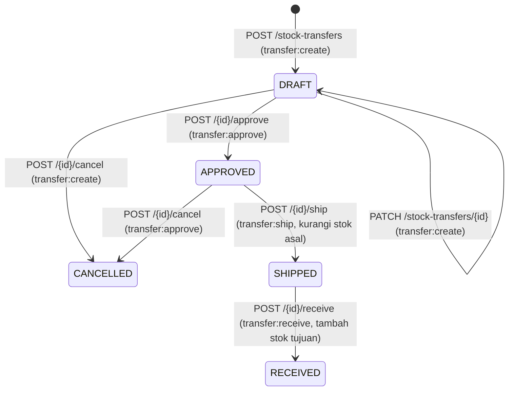

# Transfer Stok Antar-Gudang & Antar-Lokasi

## 1. Informasi Umum

| Atribut | Keterangan |
| --- | --- |
| **Modul** | Stock Transfer (*Pemindahan Barang Antar-Gudang atau Antar-Lokasi*) |
| **Base path** | `/api/v1/stock-transfers` |
| **Rujukan PRD** | FR-03, FR-06, FR-08, FR-09, FR-10, FR-11, Bagian 3.1 (Matriks Permission), 3.2 (*Warehouse Scoping*), 5.1 (*State Machine*), 5.3 (*Movement Types*), 6.1 (Stok Negatif), 6.3 (Asal ≠ Tujuan), 6.5 (Urutan Penguncian), 6.6 (Pembekuan Lokasi), 6.7 (Selisih Penerimaan), 6.9 (Presisi Kuantitas), AC-02, AC-03, AC-06, AC-09, AC-10, AC-12, Lampiran A & B |
| **Status implementasi** | ✅ Sudah diimplementasikan dan diuji (`tests/test_stock_transfer.py`, `tests/test_stock_opname.py`, `tests/test_rbac_scoping.py`) |
| **Kode sumber** | [routes/stock_transfers.py](../../app/api/routes/stock_transfers.py), [transfer_service.py](../../app/services/transfer_service.py), [inventory_service.py](../../app/services/inventory_service.py), [access_service.py](../../app/services/access_service.py), [numbering_service.py](../../app/services/numbering_service.py), [transfer_repo.py](../../app/repositories/transfer_repo.py), [schemas/stock_transfer.py](../../app/schemas/stock_transfer.py) |
| **Tabel terkait** | `stock_transfers`, `stock_transfer_lines`, `warehouses`, `storage_locations`, `items`, `uoms`, `inventory_balances`, `stock_movements`, `document_sequences`, `audit_logs` |
| **Modul terkait** | [Stok & Buku Besar](stock-ledger.md), [Gudang & Lokasi](warehouses.md), [Stock Opname](stock-opnames.md), [Audit Log](audit-logs.md) |

---

## 2. Penjelasan Fitur

### 2.1 Tujuan

Modul Transfer Stok mengelola pemindahan fisik barang dari satu lokasi penyimpanan asal (`source_warehouse_id`, `source_location_id`) ke satu lokasi penyimpanan tujuan (`destination_warehouse_id`, `destination_location_id`) — baik lintas gudang maupun antar-lokasi di dalam gudang yang sama — dengan persetujuan *Warehouse Manager* dan dua tahap mutasi fisik eksplisit (`SHIPPED` dan `RECEIVED`) untuk melacak stok dalam perjalanan (*in-transit*).

### 2.2 Alur Bisnis & Siklus Status (*State Machine* — PRD 5.1)



| Status Saat Ini | Pemicu | Status Berikutnya | Syarat & Efek |
| --- | --- | --- | --- |
| *(Baru)* | `POST /api/v1/stock-transfers` | `DRAFT` | Asal ≠ tujuan; gudang & lokasi aktif; penugasan pada gudang asal; nomor `TRF-YYYYMM-NNNN` dibuat otomatis. Belum memengaruhi stok. |
| `DRAFT` | `PATCH /api/v1/stock-transfers/{id}` | `DRAFT` | Revisi header dan/atau baris selama masih `DRAFT`. |
| `DRAFT` | `POST /api/v1/stock-transfers/{id}/approve` | `APPROVED` | Minimal 1 baris (`qty > 0`); disetujui oleh *Warehouse Manager* gudang asal. Belum memengaruhi stok. |
| `DRAFT` / `APPROVED` | `POST /api/v1/stock-transfers/{id}/cancel` | `CANCELLED` | `transfer:create` (untuk `DRAFT`) atau `transfer:approve` (untuk `APPROVED`) pada gudang asal. Status final. |
| `APPROVED` | `POST /api/v1/stock-transfers/{id}/ship` | `SHIPPED` | Lokasi asal tidak dibekukan; saldo mencukupi (bila `allow_negative_stock = false`) → mengurangi `inventory_balances` asal dan menulis ledger `OUT_TRANSFER`. Barang berstatus *in-transit*. |
| `SHIPPED` | `POST /api/v1/stock-transfers/{id}/receive` | `RECEIVED` | Penugasan pada gudang tujuan; lokasi tujuan aktif & tidak dibekukan; `0 <= qty_received <= qty` (alasan `variance_reason` wajib bila `< qty`) → menambah `inventory_balances` tujuan sebesar `qty_received` dan menulis ledger `IN_TRANSFER` (hanya untuk baris dengan `qty_received > 0`). Status final. |

### 2.3 Aturan Integritas Utama

* **Validasi Asal ≠ Tujuan (PRD 6.3):** Kombinasi `(source_warehouse_id, source_location_id)` tidak boleh sama dengan `(destination_warehouse_id, destination_location_id)` (`422 VALIDATION_ERROR`).
* **Pencegahan Stok Negatif di Bawah Penguncian (`409 INSUFFICIENT_STOCK` — PRD 6.1, AC-02, AC-06):** Saat pengiriman (`SHIPPED`), setiap baris diurutkan berdasarkan `item_id` lalu diproses melalui `inventory_service.apply_movement()`. Setelah baris saldo dikunci (`FOR UPDATE`), jika `qty_before - qty < 0` dan `allow_negative_stock = false` pada gudang asal, seluruh transaksi di-*rollback* dengan `409 INSUFFICIENT_STOCK`.
* **Aturan Selisih Penerimaan (`variance_reason` — PRD 6.7, AC-09):**
  * Penerimaan dilakukan **satu kali (final)** untuk seluruh baris Transfer.
  * Jika `qty_received > qty` → ditolak dengan `409 TRANSFER_QTY_EXCEEDS_SHIPPED`.
  * Jika `qty_received < qty` (termasuk `0`) → `variance_reason` wajib diisi (tidak boleh kosong/`null`, `422 VALIDATION_ERROR`).
  * Selisih (`qty - qty_received`) **tidak dikembalikan ke gudang asal** dan **tidak menghasilkan baris ledger tambahan**; jejak selisih tersimpan pada kolom `qty_received` dan `variance_reason` di `stock_transfer_lines` serta terbaca dari pasangan ledger `OUT_TRANSFER` dan `IN_TRANSFER`.

---

## 3. Autentikasi dan Otorisasi

* **Autentikasi:** Wajib menyertakan header `Authorization: Bearer <access_token>`.
* **Permission & Warehouse Scoping (Matriks 3.1 & PRD 3.2 poin 3 & 5):**

| Permission | Aksi | Peran Bawaan (Matriks 3.1) | Aturan Warehouse Scoping `(g)` |
| --- | --- | --- | --- |
| `transfer:read` | Daftar & detail Transfer | *Super Admin*, *Warehouse Manager*, *Warehouse Staff*, *Auditor* | **Ya untuk Warehouse Staff**: hanya melihat Transfer apabila ditugaskan pada **gudang asal ATAU gudang tujuan**. Peran lain tidak dibatasi. |
| `transfer:create` | Buat `DRAFT`, revisi `DRAFT`, batalkan `DRAFT` | *Super Admin*, *Warehouse Staff* | **Ya** — Wajib ditugaskan pada **gudang asal** (`source_warehouse_id`). |
| `transfer:approve` | Setujui `DRAFT → APPROVED`, batalkan `APPROVED` | *Super Admin*, *Warehouse Manager* | **Ya** — Wajib ditugaskan pada **gudang asal** (`source_warehouse_id`). |
| `transfer:ship` | Kirim `APPROVED → SHIPPED` | *Super Admin*, *Warehouse Staff* | **Ya** — Wajib ditugaskan pada **gudang asal** (`source_warehouse_id`). |
| `transfer:receive` | Terima `SHIPPED → RECEIVED` | *Super Admin*, *Warehouse Staff* | **Ya** — Wajib ditugaskan pada **gudang tujuan** (`destination_warehouse_id`). |

---

## 4. Ringkasan Endpoint

| # | Method | Endpoint | Fungsi | Auth | Permission |
| :-: | --- | --- | --- | --- | --- |
| 1 | GET | `/api/v1/stock-transfers` | Daftar Transfer Stok (paginasi, filter gudang/status/tanggal, pencarian, urut) | Bearer | `transfer:read` `(g)` |
| 2 | POST | `/api/v1/stock-transfers` | Buat Transfer Stok baru berstatus `DRAFT` | Bearer | `transfer:create` `(g asal)` |
| 3 | GET | `/api/v1/stock-transfers/{transfer_id}` | Detail Transfer Stok beserta daftar baris (`lines`) | Bearer | `transfer:read` `(g)` |
| 4 | PATCH | `/api/v1/stock-transfers/{transfer_id}` | Revisi Transfer Stok berstatus `DRAFT` | Bearer | `transfer:create` `(g asal)` |
| 5 | POST | `/api/v1/stock-transfers/{transfer_id}/approve` | Setujui Transfer Stok (`DRAFT → APPROVED`) | Bearer | `transfer:approve` `(g asal)` |
| 6 | POST | `/api/v1/stock-transfers/{transfer_id}/ship` | Kirim Transfer Stok & potong saldo asal (`APPROVED → SHIPPED`) | Bearer | `transfer:ship` `(g asal)` |
| 7 | POST | `/api/v1/stock-transfers/{transfer_id}/receive` | Terima Transfer Stok di tujuan & catat selisih (`SHIPPED → RECEIVED`) | Bearer | `transfer:receive` `(g tujuan)` |
| 8 | POST | `/api/v1/stock-transfers/{transfer_id}/cancel` | Batalkan Transfer Stok (`DRAFT`/`APPROVED → CANCELLED`) | Bearer | `transfer:create` / `transfer:approve` `(g asal)` |

---

## 5. Detail Setiap Endpoint

### 5.1 GET `/api/v1/stock-transfers` — Daftar Transfer

Mengambil daftar ringkasan Transfer Stok dengan dukungan pagination, filter, pencarian, dan pengurutan.

* **HTTP Method & URL:** `GET /api/v1/stock-transfers`
* **Autentikasi & Permission:** Bearer Token, `transfer:read`

**Query Parameter**

| Parameter | Tipe | Wajib | Default | Aturan & Keterangan |
| --- | --- | --- | --- | --- |
| `limit` | integer | Tidak | `50` | Rentang `1..200`. |
| `offset` | integer | Tidak | `0` | Minimal `0`. |
| `warehouse_id` | integer | Tidak | `null` | Filter Transfer yang melibatkan gudang ini sebagai asal **atau** tujuan. Untuk *Warehouse Staff*, wajib termasuk gudang yang ditugaskan (`403 WAREHOUSE_NOT_ASSIGNED` bila tidak). |
| `source_warehouse_id` | integer | Tidak | `null` | Filter spesifik gudang asal. |
| `destination_warehouse_id` | integer | Tidak | `null` | Filter spesifik gudang tujuan. |
| `status` | string | Tidak | `null` | Salah satu dari: `DRAFT`, `APPROVED`, `SHIPPED`, `RECEIVED`, `CANCELLED`. |
| `date_from` | date (`YYYY-MM-DD`) | Tidak | `null` | Batas awal tanggal pembuatan (`created_at::date >= date_from`). |
| `date_to` | date (`YYYY-MM-DD`) | Tidak | `null` | Batas akhir tanggal pembuatan (`created_at::date <= date_to`). Tidak boleh `< date_from`. |
| `search` | string | Tidak | `null` | Pencarian `ILIKE` pada `transfer_number` atau `notes`. |
| `sort_by` | string | Tidak | `"id"` | Whitelist: `"id"`, `"transfer_number"`, `"status"`, `"created_at"`, `"shipped_at"`, `"received_at"`. |
| `sort_dir` | string | Tidak | `"desc"` | `"asc"` atau `"desc"`. |

**Contoh Response Berhasil (`200 OK` — `Page[StockTransferSummaryOut]`)**

```json
{
  "items": [
    {
      "id": 9,
      "transfer_number": "TRF-202610-0009",
      "source_warehouse_id": 2,
      "source_warehouse_code": "WH-JKT",
      "source_warehouse_name": "Gudang Jakarta",
      "source_location_id": 7,
      "source_location_code": "A-01",
      "source_location_name": "Rak A01",
      "destination_warehouse_id": 4,
      "destination_warehouse_code": "WH-BDG",
      "destination_warehouse_name": "Gudang Bandung",
      "destination_location_id": 19,
      "destination_location_code": "B-01",
      "destination_location_name": "Rak B01",
      "status": "SHIPPED",
      "notes": "Pemindahan stok ke cabang",
      "line_count": 1,
      "approved_by": 3,
      "approved_at": "2026-10-23T11:10:00+07:00",
      "shipped_by": 9,
      "shipped_at": "2026-10-23T11:30:00+07:00",
      "received_by": null,
      "received_at": null,
      "created_by": 9,
      "created_at": "2026-10-23T11:00:00+07:00",
      "updated_at": "2026-10-23T11:30:00+07:00"
    }
  ],
  "total": 1,
  "limit": 50,
  "offset": 0
}
```

* **Kemungkinan Error:** `401 AUTH_TOKEN_INVALID`, `403 PERMISSION_DENIED`, `403 WAREHOUSE_NOT_ASSIGNED`, `422 VALIDATION_ERROR`.

---

### 5.2 POST `/api/v1/stock-transfers` — Buat Transfer

Membuat dokumen rencana Transfer Stok baru dengan status awal `DRAFT`.

* **HTTP Method & URL:** `POST /api/v1/stock-transfers`
* **Autentikasi & Permission:** Bearer Token, `transfer:create` + **Warehouse Scoping `(g)`** pada `source_warehouse_id`.

**Request Body (`StockTransferCreate`)**

| Field | Tipe | Wajib | Aturan Validasi |
| --- | --- | --- | --- |
| `source_warehouse_id` | integer (`> 0`) | Ya | Gudang asal harus ada (`404 NOT_FOUND`), aktif (`422 INACTIVE_REFERENCE`), dan pengguna ditugaskan ke gudang ini (`403 WAREHOUSE_NOT_ASSIGNED`). |
| `source_location_id` | integer (`> 0`) | Ya | Lokasi asal harus aktif dan benar-benar milik `source_warehouse_id` (`422 INVALID_LOCATION`). |
| `destination_warehouse_id` | integer (`> 0`) | Ya | Gudang tujuan harus ada dan aktif. |
| `destination_location_id` | integer (`> 0`) | Ya | Lokasi tujuan harus aktif, milik `destination_warehouse_id`, dan pasangan `(destination_warehouse_id, destination_location_id)` tidak boleh sama dengan asal (`422 VALIDATION_ERROR`). |
| `notes` | string \| `null` | Tidak | Catatan header; string kosong dinormalisasi menjadi `null`. |
| `lines` | array of `StockTransferLineCreate` | Tidak | Default `[]`. Setiap elemen memuat `item_id` (int `> 0`, aktif, unik dalam Transfer), `qty` (string desimal / int `> 0`, maks 4 desimal, bukan float, patuh `allow_decimal` UoM), dan `notes` (string \| `null`). |

**Contoh Request**

```json
{
  "source_warehouse_id": 2,
  "source_location_id": 7,
  "destination_warehouse_id": 4,
  "destination_location_id": 19,
  "notes": "Pemindahan stok ke cabang",
  "lines": [
    {
      "item_id": 17,
      "qty": "25.0000"
    }
  ]
}
```

* **Response Berhasil:** `201 Created` (`StockTransferOut` dengan `status: "DRAFT"` dan nomor `TRF-YYYYMM-NNNN`). Mencatat `TRANSFER_CREATED` pada `audit_logs`.
* **Kemungkinan Error:** `401 AUTH_TOKEN_INVALID`, `403 PERMISSION_DENIED`, `403 WAREHOUSE_NOT_ASSIGNED`, `404 NOT_FOUND`, `422 INACTIVE_REFERENCE`, `422 INVALID_LOCATION`, `422 VALIDATION_ERROR`.

---

### 5.3 GET `/api/v1/stock-transfers/{transfer_id}` — Detail Transfer

Mengambil detail lengkap satu Transfer Stok beserta daftar baris (`lines`).

* **HTTP Method & URL:** `GET /api/v1/stock-transfers/{transfer_id}`
* **Autentikasi & Permission:** Bearer Token, `transfer:read`
* **Path Parameter:** `transfer_id` (integer, wajib).
* **Response Berhasil (`200 OK` — `StockTransferOut`):** Memuat seluruh field ringkasan ditambah `lines` (`id`, `transfer_id`, `item_id`, `item_sku`, `item_name`, `uom_id`, `uom_code`, `allow_decimal`, `qty`, `qty_received`, `qty_variance`, `variance_reason`, `notes`, `created_by`, `created_at`, `updated_at`).
* **Kemungkinan Error:** `401 AUTH_TOKEN_INVALID`, `403 PERMISSION_DENIED`, `403 WAREHOUSE_NOT_ASSIGNED` (jika *Warehouse Staff* tidak ditugaskan ke gudang asal maupun gudang tujuan), `404 NOT_FOUND`.

---

### 5.4 PATCH `/api/v1/stock-transfers/{transfer_id}` — Revisi Transfer

Memperbarui gudang/lokasi asal, gudang/lokasi tujuan, catatan, dan/atau mengganti daftar `lines` selama Transfer masih berstatus `DRAFT`.

* **HTTP Method & URL:** `PATCH /api/v1/stock-transfers/{transfer_id}`
* **Autentikasi & Permission:** Bearer Token, `transfer:create` + **Warehouse Scoping `(g)`** pada gudang asal (baik gudang asal lama maupun gudang asal baru bila diubah).
* **Request Body (`StockTransferUpdate`):** Seluruh field opsional (`source_warehouse_id`, `source_location_id`, `destination_warehouse_id`, `destination_location_id`, `notes`, `lines`).
* **Aturan Bisnis & Audit:**
  * Mengunci header Transfer (`FOR UPDATE`); wajib berstatus `DRAFT` (`409 INVALID_STATE_TRANSITION` bila bukan).
  * Memvalidasi ulang asal ≠ tujuan, keaktifan referensi, kepemilikan lokasi, dan aturan kuantitas.
  * Mencatat `TRANSFER_UPDATED` pada `audit_logs`.
* **Response Berhasil:** `200 OK` (`StockTransferOut`).
* **Kemungkinan Error:** `401 AUTH_TOKEN_INVALID`, `403 PERMISSION_DENIED`, `403 WAREHOUSE_NOT_ASSIGNED`, `404 NOT_FOUND`, `409 INVALID_STATE_TRANSITION`, `422 INACTIVE_REFERENCE`, `422 INVALID_LOCATION`, `422 VALIDATION_ERROR`.

---

### 5.5 POST `/api/v1/stock-transfers/{transfer_id}/approve` — Setujui

Menyetujui rencana Transfer Stok (`DRAFT → APPROVED`).

* **HTTP Method & URL:** `POST /api/v1/stock-transfers/{transfer_id}/approve`
* **Autentikasi & Permission:** Bearer Token, `transfer:approve` + **Warehouse Scoping `(g)`** pada `source_warehouse_id`.
* **Request Body:** Tidak ada.
* **Aturan Bisnis & Audit:**
  * Mengunci header Transfer (`FOR UPDATE`); wajib berstatus `DRAFT` (`409 INVALID_STATE_TRANSITION` bila bukan).
  * Wajib memiliki **minimal 1 baris** (`422 VALIDATION_ERROR` bila kosong) serta seluruh referensi gudang, lokasi, dan barang masih aktif.
  * Menyimpan `approved_by`, `approved_at`, dan mencatat `TRANSFER_APPROVED` pada `audit_logs`. Belum mengubah saldo stok.
* **Response Berhasil:** `200 OK` (`StockTransferOut` dengan `status: "APPROVED"`).
* **Kemungkinan Error:** `401 AUTH_TOKEN_INVALID`, `403 PERMISSION_DENIED`, `403 WAREHOUSE_NOT_ASSIGNED`, `404 NOT_FOUND`, `409 INVALID_STATE_TRANSITION`, `422 INACTIVE_REFERENCE`, `422 INVALID_LOCATION`, `422 VALIDATION_ERROR`.

---

### 5.6 POST `/api/v1/stock-transfers/{transfer_id}/ship` — Kirim

Mengeksekusi pengiriman fisik barang dari lokasi asal (`APPROVED → SHIPPED`), mengurangi saldo stok lokasi asal, dan menulis ledger `OUT_TRANSFER` dalam satu transaksi atomik.

* **HTTP Method & URL:** `POST /api/v1/stock-transfers/{transfer_id}/ship`
* **Autentikasi & Permission:** Bearer Token, `transfer:ship` + **Warehouse Scoping `(g)`** pada `source_warehouse_id`.
* **Request Body:** Tidak ada.
* **Aturan Bisnis & Audit:**
  * Mengunci header Transfer (`FOR UPDATE`); wajib berstatus `APPROVED` (`409 INVALID_STATE_TRANSITION` bila bukan).
  * Memeriksa penugasan gudang asal (`403 WAREHOUSE_NOT_ASSIGNED`).
  * Untuk setiap baris (diurutkan berdasarkan `item_id, id`), memanggil `inventory_service.apply_movement()` dengan tipe `OUT_TRANSFER` dan `qty_change = -qty`:
    * Jika lokasi asal sedang dibekukan oleh Stock Opname → `409 LOCATION_FROZEN` (**AC-10**).
    * Jika saldo lokasi asal kurang dari `qty` dan gudang asal memiliki `allow_negative_stock = false` → `409 INSUFFICIENT_STOCK` (**AC-02**, **AC-06**).
  * Menyimpan `shipped_by`, `shipped_at`, dan mencatat `TRANSFER_SHIPPED` pada `audit_logs`. Sejak titik ini kuantitas baris dihitung sebagai `qty_in_transit` menuju lokasi tujuan (**AC-03**).
* **Response Berhasil:** `200 OK` (`StockTransferOut` dengan `status: "SHIPPED"`).
* **Kemungkinan Error:** `401 AUTH_TOKEN_INVALID`, `403 PERMISSION_DENIED`, `403 WAREHOUSE_NOT_ASSIGNED`, `404 NOT_FOUND`, `409 INVALID_STATE_TRANSITION`, `409 INSUFFICIENT_STOCK`, `409 LOCATION_FROZEN`.

---

### 5.7 POST `/api/v1/stock-transfers/{transfer_id}/receive` — Terima

Mencatat penerimaan final barang di lokasi tujuan (`SHIPPED → RECEIVED`), menambah saldo stok tujuan sebesar `qty_received`, dan menyimpan selisih bila ada.

* **HTTP Method & URL:** `POST /api/v1/stock-transfers/{transfer_id}/receive`
* **Autentikasi & Permission:** Bearer Token, `transfer:receive` + **Warehouse Scoping `(g)`** pada `destination_warehouse_id`.

**Request Body (`StockTransferReceive`)**

Wajib menyertakan seluruh `line_id` milik Transfer tersebut tepat satu kali:

| Field | Tipe | Wajib | Aturan Validasi |
| --- | --- | --- | --- |
| `lines` | array of `StockTransferReceiveLineInput` | Ya (min 1) | Harus mencakup seluruh baris pada dokumen Transfer tanpa duplikasi. |
| `lines[].line_id` | integer (`> 0`) | Ya | ID baris Transfer (`stock_transfer_lines.id`). |
| `lines[].qty_received` | string desimal / int (`>= 0`) | Ya | `0 <= qty_received <= qty` (`409 TRANSFER_QTY_EXCEEDS_SHIPPED` bila `> qty`). Bukan float; patuh `allow_decimal` UoM. |
| `lines[].variance_reason` | string \| `null` | Kondisional | **Wajib diisi** (tidak kosong) bila `qty_received < qty` (`422 VALIDATION_ERROR` bila kosong — **AC-09**). Bila `qty_received == qty`, disimpan sebagai `null`. |

**Contoh Request**

```json
{
  "lines": [
    {
      "line_id": 42,
      "qty_received": "23.0000",
      "variance_reason": "2 unit rusak saat perjalanan"
    }
  ]
}
```

**Contoh Response Berhasil (`200 OK` — `StockTransferOut`)**

```json
{
  "id": 9,
  "transfer_number": "TRF-202610-0009",
  "source_warehouse_id": 2,
  "source_warehouse_code": "WH-JKT",
  "source_warehouse_name": "Gudang Jakarta",
  "source_location_id": 7,
  "source_location_code": "A-01",
  "source_location_name": "Rak A01",
  "destination_warehouse_id": 4,
  "destination_warehouse_code": "WH-BDG",
  "destination_warehouse_name": "Gudang Bandung",
  "destination_location_id": 19,
  "destination_location_code": "B-01",
  "destination_location_name": "Rak B01",
  "status": "RECEIVED",
  "notes": "Pemindahan stok ke cabang",
  "line_count": 1,
  "approved_by": 3,
  "approved_at": "2026-10-23T11:10:00+07:00",
  "shipped_by": 9,
  "shipped_at": "2026-10-23T11:30:00+07:00",
  "received_by": 10,
  "received_at": "2026-10-23T15:45:00+07:00",
  "created_by": 9,
  "created_at": "2026-10-23T11:00:00+07:00",
  "updated_at": "2026-10-23T15:45:00+07:00",
  "lines": [
    {
      "id": 42,
      "transfer_id": 9,
      "item_id": 17,
      "item_sku": "BRG-017",
      "item_name": "Kabel NYM",
      "uom_id": 1,
      "uom_code": "ROLL",
      "allow_decimal": false,
      "qty": "25.0000",
      "qty_received": "23.0000",
      "qty_variance": "2.0000",
      "variance_reason": "2 unit rusak saat perjalanan",
      "notes": null,
      "created_by": 9,
      "created_at": "2026-10-23T11:00:00+07:00",
      "updated_at": "2026-10-23T15:45:00+07:00"
    }
  ]
}
```

* **Aturan Bisnis & Audit:**
  * Jika lokasi tujuan sedang dibekukan oleh Opname → `409 LOCATION_FROZEN`.
  * Untuk setiap baris dengan `qty_received > 0`, memanggil `inventory_service.apply_movement()` (`IN_TRANSFER`, `+qty_received`). Jika `qty_received == 0`, lokasi tetap diperiksa terhadap pembekuan tetapi tidak menulis baris `stock_movements`.
  * Mencatat `TRANSFER_RECEIVED` pada `audit_logs`.
* **Kemungkinan Error:** `401 AUTH_TOKEN_INVALID`, `403 PERMISSION_DENIED`, `403 WAREHOUSE_NOT_ASSIGNED`, `404 NOT_FOUND`, `409 INVALID_STATE_TRANSITION`, `409 TRANSFER_QTY_EXCEEDS_SHIPPED`, `409 LOCATION_FROZEN`, `422 INACTIVE_REFERENCE`, `422 INVALID_LOCATION`, `422 VALIDATION_ERROR`.

---

### 5.8 POST `/api/v1/stock-transfers/{transfer_id}/cancel` — Batalkan

Membatalkan Transfer Stok berstatus `DRAFT` atau `APPROVED` menjadi `CANCELLED`.

* **HTTP Method & URL:** `POST /api/v1/stock-transfers/{transfer_id}/cancel`
* **Autentikasi & Permission:** Bearer Token; membutuhkan `transfer:create` (untuk `DRAFT`) atau `transfer:approve` (untuk `APPROVED`) + **Warehouse Scoping `(g)`** pada `source_warehouse_id`.
* **Request Body:** Tidak ada.
* **Aturan Bisnis & Audit:**
  * Mengunci header Transfer (`FOR UPDATE`).
  * Memeriksa izin sesuai status aktual dokumen (`403 PERMISSION_DENIED` bila tidak sesuai) serta penugasan pada gudang asal (`403 WAREHOUSE_NOT_ASSIGNED`).
  * Transfer yang sudah `SHIPPED`, `RECEIVED`, atau `CANCELLED` tidak dapat dibatalkan (`409 INVALID_STATE_TRANSITION`).
  * Mencatat `TRANSFER_CANCELLED` pada `audit_logs`.
* **Response Berhasil:** `200 OK` (`StockTransferOut` dengan `status: "CANCELLED"`).
* **Kemungkinan Error:** `401 AUTH_TOKEN_INVALID`, `403 PERMISSION_DENIED`, `403 WAREHOUSE_NOT_ASSIGNED`, `404 NOT_FOUND`, `409 INVALID_STATE_TRANSITION`.

---

## 6. Relasi dan Ketergantungan

| Objek / Tabel | Kunci & Constraint Utama (`005_create_transfer_opname.sql`) | Relasi & Dampak |
| --- | --- | --- |
| `stock_transfers` | `pk_stock_transfers (id)`, `uq_stock_transfers_transfer_number (transfer_number)`, `fk_stock_transfers_source_location_warehouse (source_location_id, source_warehouse_id)`, `fk_stock_transfers_destination_location_warehouse (destination_location_id, destination_warehouse_id)`, `ck_stock_transfers_source_ne_destination` | Dua *Composite Foreign Key* ke `storage_locations (id, warehouse_id)` menjamin lokasi asal dan tujuan benar-benar milik gudang masing-masing; `CHECK` menolak lokasi asal == lokasi tujuan di level database. |
| `stock_transfer_lines` | `pk_stock_transfer_lines (id)`, `uq_stock_transfer_lines_transfer_item (transfer_id, item_id)`, `ck_stock_transfer_lines_qty_positive`, `ck_stock_transfer_lines_qty_received_bounds`, `ck_stock_transfer_lines_variance_reason_required` | Constraint database memastikan `0 <= qty_received <= qty` dan mewajibkan `variance_reason` tidak kosong saat `qty_received < qty`. |
| `inventory_service.apply_movement` | Dipanggil saat `ship` (`OUT_TRANSFER`) dan `receive` (`IN_TRANSFER`) | Mengunci lokasi & saldo stok serta menulis `stock_movements`. |

Alur lapisan: `routes/stock_transfers.py` → `transfer_service.py` (`with conn.transaction():` + `access_service` + `inventory_service.apply_movement` + `audit_service`) → `transfer_repo.py` → PostgreSQL.

---

## 7. Contoh Penggunaan (cURL)

```bash
BASE=http://localhost:8000/api/v1

# 1. Buat Transfer Stok baru (DRAFT) oleh Warehouse Staff Gudang Asal
curl -s -X POST "$BASE/stock-transfers" \
  -H "Authorization: Bearer <SOURCE_STAFF_TOKEN>" \
  -H "Content-Type: application/json" \
  -d '{
    "source_warehouse_id": 2,
    "source_location_id": 7,
    "destination_warehouse_id": 4,
    "destination_location_id": 19,
    "notes": "Transfer stok ke cabang Bandung",
    "lines": [
      {"item_id": 17, "qty": "25.0000"}
    ]
  }'

# 2. Setujui Transfer Stok (DRAFT -> APPROVED) oleh Warehouse Manager Gudang Asal
curl -s -X POST "$BASE/stock-transfers/9/approve" \
  -H "Authorization: Bearer <SOURCE_MANAGER_TOKEN>"

# 3. Kirim Transfer Stok (APPROVED -> SHIPPED, memotong stok asal)
curl -s -X POST "$BASE/stock-transfers/9/ship" \
  -H "Authorization: Bearer <SOURCE_STAFF_TOKEN>"

# 4. Terima Transfer Stok di Gudang Tujuan (SHIPPED -> RECEIVED) dengan selisih
curl -s -X POST "$BASE/stock-transfers/9/receive" \
  -H "Authorization: Bearer <DEST_STAFF_TOKEN>" \
  -H "Content-Type: application/json" \
  -d '{
    "lines": [
      {"line_id": 42, "qty_received": "23.0000", "variance_reason": "2 unit rusak di perjalanan"}
    ]
  }'
```

---

## 8. Catatan dan Status Verifikasi

| # | Status | Catatan |
| --- | --- | --- |
| 1 | ✅ Terverifikasi | Pencegahan stok negatif (`409 INSUFFICIENT_STOCK` saat `allow_negative_stock = false`) serta dukungan saldo negatif saat `allow_negative_stock = true` telah diuji di `test_ac02_negative_stock_prevention_and_allow_negative_stock_flag` (`tests/test_stock_transfer.py` — **AC-02**). |
| 2 | ✅ Terverifikasi | Konsistensi dua tahap Transfer (`OUT_TRANSFER` saat `SHIPPED`, perhitungan `qty_in_transit`, dan `IN_TRANSFER` saat `RECEIVED`) serta *Warehouse Scoping* telah diuji di `test_ac03_inter_warehouse_transfer_consistency_in_transit_and_scoping` (**AC-03**). |
| 3 | ✅ Terverifikasi | Skenario konkurensi pengiriman dua Transfer bersamaan dari lokasi yang sama (tepat satu berhasil dan satu ditolak `409 INSUFFICIENT_STOCK` berkat `SELECT ... FOR UPDATE`) telah diuji di `test_ac06_concurrent_ship_only_one_succeeds` (**AC-06**). |
| 4 | ✅ Terverifikasi | Validasi selisih penerimaan (`422 VALIDATION_ERROR` bila alasan kosong saat `qty_received < qty`, `409 TRANSFER_QTY_EXCEEDS_SHIPPED` bila `> qty`, dan pencatatan selisih tanpa mengembalikan ke gudang asal) telah diuji di `test_ac09_transfer_receipt_variance_validation_and_accounting` (**AC-09**). |
