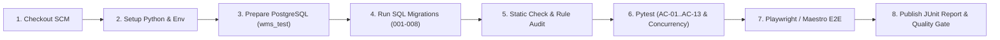
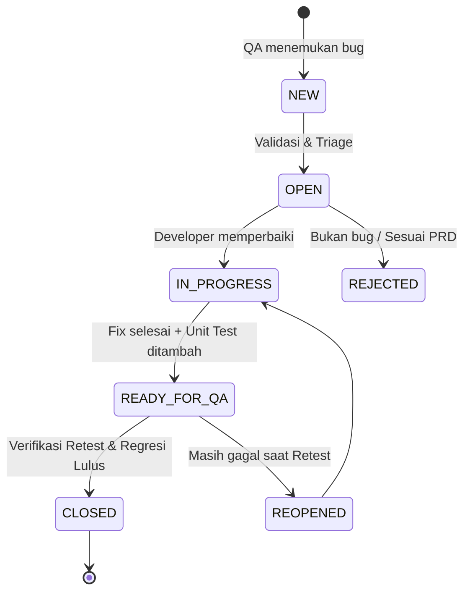

# Dokumen Rencana Pengujian, Otomasi & Ekosistem QA — WMS API

| Informasi Dokumen | Keterangan |
| --- | --- |
| **Nama Proyek** | Warehouse Management System (WMS) |
| **Acuan Dokumen** | `docs/CORE/PRODUCT_REQUIREMENTS_DOCUMENT.MD` (PRD v2.0) & `docs/CORE/FOLDER_STRUCTURE.MD` |
| **Fokus Dokumen** | Test Plan, Automation Testing, Regression Testing, Defect Management, Jenkins CI/CD, Playwright, Maestro, & Microsoft Office |
| **Lokasi Berkas** | `docs/QA/QA.MD` |

---

## Daftar Isi

1. [Test Plan (Rencana Pengujian)](#1-test-plan-rencana-pengujian)
2. [Automation Testing (Pengujian Otomatis)](#2-automation-testing-pengujian-otomatis)
3. [Playwright (E2E API & Web/Swagger Automation)](#3-playwright-e2e-api--webswagger-automation)
4. [Maestro (Pengujian Alur Perangkat Mobile / Handheld Gudang)](#4-maestro-pengujian-alur-perangkat-mobile--handheld-gudang)
5. [Regression Testing (Pengujian Regresi)](#5-regression-testing-pengujian-regresi)
6. [Jenkins (Integrasi Pipeline CI/CD Pengujian)](#6-jenkins-integrasi-pipeline-cicd-pengujian)
7. [Defect Management (Manajemen Bug & Temuan)](#7-defect-management-manajemen-bug--temuan)
8. [Microsoft Office (Administrasi, Pelaporan & Traceability QA)](#8-microsoft-office-administrasi-pelaporan--traceability-qa)

---

## 1. Test Plan (Rencana Pengujian)

### 1.1. Tujuan Pengujian
Memastikan seluruh layanan **WMS REST API** berjalan akurat, aman, bebas *race condition*, dan patuh terhadap seluruh aturan bisnis di PRD v2.0 sebelum naik ke lingkungan produksi.

### 1.2. Ruang Lingkup Pengujian (*Test Scope*)

| Kategori | Cakupan Modul / Fitur |
| --- | --- |
| **In-Scope (Diuji)** | • Autentikasi JWT, rotasi *Refresh Token*, *lockout* 5x gagal login, & RBAC 5 Peran (FR-01, AC-05, AC-11)<br>• *Warehouse Scoping* / penugasan gudang (AC-12)<br>• Master Data & aturan penonaktifan `is_active` / `ENTITY_IN_USE` (FR-02)<br>• Visibilitas stok multi-gudang, stok *in-transit*, & buku besar `stock_movements` (FR-03, FR-08)<br>• Siklus Purchase Order (PO) & Goods Receipt (GR) parsial/penuh, pencegahan *over-receipt* & posting ganda (FR-04, FR-05, AC-01, AC-07, AC-13)<br>• Siklus Transfer Stok antar-gudang/lokasi, pencegahan stok negatif, konkurensi pengiriman, & selisih penerimaan (FR-06, AC-02, AC-03, AC-06, AC-09)<br>• Siklus Stock Opname, saldo awal, pembekuan lokasi (*location freeze*), & penyesuaian stok (FR-07, AC-04, AC-10)<br>• Imutabilitas tabel *append-only* (`stock_movements`, `audit_logs`) & penomoran dokumen (FR-09, FR-10, AC-08)<br>• Pagination, filter, dan performa baca `< 200 ms (p95)` (FR-11, NFR 7.3) |
| **Out-of-Scope (Tidak Diuji)** | Lot/batch/expiry tracking, serial number, valuasi harga pokok (FIFO/LIFO/Average), reservasi stok semu, Goods Issue ke pelanggan, retur pemasok, pembalikan GR `POSTED`, dan konversi UoM. |

### 1.3. Kriteria Masuk & Keluar (*Entry & Exit Criteria*)

* **Entry Criteria (Syarat Mulai Pengujian):**
  1. Database PostgreSQL uji (`wms_test`) tersedia dan seluruh migrasi (`001`–`008`) berhasil dijalankan melalui `python -m db.migrate`.
  2. Role database `wms_owner` (untuk migrasi/reset) dan `wms_app` (untuk aplikasi) telah terkonfigurasi.
  3. Endpoint `GET /health` mengembalikan status `200 OK`.
* **Exit Criteria (Syarat Lulus / Sign-Off):**
  1. **100%** skenario Kriteria Penerimaan (**AC-01 s.d. AC-13**) berstatus **PASS**.
  2. **0** *defect* terbuka dengan tingkat keparahan *Blocker* atau *Critical*.
  3. Waktu respons pembacaan stok dan pencarian master data berada di bawah **200 ms (p95)**.
  4. Seluruh bukti uji dan *Requirement Traceability Matrix* (RTM) telah terdokumentasi.

---

## 2. Automation Testing (Pengujian Otomatis)

Pengujian otomatis menjadi tulang punggung verifikasi WMS API agar setiap aturan transaksi dan penguncian database teruji secara konsisten tanpa intervensi manual.

### 2.1. Arsitektur Otomasi Backend (`pytest` + `httpx`)
* **Tanpa Mock Database:** Seluruh tes otomatis terhubung ke PostgreSQL sungguhan (`wms_test`) menggunakan `psycopg` 3.
* **Isolasi Data Antar-Test:** Menggunakan `TRUNCATE ... RESTART IDENTITY CASCADE` antar pengujian melalui koneksi `wms_owner`, sehingga pengujian konkurensi multi-koneksi dapat melihat data yang sudah di-*commit*.
* **Struktur Modul Otomasi (`tests/`):**
  * `tests/test_auth.py` → Otomasi rotasi token, deteksi pencurian token, dan penguncian akun (**AC-11**).
  * `tests/test_rbac_scoping.py` → Otomasi matriks izin 5 role & pembatasan akses gudang (**AC-05**, **AC-12**).
  * `tests/test_goods_receipt.py` → Otomasi penerimaan parsial, *over-receipt*, *rollback* atomik, & anti-posting ganda (**AC-01**, **AC-07**, **AC-13**).
  * `tests/test_stock_transfer.py` → Otomasi pencegahan stok negatif, *in-transit*, balapan pengiriman paralel, & selisih terima (**AC-02**, **AC-03**, **AC-06**, **AC-09**).
  * `tests/test_stock_opname.py` → Otomasi pembekuan lokasi dan rekonsiliasi selisih opname (**AC-04**, **AC-10**).
  * `tests/test_immutability.py` → Otomasi serangan `UPDATE`/`DELETE` langsung ke tabel *append-only* menggunakan role `wms_app` (**AC-08**).

### 2.2. Otomasi Skenario Konkurensi (*Race Condition*)
Untuk **AC-06** (dua pengiriman Transfer memperebutkan sisa stok yang sama) dan **AC-13** (dua request mem-posting GR yang sama bersamaan), test aktual memakai dua `threading.Thread`, koneksi database terpisah, dan `threading.Barrier(2)` untuk menyinkronkan request serta memverifikasi penguncian `SELECT ... FOR UPDATE`.

---

## 3. Playwright (E2E API & Web/Swagger Automation)

**Status: rencana, belum diimplementasikan di repository.** Suite saat ini memakai `pytest` dan `httpx`; belum ada dependensi/configuration Playwright atau test browser. Skenario di bawah adalah usulan tambahan jika otomasi browser dibutuhkan, bukan bukti cakupan uji yang sudah berjalan.

### 3.1. End-to-End (E2E) API Workflow Testing (`APIRequestContext`)
Playwright dapat memakai `request` context untuk menguji alur bisnis lintas-aktor dari ujung ke ujung:
1. **Context A (Super Admin):** Menyiapkan gudang, lokasi penyimpanan, dan menugaskan staf ke gudang.
2. **Context B (Purchasing Staff):** Membuat pemasok, barang, dan menerbitkan PO (`ISSUED`).
3. **Context C (Warehouse Staff Gudang A):** Mem-posting GR (`POSTED`), membuat Transfer, dan mengirim barang (`SHIPPED`).
4. **Context D (Warehouse Manager):** Menyetujui Transfer (`APPROVED`) dan menyetujui Stock Opname (`COMPLETED`).
5. **Context E (Auditor):** Memverifikasi konsistensi laporan stok, `stock_movements`, dan `audit_logs`.

### 3.2. Otomasi Pengujian Swagger UI (`/docs`) & Kontrak OpenAPI
FastAPI menghasilkan antarmuka dokumentasi interaktif di `/docs` (Swagger UI). Jika Playwright ditambahkan, pengujian yang dapat dibuat meliputi:
* Memastikan halaman `/docs` dan skema `/openapi.json` termuat tanpa error.
* Menguji alur *Authorize* (Bearer JWT) langsung melalui antarmuka Swagger UI dan mengeksekusi *Try it out* pada endpoint utama.
* Menghasilkan rekaman jejak (*Playwright Trace Viewer*, *screenshot*, dan *video*) sebagai bukti uji visual.

### 3.3. Kesiapan Otomasi Dashboard Web (Klien Masa Depan)
Saat antarmuka web manajemen gudang dihubungkan ke WMS API, suite Playwright yang sama diperluas untuk menguji komponen UI tabel paginasi, form transaksi, dan tampilan peringatan error (`INSUFFICIENT_STOCK`, `LOCATION_FROZEN`, dll.).

---

## 4. Maestro (Pengujian Alur Perangkat Mobile / Handheld Gudang)

Operasional fisik di lantai gudang (penerimaan barang di *loading dock*, pemindahan rak, dan penghitungan fisik Stock Opname) umumnya dijalankan oleh *Warehouse Staff* menggunakan perangkat bergerak (*mobile app* / *handheld terminal* / *PDA scanner*) yang berkomunikasi dengan WMS API.

**Status: rencana untuk klien masa depan.** Belum ada aplikasi mobile/handheld dalam repository dan UI berada di luar MVP. Jika klien tersebut dibuat pada fase berikutnya, Maestro dapat digunakan sebagai framework otomasi UI deklaratif berbasis YAML:

### 4.1. Skenario Uji Maestro di Lantai Gudang
1. **`flow_login_and_warehouse_scope.yaml`**
   * Menguji login *Warehouse Staff*, memverifikasi hanya gudang yang ditugaskan yang muncul di layar perangkat, serta menguji penolakan akses (`WAREHOUSE_NOT_ASSIGNED`) bila mencoba mengakses dokumen gudang lain.
2. **`flow_goods_receipt_receiving.yaml`**
   * Menguji pemilihan PO `ISSUED`, pemilihan lokasi *bin/rack*, input kuantitas diterima, posting GR, serta validasi munculnya pesan error `OVER_RECEIPT` bila input melebihi sisa pesanan PO.
3. **`flow_transfer_ship_and_receive_variance.yaml`**
   * Menguji pengiriman barang (`SHIPPED`) dari lokasi asal dan penerimaan barang (`RECEIVED`) di lokasi tujuan, termasuk kewajiban mengisi *Variance Reason* saat kuantitas fisik yang tiba kurang dari kuantitas kirim (**AC-09**).
4. **`flow_stock_opname_physical_count.yaml`**
   * Menguji input hitung fisik (`qty_physical`) per lokasi, penambahan barang temuan baru (`qty_system = 0`), dan pengajuan hasil hitung ke status `WAITING_APPROVAL`.

---

## 5. Regression Testing (Pengujian Regresi)

Pengujian regresi memastikan bahwa penambahan fitur pada tahap berikutnya (M0 → M8), perbaikan *bug*, maupun penambahan berkas migrasi SQL baru tidak merusak fitur yang sudah berjalan dan tidak melanggar invarian bisnis.

### 5.1. Pembagian Suite Regresi

| Tingkat Regresi | Kapan Dijalankan | Cakupan Pengujian | Target Durasi |
| --- | --- | --- | --- |
| **Smoke Test** | Setiap *commit* / sebelum memulai pengujian fitur baru | `GET /health`, migrasi skema `001`–`008`, login Super Admin, dan pembuatan 1 master data dasar. | < 15 detik |
| **Sanity / Module Regression** | Setiap selesai perubahan pada satu modul (mis. ubah `transfer_service.py`) | Seluruh test pada modul terkait + verifikasi invarian `inventory_service.apply_movement()` dan `audit_logs`. | < 1 menit |
| **Full Regression Suite** | Setiap *Pull Request* ke branch utama & sebelum rilis tahap (M1–M8) | Seluruh **AC-01 s.d. AC-13**, test RBAC & *warehouse scoping*, test konkurensi, serta test imutabilitas DB. E2E Playwright masih rencana dan belum termasuk suite aktif. | Target < 3 menit |

### 5.2. Titik Kritis yang Wajib Dijaga pada Setiap Regresi
1. **Invarian Saldo & Ledger:** Tidak boleh ada selisih antara `inventory_balances.qty_on_hand` dengan `qty_after` terakhir pada `stock_movements`.
2. **Imutabilitas Append-Only:** Tabel `stock_movements` dan `audit_logs` tetap menolak `UPDATE` dan `DELETE` (**AC-08**).
3. **Presisi Desimal:** Seluruh respons API untuk kuantitas tetap berupa string desimal 4 angka di belakang koma (`"10.0000"`), tidak berubah menjadi `float`.
4. **Katalog Kode Error:** Status HTTP dan `error.code` tetap konsisten sesuai Lampiran B PRD.

---

## 6. Jenkins (Integrasi Pipeline CI/CD Pengujian)

**Status: rencana, belum dikonfigurasi.** Repository belum berisi `Jenkinsfile` atau konfigurasi Jenkins. Diagram dan tahapan berikut adalah rancangan pipeline yang dapat diterapkan kemudian, bukan status CI/CD aktif.

### 6.1. Rancangan Alur Pipeline Jenkins



### 6.2. Rincian Stage pada Jenkins Pipeline
1. **Checkout & Environment Preparation:** Mengambil kode terbaru dari repositori Git dan menyiapkan *virtual environment* Python beserta dependensi uji (`pytest`, `httpx`, `psycopg[binary,pool]`).
2. **Database Provisioning & Migration:** Menyiapkan container/instance PostgreSQL `wms_test`, menjalankan `db/init/001_create_app_role.sql` (membuat role `wms_app`), lalu menjalankan `python -m db.migrate` menggunakan kredensial `wms_owner`.
3. **Architectural Guard Check:** Memeriksa aturan ketat arsitektur (memastikan tidak ada string SQL di luar `app/repositories/` dan tidak ada penggunaan tipe `float` pada skema kuantitas).
4. **Automated & Regression Test Execution:**
   ```bash
   pytest --junitxml=reports/pytest-results.xml -v
   ```
5. **E2E Execution (opsional/fase mendatang):** Jalankan Playwright/Maestro hanya setelah framework dan klien terkait ditambahkan.
6. **Reporting & Quality Gate (rancangan):** Pipeline yang kelak dibuat dapat mempublikasikan `reports/pytest-results.xml` dan gagal jika ada test yang gagal. Saat ini belum ada gate Jenkins yang memblokir *merge* atau *deployment*.

---

## 7. Defect Management (Manajemen Bug & Temuan)

Setiap ketidaksesuaian antara perilaku aktual aplikasi dengan spesifikasi di `PRODUCT_REQUIREMENTS_DOCUMENT.md` dicatat dan dikelola melalui proses **Defect Management** yang terstruktur.

### 7.1. Siklus Hidup Defect (*Defect Lifecycle*)



### 7.2. Klasifikasi Severity (Tingkat Keparahan) pada Domain WMS

| Severity | Definisi pada Aplikasi WMS | Contoh Kasus |
| --- | --- | --- |
| **S1 — Blocker / Critical** | Melanggar invarian bisnis utama, merusak integritas stok/ledger, atau celah keamanan fatal. | • Stok menjadi negatif saat `allow_negative_stock = FALSE` (**AC-02**/**AC-06** gagal).<br>• GR terposting ganda saat diklik bersamaan (**AC-13** gagal).<br>• Tabel `stock_movements` atau `audit_logs` bisa di-`UPDATE`/`DELETE` (**AC-08** gagal).<br>• Kebocoran `password_hash` di respons API atau `audit_logs`. |
| **S2 — Major** | Fitur utama tidak berfungsi sesuai state machine atau aturan validasi PRD, namun tidak merusak data yang sudah ada. | • Lokasi yang sedang Stock Opname `IN_PROGRESS` masih bisa menerima GR (**AC-10** gagal).<br>• Penerimaan parsial tidak mengubah status PO ke `PARTIALLY_RECEIVED` (**AC-01**).<br>• Kode error HTTP tidak sesuai katalog Lampiran B PRD. |
| **S3 — Minor** | Kesalahan fungsional minor, filter/paginasi kurang tepat, atau performa sedikit di atas target. | • Filter rentang tanggal pada *ledger* kurang inklusif pada batas akhir.<br>• Waktu baca stok 230 ms (target < 200 ms). |
| **S4 — Trivial / Cosmetic** | Kesalahan pengetikan pesan (`message`) pada respons JSON atau dokumentasi OpenAPI/Swagger. | • Typo deskripsi field pada halaman `/docs`. |

### 7.3. Standar Isi Laporan Defect (*Bug Report Template*)
Setiap tiket bug wajib mencantumkan:
1. **ID & Judul Defect:** Contoh `[BUG-WMS-014] GR dapat diposting ke lokasi yang sedang dibekukan Opname`.
2. **Referensi PRD / AC:** Contoh `FR-07, Bab 6.6, AC-10`.
3. **Environment & Commit Hash:** Branch, versi migrasi DB, dan role pengguna yang dipakai.
4. **Langkah Reproduksi (*Steps to Reproduce*):** Urutan endpoint HTTP, method, dan payload JSON.
5. **Request ID (`X-Request-ID`):** Diambil dari header respons untuk memudahkan penelusuran log terstruktur server.
6. **Expected vs Actual Result:** Perbandingan status HTTP, `error.code`, serta isi tabel DB (`inventory_balances`, `stock_movements`, `audit_logs`).

---

## 8. Microsoft Office (Administrasi, Pelaporan & Traceability QA)

Selain kakas otomasi, file Excel/Word/PowerPoint di bagian ini adalah format keluaran yang disarankan untuk tata kelola dan pelaporan QA; file maupun alur Office tersebut tidak dihasilkan oleh service API saat ini:

### 8.1. Microsoft Excel — Matriks & Pelacakan Data Uji
Digunakan untuk mengelola lembar kerja (*workbook*) QA yang terdiri dari beberapa *sheet* utama:
1. **Sheet `RTM (Requirement Traceability Matrix)`:** Memetakan setiap kebutuhan fungsional (**FR-01 s.d. FR-11**), aturan validasi (**Bab 6.1 s.d. 6.9**), dan kriteria penerimaan (**AC-01 s.d. AC-13**) ke ID Test Case manual maupun nama fungsi `pytest` otomatis, sehingga menjamin cakupan pengujian **100%**.
2. **Sheet `Master Test Cases & Execution Log`:** Berisi daftar skenario uji terperinci (ID Test Case, Modul, Role Pengguna, Pre-condition, Test Data, Langkah Uji, Expected HTTP Status & Error Code, Actual Result, Status `PASS`/`FAIL`, dan Tanggal Eksekusi).
3. **Sheet `Simulasi & Rekonsiliasi Ledger`:** Kertas kerja rumus desimal 4 digit (`0.0000`) untuk memvalidasi skenario berantai (PO → GR Parsial → Transfer Kirim → Transfer Terima Berselisih → Stock Opname) guna mencocokkan perhitungan manual independen dengan hasil `inventory_balances` dan `stock_movements`.
4. **Sheet `Defect Log & Metrics`:** Rekapitulasi temuan bug beserta *Pivot Table* distribusi *defect* berdasarkan modul dan tingkat *Severity*.

### 8.2. Microsoft Word — Dokumen Formal & Berita Acara UAT
Digunakan untuk menyusun dokumen formal yang memerlukan tanda tangan persetujuan (*sign-off*):
1. **Dokumen Master Test Plan (MTP):** Versi cetak formal dari rencana pengujian untuk ditinjau bersama pemilik proyek.
2. **Berita Acara User Acceptance Testing (UAT Sign-Off Document):** Dokumen bukti kelulusan **AC-01 s.d. AC-13** yang dilengkapi tangkapan layar respons API, bukti isi tabel database, dan lembar pengesahan rilis.

### 8.3. Microsoft PowerPoint — Laporan Eksekutif Kualitas (*QA Summary Deck*)
Digunakan pada saat *Sprint Review* atau *Milestone Gate Review* (M0 s.d. M8) untuk mempresentasikan:
1. Ringkasan progres kesiapan kualitas per milestone (**M0 Fondasi** hingga **M8 Pengerasan**).
2. Metrik eksekusi pengujian (*Pass Rate*, jumlah test otomatis di Jenkins, serta waktu eksekusi rata-rata).
3. Hasil pengujian non-fungsional (grafik persentil waktu respons query stok `< 200 ms` dan hasil uji konkurensi).
4. Status penyelesaian *defect* dan rekomendasi kelayakan rilis (*Go / No-Go Decision*).

