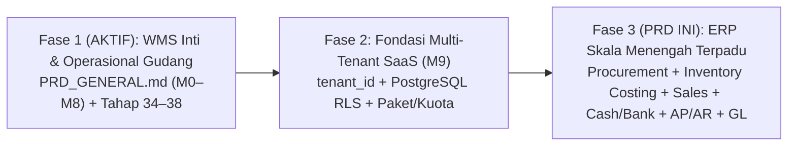
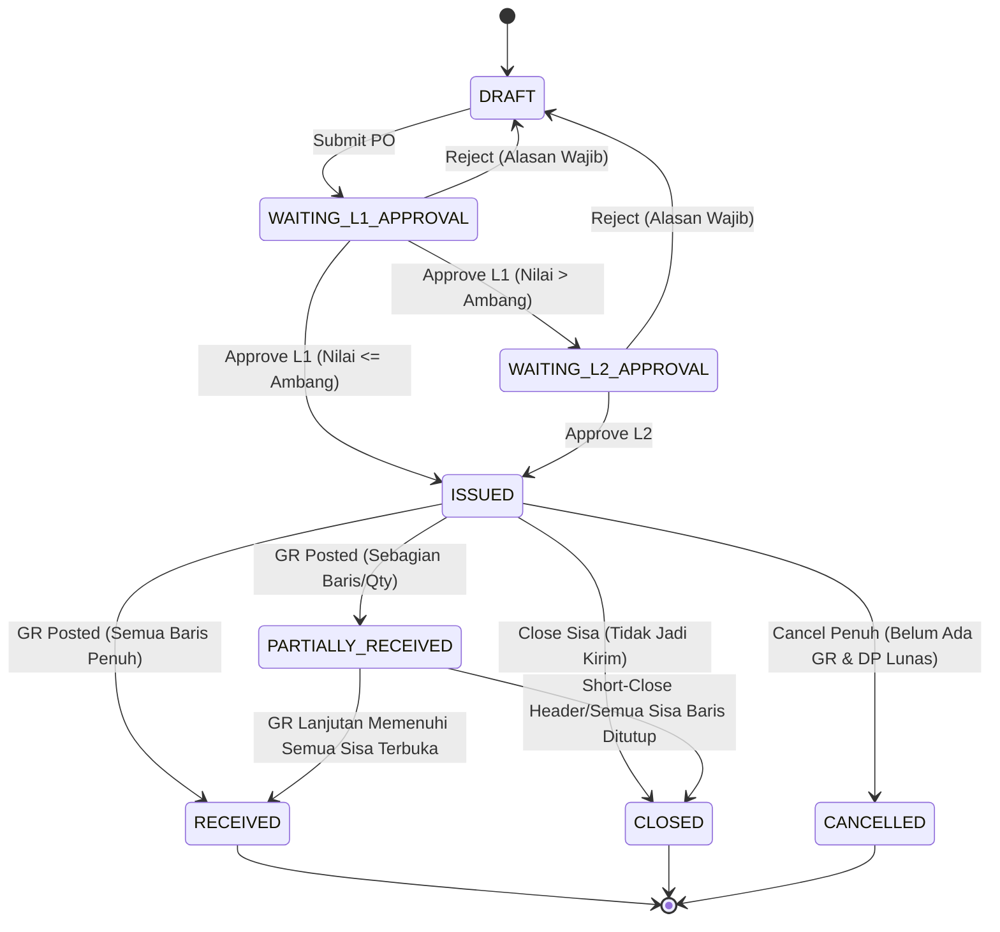

# PRD ERP Terpadu — JejakStok *(Analisis & Perancangan Fase Lanjutan)*

| Informasi | Nilai |
| :--- | :--- |
| Status | **Draft Analisis & Perancangan (BELUM UNTUK IMPLEMENTASI)** |
| Versi | `0.1-erp-analysis` |
| Prasyarat Eksekusi | Wajib menuntaskan seluruh fase **WMS (`PRD_GENERAL.md` + Tahap 34–38)** dan fondasi **Multi-Tenant SaaS (Fase 2 / M9)** sebelum satu baris kode ERP diimplementasikan |
| Cakupan Siklus Bisnis | 1. Pengadaan & Pembelian (*Procurement*) · 2. Persediaan & Multi-Gudang (*Inventory & Costing*) · 3. Penjualan & Distribusi (*Sales & Distribution*) · 4. Manajemen Kas & Bank (*Cash & Bank*) · 5. Buku Hutang & Piutang (*AP & AR Sub-ledgers*) · 6. Akuntansi Umum & Pelaporan Keuangan (*General Ledger, Balance Sheet, P&L*) |
| Rujukan Utama WMS | [PRD_GENERAL.md](PRD_GENERAL.md) · [DATABASE_DESIGN.md](DATABASE_DESIGN.md) · [SCHEMA_DATABASE.MD](SCHEMA_DATABASE.MD) |

> **Pembatasan Eksekusi Penting:** Dokumen ini disusun semata-mata sebagai cetak biru analisis bisnis dan perancangan arsitektur ERP agar seluruh keputusan desain pada fase WMS tidak menimbulkan utang teknis (*breaking change*) di masa depan. **Seluruh requirement dengan awalan `ERP-*` di dokumen ini berstatus `Future Development (Post-M9)` dan dilarang diimplementasikan sebelum fase WMS selesai sepenuhnya.**

---

## Daftar Isi

- [1. Tujuan & Peta Jalan Transisi WMS ke ERP](#1-tujuan--peta-jalan-transisi-wms-ke-erp)
- [2. Penyelarasan Arsitektur WMS dengan 6 Siklus Bisnis ERP](#2-penyelarasan-arsitektur-wms-dengan-6-siklus-bisnis-erp)
- [3. Spesifikasi Harga, Pajak, & Diskon Bertingkat pada Purchase Order (`ERP-PUR`)](#3-spesifikasi-harga-pajak--diskon-bertingkat-pada-purchase-order-erp-pur)
- [4. Analisis Mendalam 13 Skenario & Kendala Bisnis Purchase Order](#4-analisis-mendalam-13-skenario--kendala-bisnis-purchase-order)
  - [Skenario 1 — Diskon Harga Barang (Per Item & Keseluruhan PO)](#skenario-1--diskon-harga-barang-per-item--keseluruhan-po)
  - [Skenario 2 — Barang Dipesan Tidak Dapat Dipenuhi Sama Sekali oleh Supplier](#skenario-2--barang-dipesan-tidak-dapat-dipenuhi-sama-sekali-oleh-supplier)
  - [Skenario 3 — Supplier Mengirimkan Barang Hanya Sebagian (*Partial Delivery*)](#skenario-3--supplier-mengirimkan-barang-hanya-sebagian-partial-delivery)
  - [Skenario 4 — Supplier Terlambat Mengirimkan Barang dari Tanggal yang Disepakati](#skenario-4--supplier-terlambat-mengirimkan-barang-dari-tanggal-yang-disepakati)
  - [Skenario 5 — Barang Sudah Tidak Diproduksi atau Stok Supplier Habis (*Discontinued / Out of Stock*)](#skenario-5--barang-sudah-tidak-diproduksi-atau-stok-supplier-habis-discontinued--out-of-stock)
  - [Skenario 6 — Perubahan Harga Barang Setelah PO Diterbitkan](#skenario-6--perubahan-harga-barang-setelah-po-diterbitkan)
  - [Skenario 7 — Pembatalan PO (Sebagian Item maupun Seluruh Pesanan)](#skenario-7--pembatalan-po-sebagian-item-maupun-seluruh-pesanan)
  - [Skenario 8 — Perubahan Jumlah Barang yang Dipesan Setelah PO Disetujui](#skenario-8--perubahan-jumlah-barang-yang-dipesan-setelah-po-disetujui)
  - [Skenario 9 — Barang Diterima Tidak Sesuai Jumlah, Spesifikasi, atau Kualitas](#skenario-9--barang-diterima-tidak-sesuai-jumlah-spesifikasi-atau-kualitas)
  - [Skenario 10 — Supplier Mengirimkan Barang Pengganti dengan Spesifikasi Berbeda](#skenario-10--supplier-mengirimkan-barang-pengganti-dengan-spesifikasi-berbeda)
  - [Skenario 11 — Perbedaan Harga antara PO dengan Tagihan / Invoice Supplier](#skenario-11--perbedaan-harga-antara-po-dengan-tagihan--invoice-supplier)
  - [Skenario 12 — Pengembalian Barang kepada Supplier (*Purchase Return*)](#skenario-12--pengembalian-barang-kepada-supplier-purchase-return)
  - [Skenario 13 — Perubahan Estimasi Pengiriman (*ETA*) & Penjadwalan Ulang Penerimaan](#skenario-13--perubahan-estimasi-pengiriman-eta--penjadwalan-ulang-penerimaan)
- [5. Evolusi Status PO, Baris PO, Matriks Jurnal, & Penyelarasan PO-Invoice](#5-evolusi-status-po-baris-po--matriks-dampak-jurnal-akuntansi)
- [6. Keterkaitan Lintas Modul ERP & Checklist Kesiapan dari Fase WMS](#6-keterkaitan-lintas-modul-erp--checklist-kesiapan-dari-fase-wms)

---

## 1. Tujuan & Peta Jalan Transisi WMS ke ERP

JejakStok dibangun dengan strategi evolusi tiga gelombang agar setiap fase solid dan teruji sebelum menambah kompleksitas akuntansi dan komersial:

### Prinsip Anti-Konflik dengan Arsitektur WMS Saat Ini
1. **Mempertahankan Contract Boundary WMS**: Modul penerimaan (`RCV`) tetap berkomunikasi ke modul pembelian (`PUR`) melalui kontrak layanan (`apply_receipt`, `gr_status_summary`) dan ke persediaan (`INV`) melalui gerbang tunggal `apply_movement`. Modul akuntansi (`GL`) dan hutang (`AP`) **tidak menulis langsung** ke `inventory_balances` atau `purchase_orders`, melainkan berlangganan/dipanggil sebagai *downstream domain hook* atau layanan terpisah dalam transaksi atomik.
2. **Ledger Tetap *Append-Only***: `stock_movements` dan `audit_logs` tetap tidak boleh di-`UPDATE` atau di-`DELETE`. Koreksi kesalahan fisik maupun nilai finansial pada ERP dilakukan lewat **dokumen koreksi/pembalik resmi** (*Purchase Return*, *Credit/Debit Note*, *Inventory Cost Adjustment*, atau *Journal Reversal*).
3. **Evolusi Status PO Backward-Compatible**: Status PO WMS saat ini (`DRAFT`, `ISSUED`, `PARTIALLY_RECEIVED`, `RECEIVED`, `CLOSED`, `CANCELLED`) tetap dipertahankan. Penambahan alur approval berjenjang (`WAITING_L1_APPROVAL` / `WAITING_L2_APPROVAL`), amandemen/revisi versi, serta penutupan parsial per baris (`po_lines`) dirancang memperkaya siklus tersebut tanpa mematahkan alur GR WMS.

---

## 2. Penyelarasan Arsitektur WMS dengan 6 Siklus Bisnis ERP

| Siklus Bisnis ERP | Kode Modul Usulan | Fondasi WMS Saat Ini | Ekspansi Utama di Fase ERP |
| :--- | :---: | :--- | :--- |
| **1. Pengadaan & Pembelian** (*Procurement*) | `PRQ`, `PUR`, `RCV`, `PRTN` | `purchase_orders`, `po_lines`, `goods_receipts`, `gr_lines`, `suppliers` | *Purchase Requisition (PR)*, *RFQ*, harga satuan, diskon item & header, pajak/PPN, biaya kirim, revisi/amandemen berversi, *short-close* per baris, QC karantina, & *Purchase Return*. |
| **2. Persediaan & Multi-Gudang** (*Inventory & Warehouse*) | `INV`, `WHS`, `TRF`, `OPN`, `VAL` | `inventory_balances`, `stock_movements` (qty), lokasi beku, barcode/QR | Layer biaya (*Inventory Valuation*: FIFO / *Weighted Average*), `unit_cost` pada `stock_movements`, alokasi/reservasi stok untuk Sales Order, *Min/Max Reorder Point*, & mutasi bernilai rupiah. |
| **3. Penjualan & Distribusi** (*Sales & Distribution*) | `SLS`, `SHP`, `SRTN` | *(Baru)* — mencerminkan pola `PUR`/`RCV`/`TRF` | Master Pelanggan (*Customers*), *Sales Quotation*, *Sales Order (SO)*, reservasi stok, *Picking/Packing*, *Delivery Order (Surat Jalan Penjualan)*, & *Sales Return*. |
| **4. Manajemen Kas & Bank** (*Cash & Bank*) | `CSH` | *(Baru)* | Master akun Kas & Rekening Bank perusahaan, *Cash/Bank Receipt*, *Cash/Bank Payment*, transfer internal kas-bank, dan rekonsiliasi mutasi rekening koran. |
| **5. Buku Hutang & Piutang** (*AP & AR Sub-ledgers*) | `FIN-AP`, `FIN-AR` | `suppliers` *(akan diperkaya Bank, NPWP, Termin)* | *Vendor Bill (AP Invoice)* dengan *3-Way Matching* (`PO ↔ GR ↔ Invoice`), *Customer Invoice (AR)*, *Debit/Credit Note*, uang muka (*Down Payment*), & laporan *AP/AR Aging*. |
| **6. Akuntansi Umum & Laporan Keuangan** (*General Ledger*) | `FIN-GL`, `RPT` | `audit_logs` (*append-only*) | *Chart of Accounts (COA)*, periode akuntansi (*Fiscal Period & Closing*), *Auto-Journal Rules*, *Manual Journal*, Buku Besar (*GL / Trial Balance*), **Neraca (*Balance Sheet*)**, & **Laba Rugi (*Profit & Loss*)**. |

---

## 3. Spesifikasi Harga, Pajak, & Diskon Bertingkat pada Purchase Order (`ERP-PUR`)

Saat ini di fase WMS (`004_create_purchasing_tables.sql`), tabel `purchase_orders` dan `po_lines` baru mencatat kuantitas (`qty_ordered`, `qty_received`) tanpa nominal uang. Di fase ERP, struktur harga dan diskon harus mendukung kebutuhan komersial B2B tanpa menimbulkan selisih pembulatan akuntansi.

### 3.1 Struktur Field Harga & Diskon yang Direkomendasikan

1. **Level Baris (`po_lines`)**:
   - `unit_price NUMERIC(18, 4)` *(harga satuan bruto sebelum diskon)*
   - `line_discount_type VARCHAR(20)` (`NONE` | `PERCENT` | `FIXED_AMOUNT`)
   - `line_discount_value NUMERIC(18, 4)` *(nilai % `0..100` atau nominal pengurang total baris/per unit — disarankan definisi eksplisit: **total nominal diskon baris** atau tambah `line_discount_amount` hasil hitung agar tidak ambigu saat partial receiving)*
   - `line_discount_amount NUMERIC(18, 4)` *(nominal diskon aktual dalam mata uang PO untuk baris tersebut)*
   - `line_tax_rate NUMERIC(7, 4)` *(tarif PPN/pajak baris, mis. `11.0000` atau `0` untuk non-PKP / barang bebas pajak)*
   - `line_subtotal NUMERIC(18, 2)` (`qty_ordered * unit_price`)
   - `line_net_amount NUMERIC(18, 2)` (`line_subtotal - line_discount_amount`)

2. **Level Header (`purchase_orders`)**:
   - `currency_code VARCHAR(3)` (default `IDR`), `exchange_rate NUMERIC(18, 6)` (default `1`)
   - `items_net_total NUMERIC(18, 2)` (penjumlahan seluruh `line_net_amount`)
   - `order_discount_type VARCHAR(20)` (`NONE` | `PERCENT` | `FIXED_AMOUNT`)
   - `order_discount_value NUMERIC(18, 4)`
   - `order_discount_amount NUMERIC(18, 2)` *(maksimal `<= items_net_total`)*
   - `tax_mode VARCHAR(20)` (`EXCLUSIVE` | `INCLUSIVE` | `NON_TAX`)
   - `tax_total NUMERIC(18, 2)`
   - `additional_cost NUMERIC(18, 2)` *(ongkos kirim / biaya asuransi yang dibebankan ke PO, opsional)*
   - `grand_total NUMERIC(18, 2)` (`items_net_total - order_discount_amount + tax_total + additional_cost`)

### 3.2 Aturan Penting Perhitungan Diskon & Dampaknya ke Valuasi Stok (*HPP*)
- **Urutan Kalkulasi Baku**: `Harga Bruto` → kurangi **Diskon Baris** → kurangi **Diskon Header PO (dialokasikan proporsional/*pro-rata* ke tiap baris berdasarkan bobot `line_net_amount / items_net_total`)** → hitung **PPN/Pajak** atas Dasar Pengenaan Pajak (DPP) neto.
- **Alokasi ke Nilai Stok Gudang (`unit_cost`)**: Saat barang diterima di `Goods Receipt (GR)`, nilai persediaan yang masuk ke akun **Persediaan (Asset)** dan **GRNI (Hutang Penerimaan Belum Ditagih)** harus menggunakan **harga neto setelah diskon baris + proporsi diskon keseluruhan PO** (bukan harga bruto!). *Contoh:* jika barang Rp 100.000 diberi diskon item 10% (`Rp 90.000`) lalu ada diskon PO keseluruhan 5%, maka biaya perolehan yang masuk ke valuasi stok adalah `Rp 85.500` (ditambah PPN hanya bila perusahaan tidak berstatus PKP / PPN tidak dapat dikreditkan).
- **Pembulatan (*Rounding Guard*)**: Sisa pembulatan rupiah akibat alokasi pro-rata diskon header antar-baris diarahkan ke baris terakhir (*penny allocation rule*) agar penjumlahan alokasi per baris selalu sama persis dengan `order_discount_amount`.

---

## 4. Analisis Mendalam 13 Skenario & Kendala Bisnis Purchase Order

Setiap skenario berikut dirancang agar **kompatibel dengan arsitektur kontrak WMS** dan **siap terintegrasi dengan AP, Cash/Bank, dan General Ledger di fase ERP**.

---

### Skenario 1 — Diskon Harga Barang (Per Item & Keseluruhan PO)
1. **Contoh Kasus & Alur Kejadian**:
   - Purchasing memesan 100 unit *Barang A* (@ Rp 50.000, diskon item 10% karena beli partai besar) dan 20 unit *Barang B* (@ Rp 100.000, tanpa diskon item). Karena total belanja mencapai nilai tertentu, supplier memberikan tambahan **diskon akhir PO Rp 250.000** (*header discount*).
2. **Dampak**:
   - **Status PO**: Tetap mengikuti alur normal (`DRAFT` → approval bertingkat → `ISSUED`). Namun nilai `grand_total` bersih berubah sehingga menentukan *tier approval nominal*!
   - **Stok & GR**: Kuantitas tetap `100` & `20`; sistem menghitung `effective_unit_cost` masing-masing item secara pro-rata saat GR diposting.
   - **Keuangan**: Jurnal GRNI (*Accrued Payable*) saat GR diposting dan verifikasi AP Invoice memakai nilai neto setelah kedua jenis diskon (bukan bruto), sehingga tidak muncul selisih semu di P&L.
3. **Penanganan Sistem**:
   - Form PO menyediakan input diskon per baris (`%` atau `Rp`) dan blok ringkasan diskon total PO (`%` atau `Rp`), menampilkan **Subtotal Bruto**, **Diskon Item**, **Diskon PO**, **DPP**, **PPN**, dan **Grand Total**.
   - Untuk pengiriman bertahap (`PARTIALLY_RECEIVED`), nilai `order_discount_amount` yang dialokasikan ke tiap unit sudah dikunci sebagai `effective_unit_cost` per baris PO pada saat PO `ISSUED` (menggunakan `effective_line_net / qty_ordered`).
4. **Status, Validasi, & Persetujuan Tambahan**:
   - Validasi: `line_discount_amount <= line_subtotal`; `order_discount_amount <= items_net_total`; diskon tidak boleh menghasilkan `grand_total < 0`.
   - Jika pemberian/perubahan diskon mengubah `grand_total` melewati ambang batas approval, sistem mengevaluasi jenjang approval (`L1` / `L2`) berdasarkan `grand_total` final.
5. **Keterkaitan Modul**:
   - `PUR` (hitungan PO & cetak PDF PO mencantumkan rincian diskon) → `RCV`/`VAL` (mencatat `unit_cost` neto di `stock_movements`) → `FIN-AP` (*3-way match* membandingkan harga neto tagihan) → `FIN-GL` (jurnal persediaan neto).

---

### Skenario 2 — Barang Dipesan Tidak Dapat Dipenuhi Sama Sekali oleh Supplier
1. **Contoh Kasus & Alur Kejadian**:
   - PO sudah diterbitkan (`ISSUED`) kepada Supplier X untuk 50 unit mesin. Tiga hari kemudian supplier mengabarkan via surat/WA bahwa kuota impor mereka gagal atau izin edar habis sehingga **0% pesanan dapat dikirim** dan PO dibatalkan total.
2. **Dampak**:
   - **Status PO**: Harus berakhir pada status terminal **`CANCELLED`** (bila belum ada GR sama sekali) atau **`CLOSED`** (bila sistem memilih jejak *closed-unfulfilled*).
   - **Stok & GR**: Tidak ada pergerakan stok (`0` `stock_movements`), `qty_received = 0`. Tidak boleh ada GR baru yang bisa dibuat dari PO ini.
   - **Keuangan**: Tidak ada jurnal persediaan maupun hutang (*AP*). Namun **komitmen anggaran pembelian (*PO Commitment / Encumbrance*)** dilepas kembali ke `0`, dan jika perusahaan terlanjur membayar **Uang Muka (*Down Payment / Prepayment*)**, timbul piutang pengembalian dana (*Vendor Refund / Deposit Receivable*).
3. **Penanganan Sistem**:
   - Apabila **belum ada GR** dan **belum ada pembayaran Uang Muka**, tombol **`Batalkan PO`** (`CANCELLED`) langsung aktif dengan pilihan alasan terstruktur (*"Supplier tidak sanggup memenuhi"*, *"Harga/ketentuan tidak sepakat"*, dll.).
   - Apabila **sudah ada Uang Muka (`DP > 0`)**: sistem **memblokir** pembatalan langsung sebelum dokumen *AP Prepayment Refund / Credit Settlement* dibuat atau dicatat sebagai saldo deposit vendor.
4. **Status, Validasi, & Persetujuan Tambahan**:
   - Memerlukan field `cancellation_reason` wajib.
   - Jika nilai PO besar atau sudah melampaui tahap approval direksi, pembatalan diizinkan bagi `po:cancel` (Purchasing Manager) dan memicu notifikasi ke tim Gudang & Keuangan agar tidak menunggu kedatangan barang.
5. **Keterkaitan Modul**:
   - `PUR` ↔ `RCV` (mengunci pembuatan GR) ↔ `FIN-AP` / `CSH` (pengecekan uang muka/refund bila sudah bayar DP) ↔ `AUD` (jejak alasan pembatalan).

---

### Skenario 3 — Supplier Mengirimkan Barang Hanya Sebagian (*Partial Delivery*)
1. **Contoh Kasus & Alur Kejadian**:
   - PO memesan: **Barang 1 (`10` unit)**, **Barang 2 (`10` unit)**, **Barang 3 (`10` unit)**.
   - Pengiriman Truk #1 datang membawa **Barang 1 (`10` penuh)**, **Barang 2 (`4` sebagian)**, dan **Barang 3 (`0` belum dikirim)**. Pengiriman sisa dijanjikan menyusul di Truk #2 minggu depan—atau bisa juga sisa Barang 2 ternyata tidak jadi dikirim sementara Barang 3 menyusul.
2. **Dampak**:
   - **Status PO**: Saat GR #1 diposting, PO masuk ke status **`PARTIALLY_RECEIVED`**. Jika nanti seluruh sisa datang → **`RECEIVED`**. Jika sebagian sisa dipastikan tidak dikirim → ditutup sebagian (**`CLOSED`**).
   - **Stok & GR**: GR #1 hanya menambah stok Barang 1 (+10) dan Barang 2 (+4). Sisa terbuka tetap tercatat: Barang 1 (`0`), Barang 2 (`6`), Barang 3 (`10`).
   - **Keuangan**:
     - Nilai `GRNI` / Persediaan di GL hanya diakui sebesar barang yang benar-benar diterima di GR #1 (`10 × cost_1 + 4 × cost_2`).
     - Supplier dapat menagih bertahap per pengiriman (*partial vendor bill* sesuai GR #1) atau menunggu PO selesai penuh.
3. **Penanganan Sistem**:
   - Menjaga mekanisme WMS yang sudah ada (`PARTIALLY_RECEIVED` + batas `remaining = qty_ordered - qty_received` per baris di `gr_service.py`) **dan memperluasnya** dengan:
     1. Pelacakan **`qty_invoiced`** terpisah dari **`qty_received`** pada `po_lines` / `gr_lines` agar tagihan AP tahu mana GR yang sudah ditagih dan mana yang belum.
     2. **Aksi *Short-Close* Per Baris (`po_lines`)** *(dibahas detail di Skenario 5 & 7)* untuk menangani kasus campuran (mis. Barang 2 sisa `6` ditutup, sementara Barang 3 masih ditunggu di GR #2).
4. **Status, Validasi, & Persetujuan Tambahan**:
   - Tidak butuh status header baru di luar `PARTIALLY_RECEIVED` & `CLOSED`, namun di **level baris (`po_lines`)** ditambahkan status baris (`OPEN` | `PARTIALLY_RECEIVED` | `FULFILLED` | `SHORT_CLOSED` | `CANCELLED`) dan `qty_closed`.
5. **Keterkaitan Modul**:
   - `PUR` (kolom *Dipesan / Diterima / Ditutup / Sisa / Ditagih*) ↔ `RCV` (GR #1, GR #2) ↔ `INV`/`VAL` (valuasi masuk per tanggal posting masing-masing GR) ↔ `FIN-AP` (*3-Way Match* berbasis `gr_lines`).

---

### Skenario 4 — Supplier Terlambat Mengirimkan Barang dari Tanggal yang Disepakati
1. **Contoh Kasus & Alur Kejadian**:
   - PO diterbitkan 1 November dengan kesepakatan *Estimasi Tiba (`expected_delivery_date`)* 10 November. Hingga 18 November barang belum juga tiba (*terlambat 8 hari*), sementara stok gudang menipis dan produksi/penjualan terancam kosong.
2. **Dampak**:
   - **Status PO**: Secara proses dokumen masih **`ISSUED`** atau **`PARTIALLY_RECEIVED`**, namun **secara SLA/operasional masuk kondisi `OVERDUE`** (dihitung dinamis jika `current_date > expected_delivery_date` dan masih ada `qty_remaining > 0`).
   - **Stok & GR**: Stok belum bertambah sehingga memicu risiko *stockout*; kartu *"Perhatian Stok Kritis"* di Dashboard tetap merah, namun tim perlu tahu bahwa PO penggantinya *sedang terlambat*.
   - **Keuangan**: Belum ada dampak jurnal GL/AP sebelum GR diposting, namun dapat memengaruhi skor evaluasi vendor (*Supplier On-Time Delivery Rate*) atau denda keterlambatan (*Late Penalty / Claim*) sesuai kontrak B2B.
3. **Penanganan Sistem**:
   - Menambahkan `expected_delivery_date` pada `purchase_orders` (opsional di baris jika beda jadwal per item) + filter **`Terlambat (Overdue)`** di daftar PO dan widget Dashboard *"PO Melewati Tenggat Kirim"*.
   - Menyediakan 3 jalur tindak lanjut langsung dari modal PO terlambat:
     1. **Jadwal Ulang ETA** (*lihat Skenario 13*) + catat log tindak lanjut supplier,
     2. **Tutup PO (`CLOSED`) karena melewati batas waktu** agar tim dapat segera menerbitkan PO baru ke supplier cadangan,
     3. *(Opsional ERP Lanjutan)* Catat potongan denda keterlambatan pada tagihan AP jika kontrak mengatur penalti SLA.
4. **Status, Validasi, & Persetujuan Tambahan**:
   - Tidak mengubah `status` utama transaksi agar FSM tetap bersih; cukup atribut turunan `is_overdue` + `days_overdue`. Penutupan paksa karena keterlambatan memakai izin `po:close` dengan alasan baku *"Pengiriman melebihi batas SLA"*.
5. **Keterkaitan Modul**:
   - `PUR` ↔ `DSH` (alert keterlambatan & kalkulasi stok dalam perjalanan dari supplier/*on-order*) ↔ `MST` (metrik performa *lead time* supplier) ↔ `FIN-AP` (opsional klaim denda).

---

### Skenario 5 — Barang Sudah Tidak Diproduksi atau Stok Supplier Habis (*Discontinued / Out of Stock*)
1. **Contoh Kasus & Alur Kejadian**:
   - PO berisi 3 jenis barang. Setelah Barang 1 dikirim penuh dan Barang 2 dikirim 4 dari 10 unit, supplier resmi menginformasikan bahwa **sisa 6 unit Barang 2 sudah stop produksi (*discontinued*) atau stok pabriknya habis total**, sedangkan Barang 3 tetap dikirim.
2. **Dampak**:
   - **Status PO**: Bila hanya men-`CLOSED`-kan header PO sebelum Barang 3 datang, Barang 3 akan ikut terblokir! Dengan *Line-level Short-Close*, baris Barang 2 berakhir `SHORT_CLOSED` (`qty_received = 4`, `qty_closed = 6`), sedangkan header PO **tetap `PARTIALLY_RECEIVED`** menunggu Barang 3. Ketika Barang 3 selesai di-GR, PO otomatis menjadi **`CLOSED`** (karena ada item yang selesai lewat *short-close*, bukan `RECEIVED` murni).
   - **Stok & GR**: Sisa 6 unit tidak pernah menjadi saldo stok maupun ekspektasi *open on-order* lagi. Gudang tidak lagi melihat hutang penerimaan untuk Barang 2.
   - **Keuangan**: Tagihan AP hanya dapat mencocokkan **4 unit** Barang 2 (`qty_received`). Komitmen PO sebesar 6 unit sisa dilepas otomatis agar tidak membebani laporan *PO Open Commitment*.
3. **Penanganan Sistem**:
   - Aksi **`Tutup Sisa Baris` (*Line Short-Close*)** pada baris PO yang masih memiliki `qty_remaining > 0`, wajib mengisi alasan (*"Barang discontinue / stop produksi"*, *"Stok supplier habis"*) dan otomatis memblokir baris tersebut pada form pembuatan GR berikutnya.
   - Opsional di detail PO: tombol pintasan **"Buat Draft PO Baru untuk Item Pengganti / Sisa ke Supplier Lain"** agar tim Purchasing tidak input ulang manual dari nol.
4. **Status, Validasi, & Persetujuan Tambahan**:
   - Menambahkan kolom pada `po_lines`: `qty_closed NUMERIC(18, 4) DEFAULT 0`, `line_status`, `line_closed_reason`, `line_closed_at`, `line_closed_by`.
   - Constraint baru pengganti/perluasan `ck_po_lines_qty_received_bounds`: `qty_received >= 0 AND qty_closed >= 0 AND (qty_received + qty_closed) <= qty_ordered`.
   - Syarat: tidak boleh ada GR berstatus `DRAFT` yang masih mereferensikan baris tersebut. Hak akses: `po:close` (dengan aturan *Segregation of Duties*).
5. **Keterkaitan Modul**:
   - `PUR` (status baris & tombol *duplicate to new supplier*) ↔ `RCV` (menghitung `remaining = qty_ordered - qty_received - qty_closed`) ↔ `MST` (opsional menandai item/supplier katalog *discontinued*) ↔ `FIN-AP` (menutup sisa komitmen PO).

---

### Skenario 6 — Perubahan Harga Barang Setelah PO Diterbitkan
1. **Contoh Kasus & Alur Kejadian**:
   - PO sudah `ISSUED` pada harga Rp 100.000/unit. Sebelum barang dikirim (atau saat barang dikirim), supplier memberi tahu kenaikan harga bahan baku menjadi Rp 110.000/unit karena fluktuasi kurs/BBM.
2. **Dampak**:
   - **Status PO**: Jika belum ada GR dan perubahan disepakati **resmi sebelum penerimaan**, PO harus melalui **Revisi / Amandemen PO** (status kembali ke proses approval jika kenaikan melampaui toleransi atau ambang batas).
   - **Stok & GR**: Jika revisi harga disetujui *sebelum* GR diposting, valuasi stok `inventory_service`/`VAL` langsung memakai harga baru Rp 110.000. Jika revisi terjadi *setelah* GR diposting, muncul selisih biaya antara nilai GRNI lama (Rp 100.000) dengan invoice (Rp 110.000) *(lihat Skenario 11)*.
   - **Keuangan**: Menaikkan total kewajiban belanja PO dan nilai HPP barang terkait; tidak boleh mengedit harga diam-diam tanpa jejak persetujuan.
3. **Penanganan Sistem**:
   - **Larang edit harga langsung** pada PO berstatus `ISSUED` atau `PARTIALLY_RECEIVED`.
   - Sediakan mekanisme **PO Amendment / Revisi Berversi (`PO-xxx-R1`)** *(untuk ERP)*:
     - Menyimpan snapshot versi sebelumnya (`po_revisions` / `old_values` di audit log) agar dokumen asli `PO-xxx` yang sempat dikirim tetap terlacak.
     - Kenaikan harga di atas batas toleransi (mis. `> 0%` atau `> ambang konfigurasi`) wajib memicu **re-approval** (Level 1 / Level 2 sesuai total baru) sebelum versi revisi berstatus `ISSUED` kembali.
     - Jika **barang sudah diterima (`GR POSTED`)**, perubahan harga tidak dilakukan lewat edit PO masa lalu, melainkan ditangani di level **AP Vendor Invoice Variance** atau **Landed Cost / Inventory Cost Adjustment**.
4. **Status, Validasi, & Persetujuan Tambahan**:
   - Tambah `revision_no INT DEFAULT 0` dan status transisional amandemen (`AMENDMENT_DRAFT` / `WAITING_AMENDMENT_APPROVAL`, atau kembalikan ke alur approval dengan menyimpan `last_issued_snapshot` agar penerimaan fisik tidak terputus).
   - Validasi: harga revisi tidak boleh bertentangan dengan GR yang sudah diposting tanpa izin khusus Finance/Purchasing Manager.
5. **Keterkaitan Modul**:
   - `PUR` (riwayat revisi PO & re-approval) ↔ `VAL` (`unit_cost` untuk GR berikutnya) ↔ `FIN-AP` (acuan harga *3-Way Match*) ↔ `AUD` (perbandingan *before/after* harga).

---

### Skenario 7 — Pembatalan PO (Sebagian Item maupun Seluruh Pesanan)
1. **Contoh Kasus & Alur Kejadian**:
   - **Kasus A (Seluruh Pesanan)**: Perusahaan memutuskan proyek dibatalkan sebelum pengiriman dimulai.
   - **Kasus B (Sebagian Item)**: Dari 5 item pada PO `ISSUED`, perusahaan membatalkan 2 item karena kebutuhan gudang berubah sementara 3 item lainnya tetap dipesan.
2. **Dampak**:
   - **Status PO**:
     - Seluruh pesanan (belum ada GR) → **`CANCELLED`**.
     - Seluruh sisa setelah ada sebagian GR → **`CLOSED`**.
     - Sebagian item (sebelum/sesudah ada GR) → Baris yang dibatalkan menjadi `CANCELLED`/`SHORT_CLOSED` (`qty_closed = qty_ordered - qty_received`), sementara header PO tetap `ISSUED`/`PARTIALLY_RECEIVED` untuk sisa baris aktif (kecuali seluruh baris ikut tertutup, maka header otomatis menjadi `CANCELLED`/`CLOSED`).
   - **Stok & GR**: Baris atau PO yang dibatalkan langsung hilang dari daftar tunggu penerimaan `RCV` dan tidak menambah stok.
   - **Keuangan**: Komitmen anggaran untuk porsi yang dibatalkan dilepas; bila ada DP berlebih, menjadi kredit vendor / refund kas.
3. **Penanganan Sistem**:
   - Pisahkan dengan jelas dalam UI antara:
     - **Batalkan Seluruh PO** (`CANCELLED` — hanya jika `qty_received == 0` dan tidak ada GR draft/posted),
     - **Tutup PO (`CLOSED`)** (jika sudah ada GR `POSTED` dan seluruh sisa tidak dilanjut),
     - **Batalkan / Tutup Baris Tertentu** (per item di `po_lines`, selama baris tersebut tidak sedang berada dalam GR `DRAFT`).
4. **Status, Validasi, & Persetujuan Tambahan**:
   - Wajib `reason` di setiap aksi pembatalan (header maupun baris).
   - Cek prasyarat lintas modul: tidak ada `GR DRAFT`, tidak ada *AP Invoice* berstatus `POSTED/PAID` untuk item yang dibatalkan.
5. **Keterkaitan Modul**:
   - `PUR` ↔ `RCV` (cegah GR terhadap baris/PO batal) ↔ `FIN-AP` & `CSH` (validasi uang muka / tagihan) ↔ `AUD`.

---

### Skenario 8 — Perubahan Jumlah Barang yang Dipesan Setelah PO Disetujui
1. **Contoh Kasus & Alur Kejadian**:
   - PO sudah disetujui (`ISSUED`) untuk **100 unit**. Mendadak gudang meminta penambahan menjadi **130 unit** (*upsize*) atau pengurangan menjadi **70 unit** (*downsize*) sebelum barang dikirim, atau supplier terlanjur mengirim **105 unit** dari 100 pesanan dan perusahaan setuju menerima kelebihannya.
2. **Dampak**:
   - **Status PO**:
     - Pengurangan menjadi `70` sebelum kirim → bisa lewat revisi PO (nilai turun) atau langsung terima `70` lalu *short-close* sisa `30`.
     - Penambahan menjadi `130` (atau terima `105 > 100`) → **total nilai PO naik**; di WMS saat ini GR memblokir over-receipt (`qty_received > qty_ordered` ditolak error `OverReceipt`!).
   - **Stok & GR**: Tanpa revisi `qty_ordered` PO (atau konfigurasi toleransi over-receipt), gudang tidak bisa memposting barang ekstra ke saldo stok `inventory_balances`.
   - **Keuangan**: Kenaikan kuantitas memperbesar komitmen pembelian dan tagihan AP.
3. **Penanganan Sistem**:
   - **Pengurangan Qty setelah `ISSUED`**: Tidak boleh mengubah angka historis begitu saja tanpa jejak; gunakan **Revisi PO (`revision_no + 1`)** selama `new_qty >= qty_received` (yang sudah diterima tidak boleh dikurangi di bawah realisasi GR!), atau cukup terima sesuai datang lalu **Short-Close** sisanya.
   - **Penambahan Qty setelah `ISSUED`**: Gunakan **Amandemen PO** yang menghitung ulang `grand_total`; jika kenaikan melewati batas toleransi atau ambang nominal, wajib **re-approval berjenjang** (Level 1 / Level 2). Alternatif praktis untuk gudang pada selisih kecil timbangan/curah (*bulk goods* seperti kg/liter): sediakan pengaturan **Toleransi Over-Receipt per Barang/Kategori** (mis. maks `5%`) yang tetap tercatat sebagai selisih terotorisasi saat GR diposting.
4. **Status, Validasi, & Persetujuan Tambahan**:
   - Validasi keras: `new_qty_ordered >= qty_received` (termasuk terhadap GR yang sudah `POSTED`), serta tidak melanggar aturan desimal UoM (`allow_decimal`).
   - Re-approval wajib jika `new_grand_total > approved_grand_total` (di atas toleransi konfigurasi `CFG`).
5. **Keterkaitan Modul**:
   - `PUR` (amandemen qty & re-approval) ↔ `RCV` (menghitung ulang `remaining` atau toleransi *over-receipt*) ↔ `INV`/`VAL` ↔ `FIN-AP` (mengakui tagihan sesuai qty final disetujui).

---

### Skenario 9 — Barang Diterima Tidak Sesuai Jumlah, Spesifikasi, atau Kualitas
1. **Contoh Kasus & Alur Kejadian**:
   - PO memesan 50 box komponen elektronik. Saat truk datang:
     - **Kasus A (Kurang Jumlah)**: Fisik hanya 45 box *(kurang 5)*.
     - **Kasus B (Cacat / Kualitas Rusak / Salah Spek)**: Dari 45 box, 40 box bagus dan **5 box rusak/penyok/tidak sesuai spesifikasi** sehingga ditolak atau ditahan untuk retur ke supplier.
2. **Dampak**:
   - **Status PO**:
     - Jika 40 bagus diterima dan 5 ditolak mentah di pintu penerimaan (*reject at dock*, tidak masuk gudang): GR memposting **`40`** → PO menjadi **`PARTIALLY_RECEIVED`** (sisa `10` menunggu penggantian dari supplier atau *short-close*).
     - Jika seluruh 45 diterima dulu untuk diperiksa/karantina QC: `40` masuk rak reguler (*Available*), `5` masuk **Lokasi Karantina/Reject** (atau dicatat terpisah `qty_rejected`) sambil diproses retur (*Purchase Return*).
   - **Stok & GR**: Barang rusak yang ditolak di pintu **tidak boleh menambah stok siap jual (`available`)**. Jika terlanjur masuk lokasi karantina, stok tersebut wajib berstatus terisolasi (lokasi khusus karantina / *blocked stock*) agar tidak dipakai oleh *Sales Order* atau *Stock Transfer*!
   - **Keuangan**: Perusahaan **hanya mengakui hutang (GRNI / AP)** atas barang yang **lolos terima (`accepted qty`)**. Barang rusak yang ditolak/dikembalikan memicu *Debit Note* / pemotongan tagihan supplier.
3. **Penanganan Sistem**:
   - Pada modul `RCV` fase ERP, pisahkan kuantitas per baris GR menjadi:
     - `qty_delivered` (jumlah fisik datang dari surat jalan supplier),
     - `qty_accepted` (jumlah layak yang masuk `inventory_balances` rak aktif & menambah `po_lines.qty_received`),
     - `qty_rejected` + `rejection_reason` (ditolak di pintu / masuk karantina QC dan memicu dokumen *Discrepancy Report / NCR* atau langsung *Purchase Return* bila sudah terlanjur diterima).
   - Manfaatkan lokasi bertipe **`QUARANTINE` / `REJECT`** (ekspansi dari `storage_locations` + fitur `is_frozen` atau `location_type` di WMS) agar barang bermasalah tidak ikut terjual sebelum selesai diklaim ke supplier.
4. **Status, Validasi, & Persetujuan Tambahan**:
   - Tambah tipe lokasi atau flag `is_quarantine` di `storage_locations` + opsi alur *QC Inspection* (`DRAFT` → `QC_PENDING` → `POSTED`) untuk item yang butuh pengecekan mutu.
   - Validasi: `qty_accepted + qty_rejected = qty_delivered`; wajib lampirkan catatan/foto bukti bila `qty_rejected > 0`.
5. **Keterkaitan Modul**:
   - `RCV` (pencatatan terima vs tolak + foto/catatan) ↔ `WHS`/`INV` (rak karantina tidak bisa di-alokasi `SLS`) ↔ `PUR` (sisa PO tetap terbuka bila supplier wajib kirim pengganti) ↔ `PRTN` & `FIN-AP` (klaim potongan tagihan / *Debit Note*).

---

### Skenario 10 — Supplier Mengirimkan Barang Pengganti dengan Spesifikasi Berbeda
1. **Contoh Kasus & Alur Kejadian**:
   - PO memesan *Kabel NYM 2x1.5 Merk X (SKU-A)*. Karena Merk X kosong, supplier mengirim *Kabel NYM 2x1.5 Merk Y (SKU-B)* tanpa konfirmasi sebelumnya—atau dengan konfirmasi lisan bahwa ini "pengganti setara".
2. **Dampak**:
   - **Status PO**: Baris PO mengacu pada **`SKU-A`**, sedangkan fisik yang datang adalah **`SKU-B`** dengan kemungkinan harga berbeda dan barcode berbeda!
   - **Stok & GR**: **DILARANG keras** memposting `SKU-B` sebagai stok `SKU-A` di `inventory_balances`! Jika dipaksa masuk sebagai `SKU-A`, stok fisik rak (`SKU-B`) dan stok buku (`SKU-A`) langsung kacau, barcode scanner gagal mengenali barang, dan HPP penjualan salah.
   - **Keuangan**: Harga `SKU-B` bisa berbeda dengan harga kontrak `SKU-A` di PO, sehingga *3-Way Matching* akan gagal bila tidak diperbaiki secara resmi.
3. **Penanganan Sistem**:
   - **Aturan Keras Sistem**: `GR Line` wajib mencocokkan SKU sesuai baris PO (`gr_service` sudah memvalidasi item baris PO). Jika barang datang beda SKU/spesifikasi:
     - **Jalur 1 (Ditolak)**: Staf gudang menolak `SKU-B` (*reject at dock*) dan tetap hanya memposting barang lain yang sesuai.
     - **Jalur 2 (Disetujui sebagai Pengganti oleh Purchasing)**: Sebelum `GR` diposting, Purchasing melakukan aksi **`Substitusi Baris PO` (*Replace / Substitute Item*)** pada PO (menutup/memotong sisa `SKU-A` + menambahkan baris `SKU-B` dengan harga yang disepakati melalui alur revisi/approval singkat), barulah gudang mem-posting GR untuk `SKU-B`!
4. **Status, Validasi, & Persetujuan Tambahan**:
   - Tambah aksi **`Substitusi Barang`** (izin `po:amend` + approval jika harga/total naik) yang mencatat relasi `substituted_from_po_line_id` untuk jejak audit agar jelas mengapa `SKU-A` terganti `SKU-B`.
   - Tidak membolehkan operator gudang mengganti SKU PO sepihak tanpa persetujuan Purchasing.
5. **Keterkaitan Modul**:
   - `RCV` (pemindai barcode langsung mendeteksi *Mismatch SKU* dan memblokir input salah barang) ↔ `PUR` (revisi/substitusi SKU teraudit) ↔ `INV`/`VAL` (saldo & harga `SKU-B` akurat per barcode asli) ↔ `FIN-AP`.

---

### Skenario 11 — Perbedaan Harga antara PO dengan Tagihan / Invoice Supplier
1. **Contoh Kasus & Alur Kejadian**:
   - PO mencantumkan 100 unit @ **Rp 50.000** (`Rp 5.000.000`), dan GR sudah memposting 100 unit masuk ke gudang (mencatat *GRNI / Inventory* sebesar `Rp 5.000.000`). Saat tagihan resmi (*Vendor Invoice*) datang, supplier menagih **Rp 52.000/unit** (`Rp 5.200.000`) karena lupa update daftar harga atau ada selisih biaya tambahan Rp 200.000.
2. **Dampak**:
   - **Status PO**: PO sudah `RECEIVED` (barang sudah ada di rak gudang, mungkin bahkan sebagian sudah terjual/tertransfer!).
   - **Stok & GR**: Kuantitas stok fisik **tidak berubah** (`100` unit). Namun **nilai rupiah persediaan (valuasi HPP)** berpotensi kurang tercatat sebesar Rp 200.000 bila selisih tersebut sah diakui sebagai bagian harga barang.
   - **Keuangan**: Pada **3-Way Matching (`PO vs GR vs Vendor Bill`)**, terjadi *Price Variance* `+Rp 200.000`. Jika tidak ditangani terstruktur, akun perantara `GRNI` tidak pernah bersaldo `0` (menggantung selamanya di Neraca) atau AP membayar melebihi persetujuan PO!
3. **Penanganan Sistem**:
   - Mesin **3-Way Matching (`FIN-AP`)** membandingkan harga & qty invoice terhadap PO & GR dengan **Ambang Toleransi Varian** terkonfigurasi (`CFG`, mis. toleransi 0% atau maksimal Rp 10.000 pembulatan):
     - **Jika tagihan salah kirim dari supplier**: Finance memilih status `DISPUTED / ON_HOLD`, menolak invoice atau meminta **Credit Note** koreksi dari supplier.
     - **Jika kenaikan harga disetujui Manajemen/Finance**: Finance memposting Vendor Bill dengan alokasi selisih otomatis:
       - Selisih untuk unit yang **masih tersisa di stok**: menyesuaikan valuasi nilai aset persediaan (*Inventory Revaluation / Cost Adjustment*), atau untuk porsi yang sudah terjual masuk ke akun **`Purchase Price Variance (PPV) / COGS`**.
       - Saldo akun **`GRNI`** dikliring bersih sebesar nilai GR awal (`Rp 5.000.000`), dan selisih `Rp 200.000` terbukukan transparan ke **PPV / Persediaan** sehingga Hutang Usaha (`AP`) menjadi `Rp 5.200.000` yang siap dibayar via `CSH`.
4. **Status, Validasi, & Persetujuan Tambahan**:
   - Status dokumen *Vendor Invoice (AP)*: `DRAFT` → `MATCHING_HOLD` *(terkunci bila selisih harga/qty melebihi toleransi!)* → `APPROVED_WITH_VARIANCE` (butuh izin `ap:approve_variance` dari Finance/Procurement Manager) → `POSTED` → `PARTIALLY_PAID` / `PAID`.
5. **Keterkaitan Modul**:
   - `FIN-AP` (*3-Way Match*) ↔ `PUR`/`RCV` (rujukan harga & qty diterima) ↔ `VAL` (koreksi nilai stok bila masih ada) ↔ `FIN-GL` (kliring `GRNI` & jurnal `Purchase Price Variance`) ↔ `CSH` (pencairan pembayaran AP).

---

### Skenario 12 — Pengembalian Barang kepada Supplier (*Purchase Return*)
1. **Contoh Kasus & Alur Kejadian**:
   - Setelah GR diposting (`POSTED`) dan barang sudah masuk ke stok gudang, 1 minggu kemudian ditemukan 10 unit cacat produksi/rusak tersembunyi (atau kelebihan kirim yang baru diketahui saat cek ulang), dan supplier menyetujui barang dikembalikan (*Retur Pembelian*).
   - *(Catatan: di WMS MVP, pengembalian supplier tercatat sebagai `OOS-06 Out of Scope` agar `GR POSTED` tetap immutable. Pada fase ERP, fitur ini dibuka lewat dokumen terpisah `Purchase Return`, **bukan** dengan menghapus/mengedit GR lama!)*
2. **Dampak**:
   - **Status PO**:
     - PO lama **tidak diubah paksa** bila tagihan hanya dipotong kredit (*Return & Credit/Debit Note*); **ATAU** jika retur membutuhkan **pengiriman barang pengganti (*Return for Replacement*)** pada PO yang masih berjalan, sistem dapat menambah porsi pengembalian terbuka / menerbitkan referensi pengganti tanpa merusak riwayat `GR` yang sudah `POSTED`.
   - **Stok & GR**: Dokumen **`Purchase Return (PRTN)`** saat diposting wajib memanggil `inventory_service.apply_movement` dengan tipe **`PURCHASE_RETURN` (qty negatif `-10`)** dari lokasi rak/karantina tempat barang berada, sehingga saldo fisik langsung berkurang dan tercatat *append-only* di `stock_movements`.
   - **Keuangan**:
     - Mengurangi nilai Aset Persediaan sebesar `unit_cost` historis barang yang diretur.
     - Membalik/mengurangi kewajiban Hutang: jika Invoice AP belum dibayar → membuat **Vendor Debit Note** otomatis untuk memotong tagihan AP; jika Invoice sudah lunas → menimbulkan **Vendor Credit Balance** (bisa memotong PO berikutnya atau ditagihkan sebagai *Refund Kas/Bank* di `CSH`).
3. **Penanganan Sistem**:
   - Tambah modul **`Purchase Return (PRTN)`** yang mereferensikan nomor `GR` / `PO` asal dan rak sumber pengambilan (termasuk rak karantina).
   - Validasi ketat terhadap `qty_already_returned <= gr_line.qty_received` (mencegah retur melebihi yang pernah diterima dari GR tersebut) serta validasi kecukupan stok di rak asal (`INSUFFICIENT_STOCK`).
   - Menyediakan **Surat Jalan Retur Pembelian** tercetak (memanfaatkan engine template `document_templates` yang sudah ada di WMS!).
4. **Status, Validasi, & Persetujuan Tambahan**:
   - Status dokumen `PRTN`: `DRAFT` → `APPROVED` (atau `SHIPPED` saat fisik keluar gudang) → `POSTED` (stok berkurang + Debit Note terbentuk) / `CANCELLED`.
   - Wajib isi `return_reason` & pilihan resolusi (`DEDUCT_AP_DEBIT_NOTE` | `REFUND` | `REPLACEMENT`).
   - Wajib penegakan *Segregation of Duties* (`created_by != approver`).
5. **Keterkaitan Modul**:
   - `PRTN` ↔ `RCV` (validasi batas qty pernah diterima) ↔ `INV`/`VAL` (pengurangan stok & nilai aset via `apply_movement`) ↔ `FIN-AP` (*Debit Note* / pemotong tagihan) ↔ `CSH` (jika *cash refund*) ↔ `FIN-GL` (jurnal retur pembelian).

---

### Skenario 13 — Perubahan Tanggal Estimasi Pengiriman (*ETA*) & Penjadwalan Ulang Penerimaan Barang
1. **Contoh Kasus & Alur Kejadian**:
   - PO dijadwalkan tiba tanggal 12 November di Gudang Pusat. Pada 11 November, vendor memberi kabar truk tertahan cuaca / jadwal kapal mundur ke **17 November** (atau pengiriman dibagi ke dua jadwal: kloter 1 tanggal 14 Nov, kloter 2 tanggal 20 Nov).
2. **Dampak**:
   - **Status PO**: Status transaksi tetap **`ISSUED`** atau **`PARTIALLY_RECEIVED`**, namun metadata jadwal pengiriman (`expected_delivery_date`) bergeser dari 12 Nov → 17 Nov sehingga indikator `OVERDUE` tidak membunyikan alarm palsu sebelum tanggal baru, sementara histori perubahan ETA tetap tercatat untuk evaluasi kedisiplinan supplier.
   - **Stok & GR**: Belum mengubah stok aktual, tetapi **proyeksi ketersediaan stok mendatang (*Projected Stock / ATP — Available to Promise*)** untuk tim Penjualan (`SLS`) ikut bergeser dari 12 Nov ke 17 Nov! Tim gudang juga menyesuaikan jadwal *dock/loading bay* dan tenaga bongkar.
   - **Keuangan**: Tidak memicu jurnal GL, namun memengaruhi proyeksi arus kas keluar (*Cash Flow Forecast*: estimasi kapan GR & Vendor Bill jatuh tempo harus dibayar berdasarkan `ETA + payment_terms`).
3. **Penanganan Sistem**:
   - Sediakan fitur **`Reschedule ETA`** pada PO (`ISSUED` / `PARTIALLY_RECEIVED`) dengan menyimpan riwayat perubahan jadwal (`po_eta_logs`: `old_eta`, `new_eta`, `reason`, `changed_by`, `changed_at`) — tidak sekadar menimpa tanggal lama tanpa jejak!
   - Jika terdapat **Draft GR** yang dibuat berdasarkan jadwal lama atau perlu dijadwalkan ulang tanggal penerimaan rencananya, berikan penanda tanggal rencana kedatangan (*Receiving Schedule*).
   - Tampilkan kalender/daftar **"Jadwal Kedatangan Barang Hari Ini & Minggu Ini"** di Dashboard Gudang (`DSH`) untuk membantu persiapan tim Receiving.
4. **Status, Validasi, & Persetujuan Tambahan**:
   - Hak akses `po:reschedule` (Purchasing Staff / Purchasing Manager).
   - Validasi: `new_eta >= order_date`; wajib mengisi alasan bila pemunduran terjadi mendekati/melewati ETA lama (`reason` masuk ke `po_eta_logs` & `audit_logs`), agar Purchasing tidak bisa menyembunyikan keterlambatan supplier untuk memanipulasi KPI *On-Time Delivery*.
5. **Keterkaitan Modul**:
   - `PUR` (riwayat ETA & KPI vendor) ↔ `DSH` (kalender kedatangan gudang) ↔ `SLS` (*Available-to-Promise* / jadwal janji kirim ke pelanggan yang stoknya menunggu PO ini) ↔ `CSH` (proyeksi arus kas hutang jatuh tempo).

---

## 5. Evolusi Status PO, Baris PO, & Matriks Dampak Jurnal Akuntansi

### 5.1 Evolusi Diagram Siklus Status Header & Baris PO (WMS → ERP)

- **Status Level Baris (`po_lines.line_status`)**: `OPEN` → `PARTIALLY_RECEIVED` → `FULFILLED` *(atau `SHORT_CLOSED` / `CANCELLED` bila ditutup sebagian karena Skenario 5/7)*.

### 5.2 Matriks Jurnal Akuntansi Otomatis (*Auto-Journal Map*) pada Siklus Pembelian ERP

| Peristiwa / Transaksi | Pemicu | Jurnal Debit (*Dr*) | Jurnal Kredit (*Cr*) | Catatan Kontrol |
| :--- | :--- | :--- | :--- | :--- |
| **Persetujuan & Penerbitan PO** | `PO ISSUED` | *(Tidak ada jurnal GL; hanya mencatat Komitmen PO)* | — | Mencegah beban fiktif sebelum barang datang |
| **Penerimaan Barang Disetujui** | `GR POSTED` | **Persediaan Barang** *(Asset)* *(nilai neto stlh diskon)* | **GRNI / Hutang Penerimaan Sementara** *(Liability)* | Menggunakan `effective_unit_cost` baris PO |
| **Barang Ditolak di Pintu (*Reject at Dock*)** | `GR` (`qty_rejected`) | *(Tidak ada jurnal aset karena tidak masuk gudang)* | — | Masuk catatan NCR / sisa PO tetap terbuka |
| **Tagihan Supplier Cocok (*3-Way Match OK*)** | `AP Invoice POSTED` | **GRNI** + **PPN Masukan** *(jika PKP)* | **Hutang Usaha / AP** *(Supplier)* | Kliring saldo GRNI menjadi `0` |
| **Tagihan Supplier Ada Selisih Harga** | `AP Invoice` (`APPROVED_WITH_VARIANCE`) | **GRNI** + **Persediaan** *(sisa stok)* / **PPV** *(terjual)* + **PPN** | **Hutang Usaha / AP** | Selisih tidak menggantung di GRNI |
| **Retur Pembelian ke Supplier** | `PRTN POSTED` | **Hutang Usaha / Piutang Klaim Vendor** | **Persediaan Barang** *(nilai HPP retur)* + *(PPN bila berlaku)* | Stok berkurang via `apply_movement` |
| **Pembayaran Hutang via Bank/Kas** | `AP Payment POSTED` | **Hutang Usaha / AP** | **Kas / Rekening Bank** | Saldo bank & kartu hutang vendor berkurang |
| **Pembayaran Uang Muka PO** | `DP Payment POSTED` | **Uang Muka Pembelian** *(Prepayment Asset)* | **Kas / Bank** | Dikreditkan/dipotong saat `AP Invoice` terbit |

### 5.3 Kebijakan Penyelarasan PO terhadap Invoice Saat Pengiriman Tidak Penuh

Agar tagihan supplier (*AP Invoice*) yang masuk **selalu sesuai 100% dengan dokumen pembelian yang sah** tanpa merusak jejak audit pesanan awal, sistem menerapkan prinsip berikut (melarang penimpaan diam-diam / *destructive overwrite* terhadap `qty_ordered` awal):

1. **Mengapa `qty_ordered` Awal Tidak Boleh Ditimpa Tanpa Jejak**:
   - Menimpa `100 → 60` tanpa catatan menghilangkan data historis **tingkat pemenuhan pemasok (*Supplier Fill Rate = 60%*)** dan memicu ketidaksesuaian dengan dokumen PO resmi yang sebelumnya sudah disetujui manajemen serta dikirim ke supplier.
2. **Mekanisme Baku (Rekomendasi Utama — *Short-Close + 3-Way Match Berbasis Realisasi*)**:
   - Sistem menyimpan terpisah **`qty_ordered` (`100`)**, **`qty_received` (`60`)**, dan **`qty_closed` (`40`)**.
   - Dalam proses **3-Way Matching (`PO ↔ GR ↔ Vendor Invoice`)**, batas maksimal kuantitas & nominal yang boleh ditagih pada AP Invoice mengacu pada **`qty_received` (`60`) × harga neto PO**, bukan `qty_ordered` bruto.
   - Dokumen cetak menyediakan **Ringkasan Finalisasi / Penyesuaian PO** *(Finalized PO Fulfillment Summary)* yang merinci: `Pesanan Awal (100) | Diterima (60) | Tutup Sisa (40) | Dasar Penagihan Sah (60)`.
3. **Mekanisme Alternatif Bila Vendor/Pajak Mewajibkan Surat PO Tercetak Sama Persis dengan Realisasi — *PO Amendment (`PO-xxx-R1`)***:
   - Jika administrasi eksternal mewajibkan angka pada lembar PDF PO harus tertulis `60` agar sama persis dengan Faktur Pajak/Invoice, sistem menerbitkan **revisi berversi (`PO-001-R1`)**:
     - Snapshot `PO-001 (v0: qty 100)` tetap tersimpan *read-only* di tabel histori revisi (`po_revisions`) untuk keperluan audit & KPI vendor.
     - Revisi `PO-001-R1` menyelaraskan `qty_ordered = 60` (wajib memenuhi `new_qty >= qty_received`) setelah disetujui otoritas pembelian, sehingga dokumen final `PO-001-R1` yang dicetak untuk Finance menampilkan nilai dan kuantitas yang identik dengan Invoice.

---

## 6. Keterkaitan Lintas Modul ERP & Checklist Kesiapan dari Fase WMS

### 6.1 Ketergantungan Lintas Modul (*Cross-Module Data Flow*)
- **`PUR` ↔ `MST` (Supplier & Barang)**: Profil bank, NPWP, termin pembayaran (`NET 30`), mata uang, serta status barang (`is_active`, `is_purchasable`, `allow_decimal`, `min_stock`).
- **`PUR` / `RCV` ↔ `INV` / `VAL` (Gudang & Costing)**: Gudang & lokasi karantina tetap memakai validasi `validate_location`; setiap `apply_movement` pada fase ERP diperkaya dengan lapisan costing (`unit_cost`, `total_cost`) tanpa menghilangkan disiplin kunci baris (*row lock ordering* `AC-13`).
- **`PUR` ↔ `SLS` (Penjualan & *Available to Promise*)**: Perubahan `ETA` atau *short-close* baris PO langsung memperbarui proyeksi pasokan barang untuk *Sales Order* yang menunggu restock.
- **`RCV` / `PRTN` ↔ `FIN-AP` ↔ `CSH` ↔ `FIN-GL`**: Semua transaksi finansial menempel pada dokumen berstatus final (`POSTED`) dan memakai ID unik idempoten agar pengulangan request tidak pernah menggandakan jurnal akuntansi.

### 6.2 Checklist Prasyarat yang Disiapkan Lebih Awal pada Fase WMS (Tahap 34–38)
Agar transisi ke dokumen PRD ERP ini kelak mulus tanpa *migration rewrite*:
1. **Tahap 34**: Desain tabel log persetujuan (`approval_logs`) dan skema izin berjenjang (`L1`/`L2`) serta opsi `unit_price` yang bersih sehingga kelak langsung menyambung ke `grand_total` berdiskon.
2. **Tahap 35**: Konsistensi migrasi DB & invalidasi cache agar seluruh mutasi daftar dokumen & status selalu sinkron *real-time*.
3. **Tahap 36**: Pengenalan **`expected_delivery_date`** (opsional), mekanisme revisi aman untuk PO terbit, dan konsep ***Short-Close* (Header & kesiapan struktur Per Baris PO)** agar penutupan sisa pesanan akibat stok habis / discontinued / keterlambatan tidak memblokir item lain atau merusak *3-Way Matching* nanti.
4. **Tahap 37**: Penambahan atribut **`bank_name`, `bank_account_number`, `bank_account_holder`, `fax`, `npwp`, `payment_terms`** pada `suppliers` dan **`min_stock`** pada barang beserta akurasi filter gudang.
5. **Tahap 38**: Penegakan *Segregation of Duties* (`gr:create` vs `gr:post` dan `created_by != approver`) sebagai fondasi *maker-checker* standar akuntansi.
